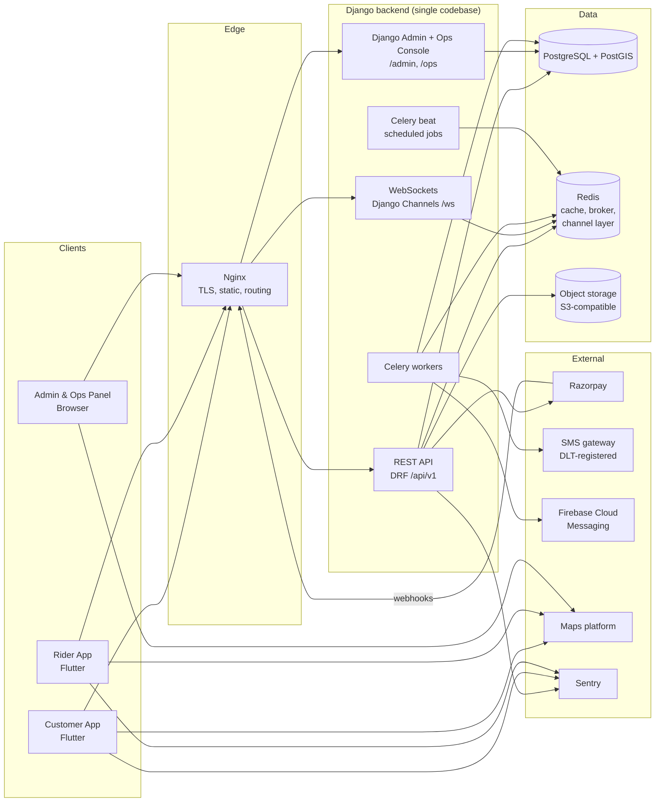

# 02: System Architecture

## 1. High-level view



One Django project serves the REST API, WebSockets, Django Admin and the custom Ops Console. Each process type is scaled separately:

| Process | Runs | Purpose |
|---------|------|---------|
| `web` | ASGI server (Uvicorn workers under Gunicorn, or Daphne) | REST API, WebSockets, admin and ops pages |
| `worker` | Celery worker | Async jobs: SMS, push, dispatch, invoices, refunds |
| `beat` | Celery beat | Scheduled jobs: payment timeouts, offer timeouts, reconciliation, reports |

## 2. Technology stack

> Versions marked *pin in Phase 0* are chosen and locked during Phase 0 after compatibility checks. Do not upgrade major versions mid-project without updating this table.
>
> **Pinned in Phase 0 (2026-11-02):** Django 5.2.18, djangorestframework 3.18.3, djangorestframework-simplejwt 5.5.1, drf-spectacular 0.30.0, django-filter 26.2, channels 4.3.2, channels-redis 4.3.0, daphne 4.2.3 (ASGI `runserver`), celery 5.6.3 (`[redis]` extra, which keeps redis-py at 6.4.0 inside kombu's tested range), django-celery-beat 2.9.0, psycopg 3.3.6, django-storages 1.14.6, django-unfold 0.110.1, django-import-export 4.4.4, django-simple-history 3.13.0, django-axes 9.0.0 (added in Phase 1), WeasyPrint 70.0, sentry-sdk 2.73.0, gunicorn 26.2.0 + uvicorn 0.54.0 + uvicorn-worker 0.4.0, python-dotenv 1.2.4. Dev: pytest 9.2.0, pytest-django 4.14.0, pytest-cov 7.1.0, factory-boy 3.3.3, freezegun 1.5.5, ruff 0.17.3, pip-audit 2.10.1.

### 2.1 Backend & admin

| Concern | Choice | Notes |
|---------|--------|-------|
| Language | Python **3.13** (pinned in Phase 0: `backend/.python-version`, `requires-python = "==3.13.*"`, image `python:3.13-slim-trixie`) | Runs in Docker and is managed with `uv` (0.11.26). The dev machine has Python 3.14, which is not used directly until every dependency (especially GeoDjango/GDAL) supports it. |
| Framework | Django **5.2.18** (5.2 LTS), pinned in Phase 0 | Every direct dependency is pinned with `==` in `backend/pyproject.toml` and locked in `backend/uv.lock` (verified to resolve together on 2026-11-02). |
| REST | Django REST Framework | |
| API schema | drf-spectacular (OpenAPI 3) | The OpenAPI schema is **the contract** the Flutter apps build against |
| Auth (apps) | djangorestframework-simplejwt | Phone + OTP issues JWTs. Refresh tokens rotate and are blacklisted on logout. |
| Auth (staff) | Django session auth, possibly **Jivo Auth** (auth.jivo.in) | See [11-open-decisions.md](11-open-decisions.md) D-04 |
| Real-time | Django Channels + channels-redis | Order tracking, rider offers, ops live board |
| Async jobs | Celery + Redis broker, django-celery-beat | |
| Database | PostgreSQL + PostGIS (GeoDjango) | Point-in-polygon serviceability and distance queries |
| Cache | Redis | Catalog caching, rate limits, latest rider locations |
| File storage | S3-compatible (AWS S3 / MinIO locally) via django-storages | Product images, KYC documents (private bucket), invoices |
| Admin UI | Django Admin + **django-unfold** theme | Master-data CRUD |
| Ops Console | Django templates + HTMX + Alpine.js + map JS SDK | Live order board, store packing screen, rider map. Server-rendered, so no separate SPA. |
| Filtering | django-filter | |
| Invoices (PDF) | WeasyPrint (HTML → PDF) | |
| Import/Export | django-import-export | Bulk catalog and inventory CSV/Excel |
| Audit trail | django-simple-history (model history) + custom AuditLog | |
| Tests | pytest, pytest-django, factory_boy, pytest-cov, freezegun | |
| Lint/format | ruff (lint + format), mypy (optional, gradual) | |
| Monitoring | Sentry, structured JSON logs | |

### 2.2 Mobile (both apps)

| Concern | Choice | Notes |
|---------|--------|-------|
| SDK | Flutter **3.47.9** / Dart **3.13.7** (installed on the dev machine, verified 2026-11-02) | Pin the SDK constraint in `pubspec.yaml` in Phase 0 |
| Monorepo | **Separate top-level app folders + path dependencies** (no pub workspace) | Each app is a standalone Flutter project with its own lockfile. Shared code lives in `packages/` and is consumed via `path: ../packages/<pkg>`. CI checks that both apps resolve the same versions of shared libraries. (Changed from pub workspaces on 2026-11-02 at the user's request, for readability.) |
| State management | Riverpod | |
| Routing | go_router | Deep links (e.g., notification tap opens the order) |
| HTTP | dio, with interceptors for the auth token, refresh, app version and logging | |
| Models | freezed + json_serializable, **or** a Dart client generated from the OpenAPI schema | Decided in Phase 0 (D-13). Recommended: generate `jivo_api` from OpenAPI. |
| Secure storage | flutter_secure_storage | JWT tokens |
| Maps | **Mappls (MapmyIndia) Flutter SDK** (DL-29) | Config files are secrets kept outside the repo; see D-03 and `deployment.md` |
| Location | geolocator, plus a foreground service for the rider app | Rider background location |
| Push | firebase_messaging + flutter_local_notifications | |
| Payments | razorpay_flutter | Customer app only |
| OTP autofill | Android SMS Retriever / User Consent API (e.g., `sms_autofill`) | |
| Images | cached_network_image | |
| WebSocket | web_socket_channel | |
| Crash reporting | sentry_flutter (or Firebase Crashlytics) | |
| Tests | flutter_test, mocktail, integration_test | |
| Lint | flutter_lints (or very_good_analysis) | |

## 3. Repository layout (monorepo)

```
jivo_quick_commerce/
├── docs/                          # ← you are here
├── backend/                       # Django project: API + admin + ops console
│   ├── config/                    # settings/{base,local,staging,production}.py, urls, asgi, wsgi, celery
│   ├── apps/
│   │   ├── core/                  # base models, utils, permissions, exceptions, pagination
│   │   ├── accounts/              # users, OTP, devices, addresses, staff roles
│   │   ├── stores/                # dark stores, service areas, timings, pricing config
│   │   ├── catalog/               # categories, products, variants, images, collections, banners
│   │   ├── inventory/             # store stock, reservations, stock movements
│   │   ├── cart/                  # carts and the pricing engine
│   │   ├── promotions/            # coupons and redemptions
│   │   ├── orders/                # orders, items, status history, invoices, ratings
│   │   ├── payments/              # Razorpay integration, payments, refunds, webhooks
│   │   ├── delivery/              # riders, KYC, shifts, dispatch, tasks, locations, cash, earnings
│   │   ├── notifications/         # devices, push/SMS senders, templates, in-app inbox
│   │   ├── support/               # tickets, FAQs
│   │   ├── cms/                   # static pages, app config
│   │   ├── reports/               # dashboard metrics, exports
│   │   └── ops_console/           # Ops Console (/ops/): dashboard, live board, packing, rider map, dispatch (admin-panel-dev)
│   ├── templates/  static/
│   ├── pyproject.toml  uv.lock
│   └── Dockerfile
├── customer_app/                  # Flutter customer app (Android + iOS), standalone project
├── rider_app/                     # Flutter rider app (Android), standalone project
├── packages/                      # shared Flutter code, used by both apps via path dependencies
│   ├── analysis_options.yaml      # shared lint config (apps include ../packages/analysis_options.yaml)
│   ├── tool/generate_api.sh       # regenerates jivo_api from backend/openapi/schema.yaml
│   ├── jivo_core/                 # theme, design system widgets, utils, auth/session, env config
│   └── jivo_api/                  # API client + models, generated from OpenAPI (never hand-edited)
├── infra/
│   ├── docker-compose.yml         # redis, minio, mailpit, backend, worker, beat (local Postgres is remote, see §4)
│   ├── nginx/
│   └── env/                       # .env.example files (never real secrets)
├── qa/                            # QA agent only: docs/ (10 QA reports), tests/ (black-box uv suite), bugs/; private/ is gitignored
└── .github/workflows/             # CI: backend tests, flutter analyze/test, builds
```

### 3.1 Flutter app internal structure (feature-first)

```
customer_app/lib/
├── main_dev.dart  main_staging.dart  main_prod.dart   # flavors
├── app/            # app widget, router, theme hookup, DI/providers bootstrap
├── features/
│   ├── auth/       # data/ (repositories), domain/ (models), presentation/ (screens, widgets, controllers)
│   ├── location/
│   ├── home/
│   ├── catalog/
│   ├── search/
│   ├── cart/
│   ├── checkout/
│   ├── orders/
│   ├── tracking/
│   ├── profile/
│   └── support/
└── shared/         # app-specific shared widgets/utilities
```

The rider app uses the same pattern: `auth`, `onboarding`, `shift`, `offers`, `task` (pickup/delivery), `earnings`, `cash`, `history`, `profile`.

## 4. Environments

| Env | Purpose | Backend | Apps |
|-----|---------|---------|------|
| **local** | Developer machines | **PostgreSQL 16 is a remote server** (credentials only in the gitignored `backend/.env`; PostGIS 3.4 enabled, engine `django.contrib.gis.db.backends.postgis` since Phase 2; the host needs GDAL/GEOS, the Docker image has them; product images go to the public MinIO bucket `jivo-public`, which `seed_demo` creates locally). `docker compose -f infra/docker-compose.yml up` runs Redis (host port **6380**), MinIO (**9000** API / **9001** console), Mailpit (**1025** SMTP / **8025** UI), and `backend` (host port **8001**), `worker`, `beat`. The defaults 6379, 5432 and 8000 are taken by other projects on the dev machine, so never use them. Tests use the remote server's `test_jivo_quick_commerce` database (created/dropped by pytest only) and Redis DB 15. Parallel test runs pick their own with `POSTGRES_TEST_DB` (must start with `test_jivo_quick_commerce`; anything else is refused at settings load) and `TEST_REDIS_DB` (3–15). | `dev` flavor → local API (`http://10.0.2.2:8001` from the Android emulator) |
| **staging** | Phase testing, QA, UAT, demos | Cloud, production-like, Razorpay **test** keys, test SMS | `staging` flavor; internal distribution (Firebase App Distribution / Play internal testing / TestFlight) |
| **production** | Live | Cloud, managed Postgres with backups, Razorpay **live** keys | `prod` flavor via Play Store / App Store |

Each environment has its own database, buckets, Firebase project (or app IDs), Razorpay keys and Sentry environment. Secrets live in environment variables or a secrets manager, never in git.

## 5. API conventions

| Topic | Convention |
|-------|-----------|
| Base path | `/api/v1/` (REST), `/ws/v1/` (WebSocket) |
| Format | JSON, `snake_case` keys |
| Auth | `Authorization: Bearer <access_token>`. Access token TTL is 15 minutes, refresh token TTL is 30 days (rotating: each refresh token works once, so clients refresh single-flight). The `/api/v1/` API accepts **only JWT** (decided in Phase 1); session cookies work only for the admin, the Ops Console and `/api/schema/`, `/api/docs/`. |
| Store context | Catalog/cart endpoints take the header `X-Store-Id`, which comes from the serviceability check |
| Client info | Every app request sends `X-App-Name` (`customer`/`rider`), `X-App-Version`, `X-Platform` (`android`/`ios`). These drive force-update and analytics. |
| Pagination | `?page=&page_size=` (default 20, max 100). Response: `{count, next, previous, results}` |
| Money | Decimal strings with 2 places, e.g., `"249.00"`. Never floats. |
| Time | ISO 8601 in UTC, e.g., `2026-11-02T10:15:00Z`. Apps convert to IST for display. |
| Errors | `{"error": {"code": "STOCK_UNAVAILABLE", "message": "Human readable", "details": {...}}}` with the correct HTTP status. Codes are listed in the OpenAPI schema. |
| Idempotency | `POST /orders/` and payment endpoints accept an `Idempotency-Key` header. A repeat with the same key returns the original result. |
| Rate limits | DRF throttling, plus Redis counters for OTP (see [09](09-nfr-security-compliance.md)) |
| Versioning | Breaking changes go to `/api/v2/`. Additive changes are allowed in v1. |
| Schema | `GET /api/schema/` (OpenAPI JSON), `/api/docs/` (Swagger UI, staff-only outside local) |
| Contract file | The schema is exported to **`backend/openapi/schema.yaml`** and committed whenever the API changes. The Flutter client `packages/jivo_api` is generated from this file by `packages/tool/generate_api.sh`. Generated code is never edited by hand. |

## 6. Authentication model

| Actor | Method | Session |
|-------|--------|---------|
| Customer | Phone number + 6-digit OTP via SMS | JWT (access + refresh) stored in secure storage |
| Rider | Phone number + OTP (`app: rider`). **Any phone can log in** (decided in Phase 1, following 04 §1 and 06 §3): the verify response carries `rider_status` (`NONE` without a profile → registration). Access to orders requires an `ACTIVE` rider (KYC approved). | JWT |
| Staff (admin/ops/store) | Email/username + password with Django sessions, **or** Jivo Auth SSO if adopted (D-04) | Django session cookie, CSRF protected |

One `User` table holds everyone. A user is a customer by default. A `Rider` profile marks a rider, and Django Groups plus per-store assignment mark staff roles. The same phone number may be both a customer and a rider. The `X-App-Name` header and token claims decide which app context applies.

## 7. Real-time design

| Channel | Who connects | Messages |
|---------|--------------|----------|
| `/ws/v1/orders/{order_id}/` | Customer (owner of the order) | Status changes, rider location (every ~5 s while out for delivery), ETA updates |
| `/ws/v1/rider/` | Rider | New offer, offer withdrawn, order cancelled, order packed |
| `/ws/ops/live/` | Staff (session auth) | New orders, status changes, rider positions for the stores they can access |

- If a socket drops, the apps **fall back to polling** (`GET /orders/{id}/track/` every 10 s). Push notifications (FCM) are always sent for important events, so a closed app is still informed.
- Rider location: the rider app POSTs a location batch every 5–10 s. The backend stores the latest point in Redis (fast reads), appends to `RiderLocation` (history, 30-day retention) and fans it out to the order's channel group.

## 8. Deployment (target)

- Docker images built in CI for `backend`, deployed to the chosen cloud (D-05). The default recommendation is AWS `ap-south-1` (Mumbai) for latency and data residency.
- Managed PostgreSQL with PostGIS, managed Redis, S3 buckets (public-read for product images via CDN, private for KYC/invoices with signed URLs).
- Nginx (or a cloud load balancer) terminates TLS and routes `/api`, `/ws`, `/admin`, `/ops`, `/static`, `/media`.
- Zero-downtime deploys: rolling restart. Migrations must be backward compatible.
- Apps: Android via Play Console (internal → closed → production tracks), iOS via TestFlight → App Store.
