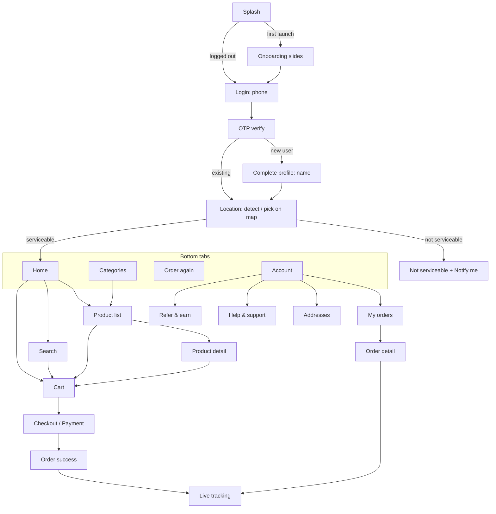

# 03: Customer App (Flutter)

Platforms: **Android and iOS**. Flavors: `dev`, `staging`, `prod`.
The phase that delivers each feature is shown as **[P#]**. See [plan/00-roadmap.md](plan/00-roadmap.md).

## 1. Navigation map

A floating **cart bar** ("2 items · ₹348 · View cart") stays visible on Home, Category, Product list, Product detail and Search when the cart is not empty. The amount is the server's item total (`bill.item_total`), shown only when the server sends it; it opens the cart.

Until a delivery location is chosen, Home shows a "Choose a delivery location" prompt that opens the location screen (instead of a forced redirect after login); catalog data needs a store.

## 2. Features

### 2.1 Launch, onboarding & app control [P1]
| Feature | Details |
|---------|---------|
| Splash | Shows the official Jivo wordmark (the native launch screen before it shows the round logo). Loads the session and calls `GET /config/app/`. Routes to onboarding, login, location or home. |
| Force update | If `X-App-Version` < `min_supported_version`, show a blocking "Update required" screen with a store link. If < `latest_version`, show a dismissible prompt. |
| Maintenance mode | If `maintenance=true`, show a full-screen message from config. |
| Onboarding slides | 2–3 brand slides on first launch only (skippable) |
| Offline handling | A global "No internet" banner. Retry on reconnect. Cached home/catalog shown read-only. |

### 2.2 Authentication [P1]
| Feature | Details |
|---------|---------|
| Phone login | Indian mobile number (+91, 10 digits, validated). Consent checkbox/text for T&C and Privacy Policy. |
| OTP verify | 6-digit OTP, autofilled on Android via SMS Retriever. Resend after a 30 s countdown. Errors for wrong or expired OTP. Lockout message when rate-limited. |
| New-user profile | **Shown only right after the first OTP sign-up** (updated 2026-11-26, user request). One screen with **Name**, **Business category** (dropdown from `GET /business-categories/`, active ones in admin order) and **Business name**, plus **Skip** and **Submit**. Submit sends `PATCH /me/` with `name` and the optional `business_category` (id) and `business_name`; Skip calls `POST /me/profile-prompt/skip/`. Either one is remembered on the server, so the screen never shows again on any device. The app shows the screen only while `is_profile_complete` is false (it is false only for a new user who has neither submitted nor skipped; accounts created before 2026-11-26 are already true). The business fields stay editable later via `PATCH /me/`. Email stays optional (Edit profile). |
| Session | Tokens in secure storage. Silent refresh. On refresh failure, log out to the login screen. |
| Logout | Revokes the refresh token, unregisters the device's FCM token, clears local data |
| Delete account | Account → Delete account → confirm via OTP → account anonymised per policy (Play Store and DPDP requirement) |

### 2.3 Location & serviceability [P2]
| Feature | Details |
|---------|---------|
| Detect location | Asks for location permission and uses GPS. If denied, falls back to manual search or map pick. When the build can show a map, the fix opens the map picker so the customer can fine-tune the pin; otherwise the fix is selected directly. |
| Pick on map | Google Maps, D-03 (DL-80). Draggable pin, reverse-geocoded address preview (the phone's platform geocoder; it falls back to the pin's coordinates), "Confirm location". The address is kept with the location and sent as notify-me's `address_text`. Builds without the Google Maps API key show a "Map isn't available" fallback (current location or manual address entry). |
| Serviceability check | `GET /serviceability/?lat=&lng=` always returns 200: `serviceable`, `store` (`id`, `name`, `is_open`, `opens_at`; null when not serviceable), `eta_minutes` (null when not serviceable or closed) and `message`. `store.id` is sent as `X-Store-Id` on catalog and cart calls. A `404 STORE_NOT_FOUND` on those calls drops the saved store and re-checks serviceability. |
| Not serviceable | Friendly screen with the "coming soon" banner (2026-11-26): a deep-green card with a gold scooter badge, the headline "We're coming to your area soon!" and, under it, the server's serviceability `message` (the delivery areas and this text are managed from the admin; the app writes no area or pincode). With no `message` it shows a general line. Then the location checked, "Notify me" (saves the interest) and "Try another address". Home's not-serviceable state shows the same banner with "Change location". The cart's NOT_SERVICEABLE checkout blocker shows the server's blocker `message` too (the app's text only when it is empty). |
| Store closed | Banner "Store closed. Opens at 7:00 AM" (or "Opens tomorrow at 7:00 AM", from `opens_at` in IST); the home header says "Store closed" instead of the ETA. Browsing allowed, checkout disabled. |
| Header | Home header shows "Delivery in **14 mins**" + the selected address. Tapping it opens the address switcher. |
| Address switch | Changing to an address served by a different store clears the cart (after confirmation), because stock and prices are per store |

### 2.4 Saved addresses [P1 basic, P2 map]
| Feature | Details |
|---------|---------|
| List / add / edit / delete | Label (Home / Work / Other + custom), house/flat, building/street, landmark, receiver name and phone (defaults to self), map pin (required) |
| Default address | One default per user |
| Validation | Pin must be inside a serviceable area to be used for an order. Saving an unserviceable address is allowed but it is flagged. |

### 2.5 Home [P2]
| Section | Details |
|---------|---------|
| Header | Compact and light: "Deliver to" with the ETA (or store closed / not delivering) as a small badge, the address with a chevron, profile shortcut |
| Search bar | Opens Search |
| Banner carousel | Admin-managed and auto-scrolling. Tap opens a category, collection, product or external URL. Can be store-specific with start/end dates. |
| Category row | Top-level categories from `GET /home/` as a compact horizontal row of small image tiles (home redesign 2026-11-21); the Categories tab keeps the full tree |
| Collections | Horizontal product rails, e.g., "Bestsellers", "Offers", "New launches". Admin-managed order. When a rail has more (`has_more`), "See all" opens the collection page: `GET /collections/{slug}/` returns its name and up to 100 products in one page (no infinite scroll). |
| Previously bought | Rail of variants from past delivered orders (when logged in and history exists) |
| Pull to refresh | Reloads home and re-checks serviceability |

**Cart availability** (§2.8): the **dev** flavor uses the real cart and order API (`06 §2.5`, `§2.6`); with `FAKE_API=true` it uses `FakeCommerceBackend`, a stand-in that follows the same contract with demo rule values (D-09 undecided) and is the only code in the app that adds money up. **Staging and prod** still show "Cart coming soon" in place of ADD and no cart bar until the cart is proven against the backend (S3-B). Catalog data is always the real API (`GET /home/`, `/categories/`, `/products/`, `/collections/{slug}/`, `/search/`, `/search/suggest/`, each with `X-Store-Id`). The fake catalog only serves tests and the dev flavor's `FAKE_API=true`.

All product tiles show the image, name, variant (e.g., 1 L), selling price, struck-out MRP, a discount badge ("12% OFF", the server's `discount_percent` when above 0) and an **ADD** button that becomes a quantity box ("100 ✎") once the item is in the cart. There are no − / + buttons: ADD and the box both open "Enter quantity" (bulk orders are typed). **Product cards in lists (redesign 2026-11-21: Home, category lists, search, All products, collections, Order again, Similar products)** differ: a green ADD adds the variant's minimum per order in one tap (it asks the cart controller for 1, which raises it to `min_qty_per_order`), then shows − qty +; − below the minimum removes the line, + stops at `orderable_quantity` with the usual message, and tapping the number opens "Enter quantity" for bulk orders. Product detail, the variant picker and cart lines keep their own controls (cart lines use − qty + too). Out-of-stock tiles are greyed out with "Out of stock". A product with several variants shows "1 L · 3 options"; its ADD (and its quantity box, which shows the total over its variants) opens a variant picker with ADD or a quantity box per variant.

### 2.6 Catalog [P2]
| Feature | Details |
|---------|---------|
| Categories tab | Full category tree |
| Product list | Left rail of sub-categories plus a product grid (Blinkit pattern). Sort: relevance, price low→high, high→low, discount. Paginated (infinite scroll). |
| Product detail | Image gallery (zoom), name, variant selector (chips: 1 L / 2 L / 5 L) with per-variant price and stock, ADD / quantity box, "You save ₹X", description, key highlights, ingredients, nutrition info, shelf life, storage, country of origin, manufacturer/marketer details, FSSAI licence number, veg mark (a dot for veg, a triangle for non-veg, with the word "Veg" / "Non-veg" next to it; CA-12). A "Similar products" rail. |
| Stock awareness | The quantity caps at the server's `orderable_quantity` (= `min(stock, max_qty_per_order)`, 0 when out of stock) and shows "Only 2 left" from `units_left` when `stock_status` is `LOW_STOCK`. The app never sees exact stock. |
| Type a quantity | ADD opens "Enter quantity" prefilled with the variant's minimum; in the cart, the quantity box (tile, product detail, variant picker, cart line; "Quantity 100, tap to change") opens it prefilled with the current quantity. Digits only, 0 to the cap (`orderable_quantity`; 0 removes the line), never 1 to `min_qty_per_order` − 1, never empty: anything else is refused inline and nothing is sent. A valid value is sent as one absolute quantity (bulk orders, e.g. 100 cartons). On a multi-variant tile the box opens the variant picker. The box is the full width of its slot and 48 dp tall. |
| Minimum per order | Each variant has `min_qty_per_order` (1 = no minimum; e.g. 5 for water cartons). ADD is prefilled with the minimum, and a typed 1 to min − 1 is refused: the app never sends 1 to min − 1 (the server refuses those with `MIN_QTY_REQUIRED`). When the minimum is above 1, tiles show "Min 5" near ADD and product detail, the variant picker and cart lines show "Minimum 5 per order". A variant that can't supply its minimum is out of stock. If a tile's catalog is older than a raised minimum, the server's `MIN_QTY_REQUIRED` ("You need to order at least 5 of …") gives the new minimum and the next tap uses it; that learned value is forgotten on every cart reload or store change and whenever the server's own copy of the variant arrives. Reorder never puts back a line below today's minimum: the result says "… wasn't added: it now has a higher minimum order quantity". |
| Minimum units per order | The store can require a minimum number of units for the whole order, any mix of products (`thresholds.min_order_units`, 0 = off; e.g. 5 cartons for water). While `units_to_min_order` is set, the cart shows a warning such as "Add 2 more cartons to place your order (minimum 5 cartons)" (the unit word is the server's `order_unit_label`) and checkout stays blocked (`MIN_UNITS_NOT_MET`). If placing the order fails with `MIN_UNITS_NOT_MET`, the app reloads the cart and goes back to it. |
| Wholesale (volume) prices | A variant can have slab prices (`price_tiers`, ADR 0001; e.g. Jivo Water per box). The price per unit depends on the **total units of all tiered items in the order** (any mix of sizes). Product detail shows a "Wholesale rates (per box)" table for the selected size ("5–24 boxes ₹90" … "250+ boxes ₹80": each range ends one below the next tier's minimum, the last is open) and the note "Price depends on total boxes in your order (all sizes)"; the variant picker shows the same rates as compact chips. The app only displays the server's tiers; the cart applies them (see 2.8). |

### 2.7 Search [P2]
| Feature | Details |
|---------|---------|
| Instant search | Debounced (300 ms) suggestions while typing. Matches product name, variant, tags and category. Product suggestions open the product, category suggestions the product list, keywords run the search. |
| Recent searches | Stored locally. Clearable. |
| Trending | Admin-defined or computed popular searches: `GET /search/suggest/` with a blank `q` |
| Results | Same tile grid as the product list. Empty state with suggestions. |

### 2.8 Cart [P3]
| Feature | Details |
|---------|---------|
| Server-side cart | Synced via API, so it survives reinstall and login on another device. Bound to the current store. |
| Line items | Image, name, variant, price, MRP, quantity box (tap to type), remove (with an "Undo" snackbar that re-adds the old quantity through the server; CA-18). From 1.3× text the line stacks: image and details, then quantity, total and remove. The price is the server's billed `price_per_unit`; for items with volume prices it shows as "₹87/box", with a "Wholesale rate" tag while `price_tier` is set. The line amount is the server's `line_total`. |
| Stock re-validation | On open and before checkout. Unavailable or reduced items are flagged with a fix action. |
| Price changes | When the server sends `previous_selling_price` on a line (the store price the customer last saw, when it differs from today's `selling_price`; API #56, CA-19), the line shows "Price changed: was ₹129, now ₹119" with an info icon (both are the server's strings; it wraps at large text), and a notice above the bill says "Prices of 2 items have changed since you last saw them. The bill uses today's prices." The wording is neutral because a store switch can also cause it. It is display only: the bill already uses today's price and checkout stays open. There is no extra tap: the server clears it on the line's next quantity change (added 2026-11-17). |
| Coupons | "Apply coupon": list of eligible coupons with savings, manual code entry, clear error reasons (min order not met, expired, already used). The customer's own personal coupons (referral rewards, `is_personal: true`) appear in the same list with a "For you" label and their expiry date (added 2026-11-13) |
| Bill details | Item total (MRP), product discount, coupon discount, delivery fee (or "FREE"), small-cart fee, handling fee, rider tip, **To pay**. Total savings highlighted. With free cartons (ADR 0002) a "Free cartons" row shows the server's `free_items_value` struck out and "FREE"; it is not part of To pay, and the savings line is the server's `total_savings` (which includes it). |
| Free cartons (ADR 0002, 2026-11-25) | The server's `free_lines` show after the paid lines as separate rows: image, name, size, "₹0" with the MRP struck out, "Qty N", a green FREE tag and the source ("Buy 10 get 1 free" from `free_offer.every`, or "Reward"). They have no quantity box or remove (a reward's carton goes with Remove on the coupon row) and never count as paid units: the minimum-cartons message uses only the server's `units_to_min_order`. The nudge is the server's `free_offer.message` ("Add 8 more cartons to get 1 more free"; the app builds the same sentence from `units_to_next_free` only if the message is empty). It is the **first card in the cart** (2026-11-26), highlighted: the gold offer gradient with dark `onGold` text (8.9:1 or more) and a gift icon. With free cartons earned (`free_offer.free_units` > 0) its headline is "You get 2 free cartons with this order!" with the nudge under it; with a fixed free size (ADR 0003, `free_offer.free_variant`) a last line says "Free carton size: Jivo Water 1 L × 12". `free_offer.notice` (an earned carton out of stock) shows as an amber notice, never a blocker. A free-carton reward on the cart shows "Free carton reward applied" and "Your 2 free cartons are in the items above" (the coupon's `free_quantity`) with Remove instead of "You save ₹0". A cart holding only a reward's carton is shown (not the empty state). Checkout lists the free lines at ₹0 above the bill; order detail lists the order's `is_free` lines at ₹0 after the paid lines. |
| Upsell | "Add ₹X more for free delivery" nudge. Volume prices (ADR 0001; the slab data is removed by ADR 0002, so this stays hidden): only when some cart line has `price_tiers` or a `price_tier`, `thresholds.next_price_tier` is set and the minimum units rule is met, a positive notice under the minimum-units area says "Add 3 more boxes to get ₹87/box on 1 L" (one line gets cheaper: its `next_tier_price` and pack size) or "Add 3 more boxes for lower prices" (several do). The count is `units_to_next_tier` and the unit word is `order_unit_label`. |
| Rider tip | Optional ₹10 / ₹20 / ₹30 / custom |
| Delivery instructions | Chips (Don't ring bell, Leave at door, Avoid calling) plus free text |
| Delivery address | Shows the selected address. Change opens the address picker and re-runs serviceability. |
| Minimum order | The checkout button is disabled below the minimum, with a message |

### 2.9 Checkout & payment [P3]
| Feature | Details |
|---------|---------|
| Payment method | Pay online (Razorpay: UPI intent/collect, cards, net banking, wallets) or Cash on Delivery (shown only if eligible) |
| Place order | `POST /orders/` with an Idempotency-Key. Online: opens Razorpay checkout. COD: goes straight to success. |
| Payment result | Success leads to verify-on-server then the success screen. Failure or cancel shows "Payment failed" with **Retry** (within 15 min) and **Change method**. |
| Order success | Animation, order number, ETA, "Track order" |
| Edge cases | App killed mid-payment: on next launch, pending orders are fetched and the server status (webhook-confirmed) is shown. Double-tap protection on Place Order. |

**How the P3 screens behave** (bound to the Phase 3 contract at S3-A, 2026-11-03; decisions DL-44):
- **Money is rendered, never derived.** Bill rows are the server's strings (`Bill`); zero rows are hidden (delivery shows FREE). "You save ₹X" is `bill.total_savings`; the "Add ₹X more for FREE delivery" nudge is `thresholds.amount_to_free_delivery` (hidden when null).
- **Checkout is the server's call.** "Proceed to checkout" and "Place order" are enabled only when `checkout.can_place_order` is true; otherwise the first `checkout.blockers` entry says why (missing address, store closed, stock, minimum order with `thresholds.amount_to_min_order`, coupon). Blocker and line-issue codes map to app text filled with the server's amounts; the server's own `message` is shown only for a code the app doesn't know and for an applied coupon that stopped applying.
- **Stock re-validation:** the cart reloads on open and again on "Proceed". A flagged line (`issue`: `OUT_OF_STOCK` / `QUANTITY_UNAVAILABLE`) shows "Out of stock" / "Only N available" and a fix that sets it to the server's `orderable_quantity` (removing it at 0). A line below a raised minimum (`MIN_QTY_REQUIRED`) shows "Order at least N" and a fix that sets it to the minimum. ADD and the quantity box set quantities with `POST /cart/items/` (a set, not an increment). Only `GET /cart/` takes `?address_id=`, so after any change (quantity, coupon, tip, instructions) the app reloads the cart quietly with the chosen saved address (until it arrives, the change's answer is shown without its ADDRESS_REQUIRED blocker, so no warning flashes); the server cart's address is never saved.
- **Coupons:** the sheet lists what `GET /cart/coupons/` returns (no expired or used-up coupons), eligible ones with their savings, others with the reason (add ₹X more, first order only, no eligible items, not valid at this store); the applied one is marked "Applied". A coupon that stops applying stays on the cart with its reason and blocks checkout until removed.
- **Saved address required:** orders need an `address_id`; a detected or pinned location shows "Save this location as an address, or choose a saved one", and the address switcher offers both. The cart is priced for the selected saved address (`GET /cart/?address_id=`).
- **Payment methods** are the cart's `payment_methods` with `is_available` (COD only when eligible).
- **Tip:** ₹10 / ₹20 / ₹30 chips; tapping the selected chip removes the tip. Custom tips accept whole rupees from ₹1 to ₹500 (`CART_MAX_TIP`). **Instructions:** the three chips save as they are toggled; the note (up to 200 characters) saves with its button or Done.
- **Place order:** online is the default. The button is disabled while the order is placed and paid, Back is blocked, and the `Idempotency-Key` is sent again only for the same request after an unknown outcome (a changed address, method or total gets a new key). Error messages say what changed: "Your total changed from ₹X to ₹Y" (`PRICE_CHANGED`, shown as a notice above the payment methods while the bill on screen still shows that new total; it goes when an order is placed, the method changes, the cart total changes again or checkout is opened afresh; CA-19), "Only N of <item> can be ordered now" (`STOCK_UNAVAILABLE`, then back to the cart). If another order is still awaiting payment, the app offers to open that order instead of placing a second one.
- **Which payment opens:** the server's `razorpay.key_id` decides. `rzp_fake_…` (the backend's local fake gateway) opens the "Test payment (dev build)" sheet in the dev flavor only; in staging or prod it is refused. Any other key opens real Razorpay with the server's options unchanged.
- **Payment failed screen** first reads the order's status from the server; a webhook-confirmed payment moves on to success. Retry needs that read to have succeeded on this visit and the server's `can_retry_payment`; Cancel and Change payment method need `can_cancel`. After an attempt that ends unpaid, the status is read again before anything else is allowed. If the read fails, the screen says so and offers "Check again". The device clock only drives the "Pay by 3:45 pm" hint. Change payment method cancels with `CHANGE_PAYMENT_METHOD` and reopens checkout (the cart stays); Cancel order uses `PAYMENT_PROBLEM`. An expired order (`PAYMENT_FAILED`, T4) shows "the time to pay has run out" and Back to cart.
- **App killed mid-payment:** on start, Home asks for active orders; a `PAYMENT_PENDING` one opens its payment screen once by itself, and a banner ("Order X is waiting for payment · Pay now") stays until it is paid or cancelled.
- **Order success** is reached only after the server confirmed the order. It shows "Arriving by <time>" from `eta_at`. Back goes Home. "Track order" says tracking arrives later until the order detail (Phase 4) and live tracking (Phase 6) screens exist.

### 2.10 Orders & tracking [P4 history, P6 live]
| Feature | Details |
|---------|---------|
| Live tracking | Status timeline (Placed → Confirmed → Packing → On the way → Delivered), ETA countdown, map with store, customer pin and the moving rider marker, rider name/photo/phone (call button), delivery OTP shown prominently |
| Order list | Paginated: active orders on top, then past orders. Status chips. Each row shows up to 4 product thumbnails and, when the order has more lines, a "+N" tile (40 dp; N = `line_count` − thumbnails shown, never below 0; read as "and N more products"; API #57, CA-29, added 2026-11-17). The item count stays the units (`item_count`). |
| Order detail | Items, bill, payment method/status, address, timeline, invoice download (PDF), help |
| Cancel | Allowed until packing starts. Reason picker. Confirmation. Refund info shown (to source, 5–7 working days). |
| Reorder | "Order again" adds available items from a past order to the cart and reports any that are unavailable |
| Rate | After delivery: rate the order (1–5 stars + tags) and rate the rider [P7] |

**Built so far (P5, 2026-11-04):** while an order is active, the order detail polls `GET /orders/{id}/track/` every 10 s and shows the rider card (photo, name, call button) and, while `OUT_FOR_DELIVERY`, the delivery OTP; a status change reloads the detail. Rating is built ahead on fakes (P7): a "How was your order?" card on delivered orders opens the rate screen with the tapped stars preselected; 4–5 stars offer positive tags, 1–3 negative ones (proposed codes `ON_TIME`, `WELL_PACKED`, `FRESH_PRODUCTS`, `POLITE_RIDER`, `LATE_DELIVERY`, `DAMAGED_ITEMS`, `MISSING_ITEMS`, `RUDE_RIDER`); rider stars are optional; comment up to 500 characters. **P7 (2026-11-06):** `ApiRatingRepository` binds `POST /orders/{id}/rating/` and `GET /orders/{id}/rating/` (404 = not rated) per api-requests #34; it stays off (fakes only) until the backend endpoints merge, then the one-line `ratingApiBound` switch in `app/repositories.dart` turns rating on in the dev flavor. The rate screen shows the existing rating read-only when the order is already rated. `jivo://orders/<id>/rate` (inbox entry or push) opens the rate screen, or the order detail with its rating card when rating is off. **P7 bind (2026-11-09):** `ApiRatingRepository` now uses the generated `orders_rating_retrieve` / `orders_rating_create` (`OrderRatingCreateRequest`); the `ratingApiBound` switch is gone and rating is on the real API in every flavor (fakes only with dev + `FAKE_API`). `POLITE_RIDER` / `RUDE_RIDER` need rider stars (server rule): they are offered only after the rider stars are picked, never sent without them, and the submit button stays consistent. The read-only rated view shows the rider stars when given.

**Built in P6 (T-613, 2026-11-06):** tracking, the order detail and "My orders" listen to the order socket `/ws/v1/orders/{id}/` (06 §4): the JWT goes in the first `auth` message, the token is renewed a minute before `expires_at`, the socket pings every 25 s and reconnects with backoff (1, 2, 4, 8, 16, then 30 s; 4401 reconnects with a refreshed token; 4403/4404 stop). While the socket is up there is no polling: `rider.location` moves the rider and `order.eta` updates the ETA in place, and a new `order.status` re-reads `track/` (the OTP is never on the socket). When the socket drops, `track/` is polled every 10 s again; when it is back, `track/` is re-read once and polling stops. One socket per order is shared by the three screens; "My orders" opens sockets for at most 3 active orders, so a user has at most 4 sockets (those 3 plus one order detail or tracking screen for another order), under the server cap of 5 (`WS_MAX_SOCKETS_PER_USER`); a 4429 close backs off and retries while polling covers the gap. A close before `auth.ok` (including the app's own 10 s auth timeout) refreshes the token before the next attempt. The map is Google Maps (store, home and rider dots, a straight store-to-home line; DL-80); without the API key it falls back to the route sketch. Unknown socket messages are ignored.

**Live tracking redesign (T-821, 2026-11-23, needs the T-821 backend):** while the order is active (not DELIVERY_FAILED) and the build has a Maps key, the map fills the screen behind a draggable bottom sheet (initial 42 %, 22–92 %). The map shows the store, your pin and a painted scooter marker rotated by the rider's `heading` (the direction of travel when the server sends none) that glides between fixes (1.5 s ease, marker redrawn at most every 40 ms, only the map widget rebuilds); the server's encoded `route` polyline is drawn from the rider onwards (a dashed store-to-you line before a rider is tracked); the camera fits rider, store (before pickup) and you, follows when the rider leaves the view, and stops following once you move the map until "Show the whole route" is tapped. The sheet shows the status, order number, ETA (the server's live ETA, `live_eta_at`, falling back to `eta_at`) and the server's `distance_remaining_m` ("1.8 km away"), the freshness line, the delivery OTP, cash due, the rider (photo, name, vehicle; call only with the phone the server sends, DL-56), the delivery stage, the 8 steps exactly as `progress` reports them (time on done steps; a step key this build doesn't know shows the server's label), "Need help with this order?" (new ticket with the order attached, or Call support), rating and order details. There is no chat (no chat API). Freshness: "Live · Updated 5 sec ago" while the socket is up; a rider fix older than 60 s on the server's clock (`server_time` offset, so a wrong phone clock does not matter) or flagged `is_stale` is never shown as live: the line says "Rider's location last updated 2 min ago", the marker and route turn grey and the map shows "Location not live". Without a Maps key, and once the order is finished, the same content is one scrolling page with the route sketch. `order.route` (newer `computed_at` only) and `rider.location` (newer `recorded_at` only, with `distance_remaining_m`) apply in place; a `track/` read never moves the rider back to an older fix it carries.

### 2.11 Account [P1/P7]
| Feature | Details |
|---------|---------|
| Profile | View/edit name and email. The phone number is shown but is not editable in v1. |
| Addresses | See 2.4 |
| Notifications | In-app notification inbox [P6]. Toggle for promotional push. |
| Help & support | FAQs, "Get help with an order" (choose an order, then an issue type, which creates a ticket with an optional photo), ticket list and replies, call or email support [P7] |
| Legal | About, Terms, Privacy Policy, Refund Policy (CMS pages) |
| App info | Version, rate us |
| Rewards (ADR 0002, 2026-11-25) | Was "My coupons" (same route `/account/coupons`). Two tabs. **Available:** the free-carton rewards from `GET /account/rewards/` (`available`; used and expired ones are never listed here), each card saying the server's quantity and fixed size, e.g. "2 free cartons · 1 L × 12" (`quantity`, `free_variant.name`; ADR 0003; "2 free cartons" without a named size), its source (Welcome gift / Referral reward), its expiry and a chip: **Available** with a **Use** button, or **Claimed** with "On your order JV-…". A reward already on the cart shows "In your cart" and View cart. Below them the other coupons from `GET /cart/coupons/` (copyable code cards; a free-carton coupon missing from the rewards list is shown as a usable reward). **Use (ADR 0003, 2026-11-26):** when the store has a fixed free size (the reward's `free_variant`, or the coupon list's pre-filled `free_variant_id`), Use applies the reward at once through `POST /cart/coupon/` with only `code` (no size sheet), says "2 free cartons added to your cart" and opens the cart; `MIN_ORDER_UNITS` shows "Add 3 more cartons to use this reward (minimum 5 paid cartons)" in a snackbar with "Add cartons", and `FREE_VARIANT_UNAVAILABLE` says "The free carton size is not available at this store right now". `GET /account/rewards/` is sent with the serving store's `X-Store-Id`. **Fallback (ADR 0002, no fixed size, or the server still asks for `free_variant_id`):** a size picker with the water sizes in stock at the current store (the catalog's `water` category, each with its MRP as "Worth ₹110") and a note that the order still needs the store's minimum of paid cartons; "Add 2 free cartons" applies it with `free_variant_id` and opens the cart; `FREE_VARIANT_UNAVAILABLE` asks for another size. The cart's coupon sheet does the same for a listed or typed reward ("Get 2 free cartons." when the size is fixed, else "… Pick a size when you apply them."). **History:** earned, claimed, used, expired and volume-offer free cartons, newest first, each with its date, count and order number. The two lists load separately: one failing shows its own Retry. |
| Refer & earn | The customer's own referral code with Copy and Share, the rules, and counts (friends joined, rewards earned). A new customer (no code entered, no order placed yet) can enter a friend's code once. See below. |

**Refer & earn (added 2026-11-13, API `GET /account/referral/`, `POST /account/referral/apply/`, 06 §2.1):**
- An Account row "Refer & earn" opens the screen. It shows the customer's own code (large, with Copy), a Share button that copies `share_message` to the clipboard with a snackbar (no system share sheet yet: `share_plus` is not a dependency), and the terms: "When your friend's first order is delivered, you both get ₹90 off" (amount from `reward_amount`; validity `reward_validity_days` days; one use). Hide the share part when `is_enabled` is false and show "The referral program is paused".
- Counts: "Friends joined: N" (`friends_joined`) and "Rewards earned: N" (`friends_rewarded`).
- "Have a referral code?" box: shown only when `can_apply_code` is true (new customer, before the first order). Typing a code and tapping Apply calls `apply/`; on success show "Code applied. You'll get ₹90 off after your first order is delivered" and re-render from the response. Errors are shown inline from the error code: `REFERRAL_CODE_INVALID` "This code is not valid", `REFERRAL_SELF` "You can't use your own code", `REFERRAL_ALREADY_APPLIED` "You have already used a referral code", `REFERRAL_NOT_ELIGIBLE` "Referral codes are only for new customers before their first order" (`details.reason` `PROGRAM_OFF`: "The referral program is paused").
- When `referred_by` is set, show "You joined with code AB**12" and its state: PENDING "₹90 off after your first order is delivered", REWARDED "Your reward is in your coupons", VOID nothing extra.
- The reward is a personal coupon in the cart's "Apply coupon" list (see 2.8). The push / inbox entry `referral.reward_earned` links to `jivo://account/referral`.

**Built so far (P5, ahead on fakes):** Help & support with FAQs (grouped by category), "Get help with an order" (order optional from Help; order issue types only when an order is chosen; message 10–1000 characters), ticket list, thread and reply (no reply box once `CLOSED`). The optional photo waits for the attachment contract. Legal pages and About open in an in-app viewer that renders a safe subset of the CMS HTML (headings, paragraphs, lists, bold/italic, `https`/`mailto`/`tel`/`jivo` links; scripts, styles, frames, attributes and other links are dropped). Since T-713 (P7 API) the dev flavor uses `faqs_list`, `support_tickets_*` and `pages_retrieve`; a page the server doesn't have (404) offers the `config/app` policy URL in the browser, and 429 on new tickets or replies shows when to try again. Staging and prod keep the browser policy links and "Call support" until support is enabled there. Rating is still on fakes (no API yet). **P7 (2026-11-06):** a support reply push or inbox entry opens the ticket via `jivo://support/tickets/<id>` (or FCM `type: ticket` + `ticket_id`); `jivo://support/tickets` and `jivo://help` open the list and Help, and without support in the build they open Help. **Ticket photos (2026-11-09):** up to 3 photos per message (camera or gallery via image_picker, downscaled to 1600 px), JPEG/PNG/WebP only and at most 5 MB each, checked in the app first. Each photo is uploaded with `support_tickets_attachments_create` and its key sent in `attachment_keys` of the reply (`support_tickets_messages_create`); a retry does not upload a photo twice. Photos alone are sent with the text "Photos of the issue" (the API needs a message). On a new ticket, the photos go up after the ticket is created, as a second message; if they fail, the ticket still opens and a snackbar says the photos weren't added. A 413 (the live proxy currently caps uploads near 2.5 MB) shows "This photo is too large to upload". Message photos show as thumbnails (signed URLs; an expired one shows a placeholder until refresh).

**Refer & earn (2026-11-13, user decision):** every customer has a referral code (`GET /account/referral/`). The Account row reads "Refer & earn ₹90" (the server's `reward_amount`; "Refer a friend" while it loads, fails or the program is paused) and, while `can_apply_code` is true, "Got a friend's code? Enter it here". The Referral screen shows the code with Copy, a Share button, three rule lines (reward amount, validity days and any minimum order come from the server), and the counts `friends_joined` and `friends_rewarded` ("Rewards earned"). Share copies the server's `share_message` to the clipboard with a snackbar, because the app has no share-sheet package yet. With `is_enabled: false` the code and Share are replaced by a "paused" notice. "Have a referral code?" (a field + Apply, `POST /account/referral/apply/`) shows only while `can_apply_code` is true; after a successful apply it is replaced by "You joined with code AB**7P" and the status (PENDING: "You and your friend will each get ₹90 off after your first delivery"; REWARDED: the reward is in the coupons; VOID: no reward). The `REFERRAL_*` errors map to messages in jivo_core (`REFERRAL_NOT_ELIGIBLE` with `reason: PROGRAM_OFF` says the program is paused). Checkout also shows a closable "Have a referral code?" card while `can_apply_code` is true; "Enter code" opens the Referral screen, and closing it is remembered per user on the device. When the referred customer's first order is delivered, both customers get a personal ₹90 coupon (30 days, one use) in the normal "Apply coupon" list.

**Refer & earn reward is free cartons (ADR 0002, 2026-11-25; ADR 0003, 2026-11-26):** when `GET /account/referral/` says `reward_type: FREE_UNIT`, every referral text names the server's `reward_quantity` (2 on staging) with l10n plurals ("2 free cartons", "1 free carton"; never a hard-coded 1) and never a ₹ amount: the headline and Account strip "Invite a friend. You and your friend each get 2 free cartons", rule 3, the apply confirmation, the PENDING status and the checkout card. REWARDED says "Your reward is in Rewards. Tap Use there to add it to your cart." (no number: a given reward keeps its own quantity). The old ₹ copy is kept only for a ₹-type reward.

**Inbox (P6, T-613):** bound to `/me/notifications/` (infinite scroll), `…/{id}/read/` on tap and `…/read-all/` from the app-bar action (shown only while something is unread). The Account row shows an unread badge (`9+` cap), counted on the first page until the API sends an unread count (api-requests #45). Only `jivo://` links are followed. Push (FCM) runs behind the `PushMessaging` interface: Firebase when the flavor has its config (dev since 2026-11-17, see "Firebase push" in §2.12), otherwise the no-op build; token registration (`POST /me/devices/`) and tap routing (order → tracking) use it.
| Logout / Delete account | See 2.2 |

### 2.12 Notifications [P6]
| Event | Push | SMS |
|-------|------|-----|
| Order placed | ✔ | ✔ (order confirmation) |
| Order confirmed by store | ✔ | |
| Rider assigned / out for delivery (with OTP) | ✔ | ✔ (OTP + tracking link, optional) |
| Delivered | ✔ | |
| Cancelled / refund initiated / refund completed | ✔ | ✔ |
| Payment failed | ✔ | |
| Promotions (opt-out) | ✔ | |

Tapping a notification deep-links to the relevant screen (order tracking, product, collection).

**Push registration (P5):** the FCM token is registered with `POST /me/devices/` after sign-in, on every app start while signed in (covers app-version changes) and on every token refresh; logout sends it as `fcm_token` so the device stops getting pushes. It runs behind a push interface that is a no-op until the Firebase projects exist (D-19); a tap that arrives before the user is in the app is opened after start-up.

**Firebase push (D-19, 2026-11-17):** the push interface now has a Firebase Cloud Messaging adapter (`firebase_messaging`), used whenever the build has the flavor's `google-services.json` (dev: Firebase project `jivo-quick`; staging and prod get their own projects later, with the same mechanism and only a different file). A build without the file (CI, other developers, a flavor without a project) runs with push off and nothing else changes. Behaviour:
- **Permission.** Android 13+ asks for notification permission right after sign-in and, if still not allowed, once more on the first "Order placed" screen (each moment at most once per install). Never on cold start. The device is registered even when the user declines, so allowing notifications later in system settings works without a new sign-in.
- **Channels.** `orders` (high importance, heads-up): order status, delivery OTP, support replies. `general` (default importance): offers, new products and everything else. A message that names no channel lands in `general`, so the server names `orders` for order and support events.
- **Token.** Registered with `POST /me/devices/` on sign-in, on every start while signed in and on every refresh. Logout sends it as `fcm_token`; after any sign-out (including an expired session) the app also deletes the local token, so the next sign-in registers a new one and pushes meant for the previous user stop.
- **Display.** App in the background or closed: the system shows the notification. App in the foreground: the app shows the same notification itself (a local notification on the same channel), not an in-app banner.
- **Taps.** Every tap (foreground, background or cold start) routes through the deep-link map in §2.12: `link` (a `jivo://` link) wins; otherwise `type` with `order_id` (order tracking, or the detail when tracking is unavailable), `ticket_id`, or `slug` (product, collection, category). Unknown payloads and non-allowed `https` hosts are ignored.
- **iOS.** Not configured yet (needs `GoogleService-Info.plist` per flavor and the APNs key); push is off on iOS until then.

## 3. Screen inventory (for design)

| # | Screen | Phase |
|---|--------|-------|
| 1 | Splash | P1 |
| 2 | Onboarding slides | P1 |
| 3 | Force update / Maintenance | P1 |
| 4 | Login (phone) | P1 |
| 5 | OTP verify | P1 |
| 6 | Complete profile | P1 |
| 7 | Account | P1 |
| 8 | Edit profile | P1 |
| 9 | Address list | P1 |
| 10 | Add/Edit address (with map) | P1/P2 |
| 11 | Location permission / detect | P2 |
| 12 | Map pin picker | P2 |
| 13 | Not serviceable | P2 |
| 14 | Home | P2 |
| 15 | Categories | P2 |
| 16 | Product list (category) | P2 |
| 17 | Product detail | P2 |
| 18 | Search | P2 |
| 19 | Collection page | P2 |
| 20 | Cart | P3 |
| 21 | Coupons sheet | P3 |
| 22 | Payment method / checkout | P3 |
| 23 | Payment failed / retry | P3 |
| 24 | Order success | P3 |
| 25 | Orders list | P4 |
| 26 | Order detail | P4 |
| 27 | Cancel order sheet | P4 |
| 28 | Live tracking | P6 |
| 29 | Notification inbox | P6 |
| 30 | Rate order/rider | P7 |
| 31 | Help: FAQ, ticket list, ticket detail, new ticket | P7 |
| 32 | CMS page viewer | P7 |
| 33 | Delete account | P1 |
| 34 | Refer & earn | 2026-11-13 |

## 4. UX standards
- Every list has **loading (skeleton)**, **empty** and **error with retry** states.
- Buttons that trigger network calls show progress and are disabled until the call completes.
- Prices are always shown with ₹ and no decimals unless paise are non-zero.
- Minimum touch target 48 dp. Text scales with system font size. Colors meet WCAG AA contrast.
- Analytics events (screen views, add to cart, checkout start, purchase) go through one analytics wrapper (provider decided in Phase 0).
