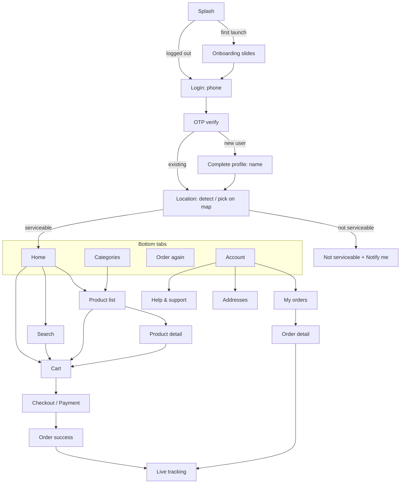

# 03: Customer App (Flutter)

Platforms: **Android and iOS**. Flavors: `dev`, `staging`, `prod`.
The phase that delivers each feature is shown as **[P#]**. See [plan/00-roadmap.md](plan/00-roadmap.md).

## 1. Navigation map

A floating **cart bar** ("2 items · ₹348 · View cart") stays visible on Home, Category, Product list, Product detail and Search when the cart is not empty. The amount is the server's item total (`bill.item_total`), shown only when the server sends it; it opens the cart.

Until a delivery location is chosen, Home shows a "Choose a delivery location" prompt that opens the location screen (instead of a forced redirect after login); catalog data needs a store.

## 2. Features

### 2.1 Launch, onboarding & app control [P1]
| Feature | Details |
|---------|---------|
| Splash | Loads the session and calls `GET /config/app/`. Routes to onboarding, login, location or home. |
| Force update | If `X-App-Version` < `min_supported_version`, show a blocking "Update required" screen with a store link. If < `latest_version`, show a dismissible prompt. |
| Maintenance mode | If `maintenance=true`, show a full-screen message from config. |
| Onboarding slides | 2–3 brand slides on first launch only (skippable) |
| Offline handling | A global "No internet" banner. Retry on reconnect. Cached home/catalog shown read-only. |

### 2.2 Authentication [P1]
| Feature | Details |
|---------|---------|
| Phone login | Indian mobile number (+91, 10 digits, validated). Consent checkbox/text for T&C and Privacy Policy. |
| OTP verify | 6-digit OTP, autofilled on Android via SMS Retriever. Resend after a 30 s countdown. Errors for wrong or expired OTP. Lockout message when rate-limited. |
| New-user profile | Name (required), email (optional) |
| Session | Tokens in secure storage. Silent refresh. On refresh failure, log out to the login screen. |
| Logout | Revokes the refresh token, unregisters the device's FCM token, clears local data |
| Delete account | Account → Delete account → confirm via OTP → account anonymised per policy (Play Store and DPDP requirement) |

### 2.3 Location & serviceability [P2]
| Feature | Details |
|---------|---------|
| Detect location | Asks for location permission and uses GPS. If denied, falls back to manual search or map pick. When the build can show a map, the fix opens the map picker so the customer can fine-tune the pin; otherwise the fix is selected directly. |
| Pick on map | Mappls (MapmyIndia) map, D-03. Draggable pin, reverse-geocoded address preview (Mappls reverse geocoding; it falls back to the pin's coordinates), "Confirm location". The address is kept with the location and sent as notify-me's `address_text`. Builds without the Mappls SDK config files, and maps that fail to authenticate, show a "Map isn't available" fallback (current location or manual address entry). |
| Serviceability check | `GET /serviceability/?lat=&lng=` always returns 200: `serviceable`, `store` (`id`, `name`, `is_open`, `opens_at`; null when not serviceable), `eta_minutes` (null when not serviceable or closed) and `message`. `store.id` is sent as `X-Store-Id` on catalog and cart calls. A `404 STORE_NOT_FOUND` on those calls drops the saved store and re-checks serviceability. |
| Not serviceable | Friendly screen: "We're not in your area yet". "Notify me" saves the interest. "Try another address". |
| Store closed | Banner "Store closed. Opens at 7:00 AM" (or "Opens tomorrow at 7:00 AM", from `opens_at` in IST); the home header says "Store closed" instead of the ETA. Browsing allowed, checkout disabled. |
| Header | Home header shows "Delivery in **14 mins**" + the selected address. Tapping it opens the address switcher. |
| Address switch | Changing to an address served by a different store clears the cart (after confirmation), because stock and prices are per store |

### 2.4 Saved addresses [P1 basic, P2 map]
| Feature | Details |
|---------|---------|
| List / add / edit / delete | Label (Home / Work / Other + custom), house/flat, building/street, landmark, receiver name and phone (defaults to self), map pin (required) |
| Default address | One default per user |
| Validation | Pin must be inside a serviceable area to be used for an order. Saving an unserviceable address is allowed but it is flagged. |

### 2.5 Home [P2]
| Section | Details |
|---------|---------|
| Header | ETA, address, profile shortcut |
| Search bar | Opens Search |
| Banner carousel | Admin-managed and auto-scrolling. Tap opens a category, collection, product or external URL. Can be store-specific with start/end dates. |
| Category grid | Top-level categories with images |
| Collections | Horizontal product rails, e.g., "Bestsellers", "Offers", "New launches". Admin-managed order. When a rail has more (`has_more`), "See all" opens the collection page: `GET /collections/{slug}/` returns its name and up to 100 products in one page (no infinite scroll). |
| Previously bought | Rail of variants from past delivered orders (when logged in and history exists) |
| Pull to refresh | Reloads home and re-checks serviceability |

**Cart availability** (§2.8): the **dev** flavor uses the real cart and order API (`06 §2.5`, `§2.6`); with `FAKE_API=true` it uses `FakeCommerceBackend`, a stand-in that follows the same contract with demo rule values (D-09 undecided) and is the only code in the app that adds money up. **Staging and prod** still show "Cart coming soon" in place of ADD and no cart bar until the cart is proven against the backend (S3-B). Catalog data is always the real API (`GET /home/`, `/categories/`, `/products/`, `/collections/{slug}/`, `/search/`, `/search/suggest/`, each with `X-Store-Id`). The fake catalog only serves tests and the dev flavor's `FAKE_API=true`.

All product tiles show the image, name, variant (e.g., 1 L), selling price, struck-out MRP, a discount badge ("12% OFF", the server's `discount_percent` when above 0) and an **ADD** button that becomes a − qty + stepper. Out-of-stock tiles are greyed out with "Out of stock". A product with several variants shows "1 L · 3 options"; its ADD (and its stepper, which shows the total over its variants) opens a variant picker with a stepper per variant.

### 2.6 Catalog [P2]
| Feature | Details |
|---------|---------|
| Categories tab | Full category tree |
| Product list | Left rail of sub-categories plus a product grid (Blinkit pattern). Sort: relevance, price low→high, high→low, discount. Paginated (infinite scroll). |
| Product detail | Image gallery (zoom), name, variant selector (chips: 1 L / 2 L / 5 L) with per-variant price and stock, ADD/stepper, "You save ₹X", description, key highlights, ingredients, nutrition info, shelf life, storage, country of origin, manufacturer/marketer details, FSSAI licence number, veg mark. A "Similar products" rail. |
| Stock awareness | The stepper caps at the server's `orderable_quantity` (= `min(stock, max_qty_per_order)`, 0 when out of stock) and shows "Only 2 left" from `units_left` when `stock_status` is `LOW_STOCK`. The app never sees exact stock. |

### 2.7 Search [P2]
| Feature | Details |
|---------|---------|
| Instant search | Debounced (300 ms) suggestions while typing. Matches product name, variant, tags and category. Product suggestions open the product, category suggestions the product list, keywords run the search. |
| Recent searches | Stored locally. Clearable. |
| Trending | Admin-defined or computed popular searches: `GET /search/suggest/` with a blank `q` |
| Results | Same tile grid as the product list. Empty state with suggestions. |

### 2.8 Cart [P3]
| Feature | Details |
|---------|---------|
| Server-side cart | Synced via API, so it survives reinstall and login on another device. Bound to the current store. |
| Line items | Image, name, variant, price, MRP, stepper, remove |
| Stock re-validation | On open and before checkout. Unavailable or reduced items are flagged with a fix action. |
| Coupons | "Apply coupon": list of eligible coupons with savings, manual code entry, clear error reasons (min order not met, expired, already used) |
| Bill details | Item total (MRP), product discount, coupon discount, delivery fee (or "FREE"), small-cart fee, handling fee, rider tip, **To pay**. Total savings highlighted. |
| Upsell | "Add ₹X more for free delivery" nudge |
| Rider tip | Optional ₹10 / ₹20 / ₹30 / custom |
| Delivery instructions | Chips (Don't ring bell, Leave at door, Avoid calling) plus free text |
| Delivery address | Shows the selected address. Change opens the address picker and re-runs serviceability. |
| Minimum order | The checkout button is disabled below the minimum, with a message |

### 2.9 Checkout & payment [P3]
| Feature | Details |
|---------|---------|
| Payment method | Pay online (Razorpay: UPI intent/collect, cards, net banking, wallets) or Cash on Delivery (shown only if eligible) |
| Place order | `POST /orders/` with an Idempotency-Key. Online: opens Razorpay checkout. COD: goes straight to success. |
| Payment result | Success leads to verify-on-server then the success screen. Failure or cancel shows "Payment failed" with **Retry** (within 15 min) and **Change method**. |
| Order success | Animation, order number, ETA, "Track order" |
| Edge cases | App killed mid-payment: on next launch, pending orders are fetched and the server status (webhook-confirmed) is shown. Double-tap protection on Place Order. |

**How the P3 screens behave** (bound to the Phase 3 contract at S3-A, 2026-11-03; decisions DL-44):
- **Money is rendered, never derived.** Bill rows are the server's strings (`Bill`); zero rows are hidden (delivery shows FREE). "You save ₹X" is `bill.total_savings`; the "Add ₹X more for FREE delivery" nudge is `thresholds.amount_to_free_delivery` (hidden when null).
- **Checkout is the server's call.** "Proceed to checkout" and "Place order" are enabled only when `checkout.can_place_order` is true; otherwise the first `checkout.blockers` entry says why (missing address, store closed, stock, minimum order with `thresholds.amount_to_min_order`, coupon). Blocker and line-issue codes map to app text filled with the server's amounts; the server's own `message` is shown only for a code the app doesn't know and for an applied coupon that stopped applying.
- **Stock re-validation:** the cart reloads on open and again on "Proceed". A flagged line (`issue`: `OUT_OF_STOCK` / `QUANTITY_UNAVAILABLE`) shows "Out of stock" / "Only N available" and a fix that sets it to the server's `orderable_quantity` (removing it at 0). The ADD stepper sets quantities with `POST /cart/items/` (a set, not an increment).
- **Coupons:** the sheet lists what `GET /cart/coupons/` returns (no expired or used-up coupons), eligible ones with their savings, others with the reason (add ₹X more, first order only, no eligible items, not valid at this store); the applied one is marked "Applied". A coupon that stops applying stays on the cart with its reason and blocks checkout until removed.
- **Saved address required:** orders need an `address_id`; a detected or pinned location shows "Save this location as an address, or choose a saved one", and the address switcher offers both. The cart is priced for the selected saved address (`GET /cart/?address_id=`).
- **Payment methods** are the cart's `payment_methods` with `is_available` (COD only when eligible).
- **Tip:** ₹10 / ₹20 / ₹30 chips; tapping the selected chip removes the tip. Custom tips accept whole rupees from ₹1 to ₹500 (`CART_MAX_TIP`). **Instructions:** the three chips save as they are toggled; the note (up to 200 characters) saves with its button or Done.
- **Place order:** online is the default. The button is disabled while the order is placed and paid, Back is blocked, and the `Idempotency-Key` is sent again only for the same request after an unknown outcome (a changed address, method or total gets a new key). Error messages say what changed: "Your total changed from ₹X to ₹Y" (`PRICE_CHANGED`), "Only N of <item> can be ordered now" (`STOCK_UNAVAILABLE`, then back to the cart). If another order is still awaiting payment, the app offers to open that order instead of placing a second one.
- **Which payment opens:** the server's `razorpay.key_id` decides. `rzp_fake_…` (the backend's local fake gateway) opens the "Test payment (dev build)" sheet in the dev flavor only; in staging or prod it is refused. Any other key opens real Razorpay with the server's options unchanged.
- **Payment failed screen** first reads the order's status from the server; a webhook-confirmed payment moves on to success. Retry needs that read to have succeeded on this visit and the server's `can_retry_payment`; Cancel and Change payment method need `can_cancel`. After an attempt that ends unpaid, the status is read again before anything else is allowed. If the read fails, the screen says so and offers "Check again". The device clock only drives the "Pay by 3:45 pm" hint. Change payment method cancels with `CHANGE_PAYMENT_METHOD` and reopens checkout (the cart stays); Cancel order uses `PAYMENT_PROBLEM`. An expired order (`PAYMENT_FAILED`, T4) shows "the time to pay has run out" and Back to cart.
- **App killed mid-payment:** on start, Home asks for active orders; a `PAYMENT_PENDING` one opens its payment screen once by itself, and a banner ("Order X is waiting for payment · Pay now") stays until it is paid or cancelled.
- **Order success** is reached only after the server confirmed the order. It shows "Arriving by <time>" from `eta_at`. Back goes Home. "Track order" says tracking arrives later until the order detail (Phase 4) and live tracking (Phase 6) screens exist.

### 2.10 Orders & tracking [P4 history, P6 live]
| Feature | Details |
|---------|---------|
| Live tracking | Status timeline (Placed → Confirmed → Packing → On the way → Delivered), ETA countdown, map with store, customer pin and the moving rider marker, rider name/photo/phone (call button), delivery OTP shown prominently |
| Order list | Paginated: active orders on top, then past orders. Status chips. |
| Order detail | Items, bill, payment method/status, address, timeline, invoice download (PDF), help |
| Cancel | Allowed until packing starts. Reason picker. Confirmation. Refund info shown (to source, 5–7 working days). |
| Reorder | "Order again" adds available items from a past order to the cart and reports any that are unavailable |
| Rate | After delivery: rate the order (1–5 stars + tags) and rate the rider [P7] |

**Built so far (P5, 2026-11-04):** while an order is active, the order detail polls `GET /orders/{id}/track/` every 10 s and shows the rider card (photo, name, call button) and, while `OUT_FOR_DELIVERY`, the delivery OTP; a status change reloads the detail. Rating is built ahead on fakes (P7): a "How was your order?" card on delivered orders opens the rate screen with the tapped stars preselected; 4–5 stars offer positive tags, 1–3 negative ones (proposed codes `ON_TIME`, `WELL_PACKED`, `FRESH_PRODUCTS`, `POLITE_RIDER`, `LATE_DELIVERY`, `DAMAGED_ITEMS`, `MISSING_ITEMS`, `RUDE_RIDER`); rider stars are optional; comment up to 500 characters.

### 2.11 Account [P1/P7]
| Feature | Details |
|---------|---------|
| Profile | View/edit name and email. The phone number is shown but is not editable in v1. |
| Addresses | See 2.4 |
| Notifications | In-app notification inbox [P6]. Toggle for promotional push. |
| Help & support | FAQs, "Get help with an order" (choose an order, then an issue type, which creates a ticket with an optional photo), ticket list and replies, call support [P7] |
| Legal | About, Terms, Privacy Policy, Refund Policy (CMS pages) |
| App info | Version, rate us |

**Built so far (P5, ahead on fakes):** Help & support with FAQs (grouped by category), "Get help with an order" (order optional from Help; order issue types only when an order is chosen; message 10–1000 characters), ticket list, thread and reply (no reply box once `CLOSED`). The optional photo waits for the attachment contract. Legal pages and About open in an in-app viewer that renders a safe subset of the CMS HTML (headings, paragraphs, lists, bold/italic, `https`/`mailto`/`tel`/`jivo` links; scripts, styles, frames, attributes and other links are dropped). Until the P7 endpoints exist the real-API build keeps the browser policy links and shows only "Call support".
| Logout / Delete account | See 2.2 |

### 2.12 Notifications [P6]
| Event | Push | SMS |
|-------|------|-----|
| Order placed | ✔ | ✔ (order confirmation) |
| Order confirmed by store | ✔ | |
| Rider assigned / out for delivery (with OTP) | ✔ | ✔ (OTP + tracking link, optional) |
| Delivered | ✔ | |
| Cancelled / refund initiated / refund completed | ✔ | ✔ |
| Payment failed | ✔ | |
| Promotions (opt-out) | ✔ | |

Tapping a notification deep-links to the relevant screen (order tracking, product, collection).

**Push registration (P5):** the FCM token is registered with `POST /me/devices/` after sign-in, on every app start while signed in (covers app-version changes) and on every token refresh; logout sends it as `fcm_token` so the device stops getting pushes. It runs behind a push interface that is a no-op until the Firebase projects exist (D-19); a tap that arrives before the user is in the app is opened after start-up.

## 3. Screen inventory (for design)

| # | Screen | Phase |
|---|--------|-------|
| 1 | Splash | P1 |
| 2 | Onboarding slides | P1 |
| 3 | Force update / Maintenance | P1 |
| 4 | Login (phone) | P1 |
| 5 | OTP verify | P1 |
| 6 | Complete profile | P1 |
| 7 | Account | P1 |
| 8 | Edit profile | P1 |
| 9 | Address list | P1 |
| 10 | Add/Edit address (with map) | P1/P2 |
| 11 | Location permission / detect | P2 |
| 12 | Map pin picker | P2 |
| 13 | Not serviceable | P2 |
| 14 | Home | P2 |
| 15 | Categories | P2 |
| 16 | Product list (category) | P2 |
| 17 | Product detail | P2 |
| 18 | Search | P2 |
| 19 | Collection page | P2 |
| 20 | Cart | P3 |
| 21 | Coupons sheet | P3 |
| 22 | Payment method / checkout | P3 |
| 23 | Payment failed / retry | P3 |
| 24 | Order success | P3 |
| 25 | Orders list | P4 |
| 26 | Order detail | P4 |
| 27 | Cancel order sheet | P4 |
| 28 | Live tracking | P6 |
| 29 | Notification inbox | P6 |
| 30 | Rate order/rider | P7 |
| 31 | Help: FAQ, ticket list, ticket detail, new ticket | P7 |
| 32 | CMS page viewer | P7 |
| 33 | Delete account | P1 |

## 4. UX standards
- Every list has **loading (skeleton)**, **empty** and **error with retry** states.
- Buttons that trigger network calls show progress and are disabled until the call completes.
- Prices are always shown with ₹ and no decimals unless paise are non-zero.
- Minimum touch target 48 dp. Text scales with system font size. Colors meet WCAG AA contrast.
- Analytics events (screen views, add to cart, checkout start, purchase) go through one analytics wrapper (provider decided in Phase 0).
