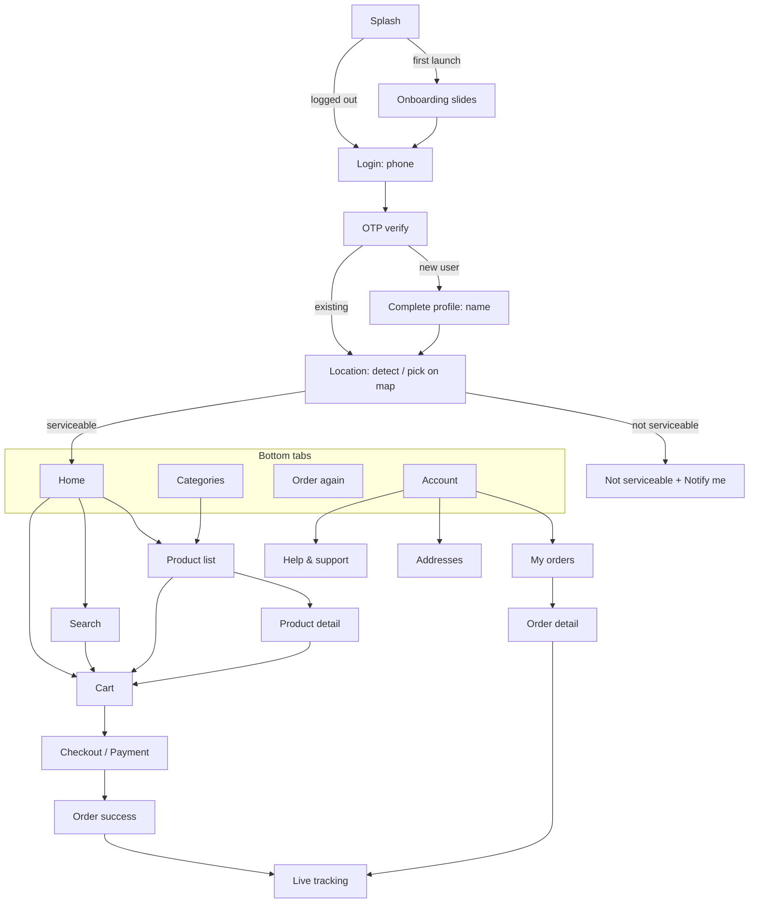

# 03: Customer App (Flutter)

Platforms: **Android and iOS**. Flavors: `dev`, `staging`, `prod`.
The phase that delivers each feature is shown as **[P#]**. See [plan/00-roadmap.md](plan/00-roadmap.md).

## 1. Navigation map

A floating **cart bar** ("2 items · ₹348 · View cart") stays visible on Home, Category, Product list, Product detail and Search when the cart is not empty.

## 2. Features

### 2.1 Launch, onboarding & app control [P1]
| Feature | Details |
|---------|---------|
| Splash | Loads the session and calls `GET /config/app/`. Routes to onboarding, login, location or home. |
| Force update | If `X-App-Version` < `min_supported_version`, show a blocking "Update required" screen with a store link. If < `latest_version`, show a dismissible prompt. |
| Maintenance mode | If `maintenance=true`, show a full-screen message from config. |
| Onboarding slides | 2–3 brand slides on first launch only (skippable) |
| Offline handling | A global "No internet" banner. Retry on reconnect. Cached home/catalog shown read-only. |

### 2.2 Authentication [P1]
| Feature | Details |
|---------|---------|
| Phone login | Indian mobile number (+91, 10 digits, validated). Consent checkbox/text for T&C and Privacy Policy. |
| OTP verify | 6-digit OTP, autofilled on Android via SMS Retriever. Resend after a 30 s countdown. Errors for wrong or expired OTP. Lockout message when rate-limited. |
| New-user profile | Name (required), email (optional) |
| Session | Tokens in secure storage. Silent refresh. On refresh failure, log out to the login screen. |
| Logout | Revokes the refresh token, unregisters the device's FCM token, clears local data |
| Delete account | Account → Delete account → confirm via OTP → account anonymised per policy (Play Store and DPDP requirement) |

### 2.3 Location & serviceability [P2]
| Feature | Details |
|---------|---------|
| Detect location | Asks for location permission and uses GPS. If denied, falls back to manual search or map pick. |
| Pick on map | Draggable pin, reverse-geocoded address preview, "Confirm location" |
| Serviceability check | `GET /serviceability/?lat=&lng=` returns serviceable, store_id, ETA in minutes, and store open/closed |
| Not serviceable | Friendly screen: "We're not in your area yet". "Notify me" saves the interest. "Try another address". |
| Store closed | Banner "Store opens at 7:00 AM". Browsing allowed, checkout disabled. |
| Header | Home header shows "Delivery in **14 mins**" + the selected address. Tapping it opens the address switcher. |
| Address switch | Changing to an address served by a different store clears the cart (after confirmation), because stock and prices are per store |

### 2.4 Saved addresses [P1 basic, P2 map]
| Feature | Details |
|---------|---------|
| List / add / edit / delete | Label (Home / Work / Other + custom), house/flat, building/street, landmark, receiver name and phone (defaults to self), map pin (required) |
| Default address | One default per user |
| Validation | Pin must be inside a serviceable area to be used for an order. Saving an unserviceable address is allowed but it is flagged. |

### 2.5 Home [P2]
| Section | Details |
|---------|---------|
| Header | ETA, address, profile shortcut |
| Search bar | Opens Search |
| Banner carousel | Admin-managed and auto-scrolling. Tap opens a category, collection, product or external URL. Can be store-specific with start/end dates. |
| Category grid | Top-level categories with images |
| Collections | Horizontal product rails, e.g., "Bestsellers", "Offers", "New launches". Admin-managed order. |
| Previously bought | Rail of variants from past delivered orders (when logged in and history exists) |
| Pull to refresh | Reloads home and re-checks serviceability |

All product tiles show the image, name, variant (e.g., 1 L), selling price, struck-out MRP, a discount badge ("12% OFF") and an **ADD** button that becomes a − qty + stepper. Out-of-stock tiles are greyed out with "Out of stock".

### 2.6 Catalog [P2]
| Feature | Details |
|---------|---------|
| Categories tab | Full category tree |
| Product list | Left rail of sub-categories plus a product grid (Blinkit pattern). Sort: relevance, price low→high, high→low, discount. Paginated (infinite scroll). |
| Product detail | Image gallery (zoom), name, variant selector (chips: 1 L / 2 L / 5 L) with per-variant price and stock, ADD/stepper, "You save ₹X", description, key highlights, ingredients, nutrition info, shelf life, storage, country of origin, manufacturer/marketer details, FSSAI licence number, veg mark. A "Similar products" rail. |
| Stock awareness | The stepper caps at `min(available, max_qty_per_order)` and shows "Only 2 left" when low |

### 2.7 Search [P2]
| Feature | Details |
|---------|---------|
| Instant search | Debounced (300 ms) suggestions while typing. Matches product name, variant, tags and category. |
| Recent searches | Stored locally. Clearable. |
| Trending | Admin-defined or computed popular searches |
| Results | Same tile grid as the product list. Empty state with suggestions. |

### 2.8 Cart [P3]
| Feature | Details |
|---------|---------|
| Server-side cart | Synced via API, so it survives reinstall and login on another device. Bound to the current store. |
| Line items | Image, name, variant, price, MRP, stepper, remove |
| Stock re-validation | On open and before checkout. Unavailable or reduced items are flagged with a fix action. |
| Coupons | "Apply coupon": list of eligible coupons with savings, manual code entry, clear error reasons (min order not met, expired, already used) |
| Bill details | Item total (MRP), product discount, coupon discount, delivery fee (or "FREE"), small-cart fee, handling fee, rider tip, **To pay**. Total savings highlighted. |
| Upsell | "Add ₹X more for free delivery" nudge |
| Rider tip | Optional ₹10 / ₹20 / ₹30 / custom |
| Delivery instructions | Chips (Don't ring bell, Leave at door, Avoid calling) plus free text |
| Delivery address | Shows the selected address. Change opens the address picker and re-runs serviceability. |
| Minimum order | The checkout button is disabled below the minimum, with a message |

### 2.9 Checkout & payment [P3]
| Feature | Details |
|---------|---------|
| Payment method | Pay online (Razorpay: UPI intent/collect, cards, net banking, wallets) or Cash on Delivery (shown only if eligible) |
| Place order | `POST /orders/` with an Idempotency-Key. Online: opens Razorpay checkout. COD: goes straight to success. |
| Payment result | Success leads to verify-on-server then the success screen. Failure or cancel shows "Payment failed" with **Retry** (within 15 min) and **Change method**. |
| Order success | Animation, order number, ETA, "Track order" |
| Edge cases | App killed mid-payment: on next launch, pending orders are fetched and the server status (webhook-confirmed) is shown. Double-tap protection on Place Order. |

### 2.10 Orders & tracking [P4 history, P6 live]
| Feature | Details |
|---------|---------|
| Live tracking | Status timeline (Placed → Confirmed → Packing → On the way → Delivered), ETA countdown, map with store, customer pin and the moving rider marker, rider name/photo/phone (call button), delivery OTP shown prominently |
| Order list | Paginated: active orders on top, then past orders. Status chips. |
| Order detail | Items, bill, payment method/status, address, timeline, invoice download (PDF), help |
| Cancel | Allowed until packing starts. Reason picker. Confirmation. Refund info shown (to source, 5–7 working days). |
| Reorder | "Order again" adds available items from a past order to the cart and reports any that are unavailable |
| Rate | After delivery: rate the order (1–5 stars + tags) and rate the rider [P7] |

### 2.11 Account [P1/P7]
| Feature | Details |
|---------|---------|
| Profile | View/edit name and email. The phone number is shown but is not editable in v1. |
| Addresses | See 2.4 |
| Notifications | In-app notification inbox [P6]. Toggle for promotional push. |
| Help & support | FAQs, "Get help with an order" (choose an order, then an issue type, which creates a ticket with an optional photo), ticket list and replies, call support [P7] |
| Legal | About, Terms, Privacy Policy, Refund Policy (CMS pages) |
| App info | Version, rate us |
| Logout / Delete account | See 2.2 |

### 2.12 Notifications [P6]
| Event | Push | SMS |
|-------|------|-----|
| Order placed | ✔ | ✔ (order confirmation) |
| Order confirmed by store | ✔ | |
| Rider assigned / out for delivery (with OTP) | ✔ | ✔ (OTP + tracking link, optional) |
| Delivered | ✔ | |
| Cancelled / refund initiated / refund completed | ✔ | ✔ |
| Payment failed | ✔ | |
| Promotions (opt-out) | ✔ | |

Tapping a notification deep-links to the relevant screen (order tracking, product, collection).

## 3. Screen inventory (for design)

| # | Screen | Phase |
|---|--------|-------|
| 1 | Splash | P1 |
| 2 | Onboarding slides | P1 |
| 3 | Force update / Maintenance | P1 |
| 4 | Login (phone) | P1 |
| 5 | OTP verify | P1 |
| 6 | Complete profile | P1 |
| 7 | Account | P1 |
| 8 | Edit profile | P1 |
| 9 | Address list | P1 |
| 10 | Add/Edit address (with map) | P1/P2 |
| 11 | Location permission / detect | P2 |
| 12 | Map pin picker | P2 |
| 13 | Not serviceable | P2 |
| 14 | Home | P2 |
| 15 | Categories | P2 |
| 16 | Product list (category) | P2 |
| 17 | Product detail | P2 |
| 18 | Search | P2 |
| 19 | Collection page | P2 |
| 20 | Cart | P3 |
| 21 | Coupons sheet | P3 |
| 22 | Payment method / checkout | P3 |
| 23 | Payment failed / retry | P3 |
| 24 | Order success | P3 |
| 25 | Orders list | P4 |
| 26 | Order detail | P4 |
| 27 | Cancel order sheet | P4 |
| 28 | Live tracking | P6 |
| 29 | Notification inbox | P6 |
| 30 | Rate order/rider | P7 |
| 31 | Help: FAQ, ticket list, ticket detail, new ticket | P7 |
| 32 | CMS page viewer | P7 |
| 33 | Delete account | P1 |

## 4. UX standards
- Every list has **loading (skeleton)**, **empty** and **error with retry** states.
- Buttons that trigger network calls show progress and are disabled until the call completes.
- Prices are always shown with ₹ and no decimals unless paise are non-zero.
- Minimum touch target 48 dp. Text scales with system font size. Colors meet WCAG AA contrast.
- Analytics events (screen views, add to cart, checkout start, purchase) go through one analytics wrapper (provider decided in Phase 0).
