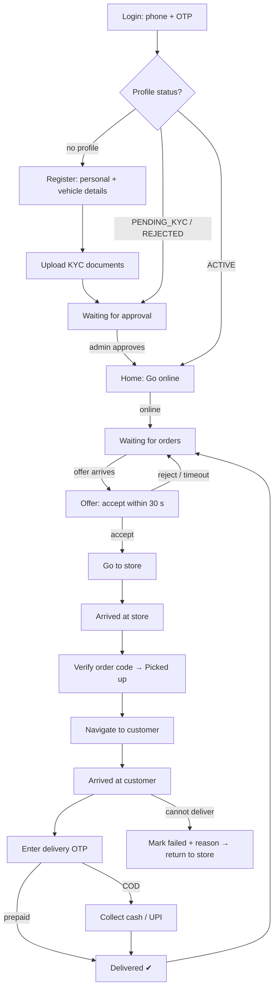

# 04: Rider App (Flutter)

Platform: **Android** in v1 (iOS optional, see D-07). Flavors: `dev`, `staging`, `prod`.
Riders are attached to a **home dark store** and receive offers only for that store's orders.

## 1. Rider journey

## 2. Features

### 2.1 Authentication & app control [P1 login, P5 rest]
| Feature | Details |
|---------|---------|
| Login | Phone + OTP (same backend as the customer app, with `X-App-Name: rider`). The OTP is read from the SMS with the Android **SMS User Consent API** (one system prompt, no SMS permission, no app hash in the DLT template). See §5 for the package risk. |
| Force update / maintenance | Same mechanism as the customer app, with rider-specific minimum versions |
| Permissions gate | Before going online the app checks, in this order, and guides the rider to grant: (1) an in-app **prominent disclosure** (Play User Data policy), shown **before the first location prompt**, not only before the background one; (2) **precise** location while in use (choosing "Approximate" keeps this step open; Android offers "change to precise"); (3) location **"Allow all the time"** (Android 10+; on Android 11+ the system opens the app's location settings page); (4) notifications (Android 13+); (5) battery optimisation exemption; (6) device location (GPS) on. **Non-blocking notices:** full-screen offer alerts on Android 14+ (see §3) and OEM auto-start guidance for Xiaomi/Redmi/POCO, OPPO, vivo/iQOO, realme and OnePlus. |

### 2.2 Registration & KYC [P5]
| Feature | Details |
|---------|---------|
| Registration form | Full name, date of birth, emergency contact, preferred home store (dropdown), vehicle type (bicycle / e-bike / motorbike / scooter), vehicle number (for motorised) |
| Documents | Upload photo (selfie), Aadhaar (front/back), PAN, Driving Licence (motorised only), vehicle RC (motorised only). Camera or gallery, compressed to ≤ 1 MB each. |
| Bank details | Account holder name, account number, IFSC (for payouts). Optional UPI ID. |
| Status screen | Pending review / Rejected (with reason and re-upload) / Approved |
| Admin approval | Ops verifies documents in the admin panel, assigns the store and sets status `ACTIVE` |

### 2.3 Home & shift [P5]
| Feature | Details |
|---------|---------|
| Online/Offline toggle | Large switch. Going online starts a **shift** and the foreground location service (with a persistent notification "You're online"). Offline ends both. |
| Guards | Cannot go online if: not ACTIVE, outside a configurable radius of the home store (e.g., 2 km), required permissions are missing, or cash in hand ≥ limit (can go online but receives **prepaid orders only**; see 2.7) |
| Auto-offline | The server marks the rider offline after 10 min with no location heartbeat, and notifies them |
| Today summary | Orders delivered, earnings today, online hours, cash in hand |
| Current task card | If a task is active, home shows it with a "Continue" button |

### 2.4 Order offers [P5]
| Feature | Details |
|---------|---------|
| Offer delivery | FCM high-priority data message + WebSocket `/ws/v1/rider/` (P6). Polling `GET /rider/offers/current/` is the fallback. |
| Offer screen | Full-screen with a loud ringtone and vibration. Shows store name, drop area (locality only, not the full address), distance store→customer, payment type (Prepaid / COD ₹amount), estimated payout, and a 30 s countdown. |
| Accept | Task assigned. The full customer address and phone are revealed. |
| Reject | Optional reason. The offer goes to the next rider. |
| Timeout | Treated as a reject, and logged for acceptance-rate metrics |
| Withdrawn | If the order is cancelled before pickup, the rider sees "Order cancelled" and returns to idle |

### 2.5 Pickup flow [P5]
| Step | Details |
|------|---------|
| Go to store | Store address + a "Navigate" button (opens Google Maps / the maps app with directions) |
| Arrived at store | Button. Allowed only within ~200 m of the store (geofence check, configurable). |
| Order status | Shows "Packing…" or "Ready for pickup". The rider gets a push when the store marks the order PACKED. |
| Verify & pick up | Scan the QR code on the packed bag, **or** type the 4-character order code. A mismatch shows an error. Success sets the order to OUT_FOR_DELIVERY. |
| Item list | Read-only list of items and quantities to cross-check the bag |

### 2.6 Delivery flow [P5]
| Step | Details |
|------|---------|
| Navigate | Customer pin + address + landmark + instructions. "Navigate" opens the maps app. |
| Call customer | Direct dial (v1). Masked calling is v2. |
| Arrived at customer | Button, allowed within ~200 m of the drop pin (configurable, with an override reason) |
| Delivery OTP | Enter the 4-digit OTP the customer reads out. 5 attempts max, then ops is alerted. |
| COD collection | Shows the **amount due**. The rider confirms "Cash collected", or shows a **UPI QR** (Razorpay QR / payment link) that the customer pays, with the server confirming payment. The amount must match exactly. |
| Delivered | Success screen, earnings for this order, back to idle |
| Failed delivery | Reasons: customer not reachable (after calling + a 10-min wait timer), customer refused, wrong address, other. Optional photo. Ops is notified. The rider is told to return the items to the store and the task becomes "Return to store". |

### 2.7 Cash management (COD) [P5]
| Feature | Details |
|---------|---------|
| Cash in hand | Running balance of COD collected minus deposits |
| Limit | Default ₹5,000. At or above the limit, the dispatcher sends the rider **prepaid offers only** and the app shows a "Deposit cash" banner. |
| Deposit | The rider hands cash to the Store Manager, who records the deposit in the ops panel. The rider sees the deposit in their ledger instantly. |
| Ledger | Date-wise list: COD collected (per order), deposits, balance |

### 2.8 Earnings & history [P5]
| Feature | Details |
|---------|---------|
| Earnings | Today / this week / custom range. Per-order base pay + distance pay + customer tips + incentives − penalties. |
| Payouts | Payout history (period, amount, status, reference) recorded by Finance |
| History | Past tasks: order number, date, store→drop, distance, payout, status |

### 2.9 Profile & support [P5/P7]
| Feature | Details |
|---------|---------|
| Profile | Photo, name, phone, home store, vehicle, KYC status, rating |
| Documents | View uploaded documents and their status |
| Support | Call ops, FAQs, raise a ticket [P7] |
| Logout | Allowed only when offline with no active task |

## 3. Background location requirements
- Location is tracked only while the rider is **online**. It stops immediately when offline (privacy, Play policy).
- An Android **foreground service** with a persistent notification. Interval 5–10 s on an active task, 30 s while idle (configurable from the server).
- Points are batched and sent every 5–10 s. Points are buffered offline and flushed on reconnect.
- Play Console requires a **background location permission declaration** and a demo video. Prepare this early (see D-11, Phase 5).
- Battery: request ignore-battery-optimisation and guide the rider through OEM-specific auto-start settings (Xiaomi, Oppo, Vivo, Realme, OnePlus).
- **Full-screen offer alerts (Android 14+).** Play revokes `USE_FULL_SCREEN_INTENT` by default for apps that are not calling or alarm apps. Without it, an offer arrives as a heads-up notification and does not wake a locked phone. The permissions gate shows a **non-blocking** notice that opens the system setting. Whether it should block going online is an open question for Jivo.
- **Location Accuracy.** Tracking runs in the foreground service's own Flutter engine, which has no Activity. If the Play-services location settings check wants a change (for example Google Location Accuracy is off), it cannot show its dialog there and reports "location disabled" although location is on. The app then switches to the platform location manager for the session (the platform fused provider on Android 12+, GPS below). The gate's "GPS on" check does not detect Location Accuracy being off. Found on the API 37 emulator in the Phase 0 spike.

## 4. Screen inventory

| # | Screen | Phase |
|---|--------|-------|
| 1 | Splash / force update / maintenance | P1 |
| 2 | Login (phone), OTP | P1 |
| 3 | Registration form | P5 |
| 4 | Document upload | P5 |
| 5 | Bank details | P5 |
| 6 | Approval status | P5 |
| 7 | Permissions checklist | P5 |
| 8 | Home (online toggle, summary) | P5 |
| 9 | Incoming offer (full screen) | P5 |
| 10 | Task: go to store / at store / pickup verify (QR scanner) | P5 |
| 11 | Task: go to customer / at customer | P5 |
| 12 | Delivery OTP + COD collection | P5 |
| 13 | Failed delivery | P5 |
| 14 | Delivered (success) | P5 |
| 15 | Earnings | P5 |
| 16 | Cash ledger | P5 |
| 17 | History | P5 |
| 18 | Profile, documents | P5 |
| 19 | Notifications inbox | P6 |
| 20 | Support / FAQ / tickets | P7 |

## 5. Implementation notes and risks

- **OTP autofill package.** The app uses `smart_auth` 3.2.0 for the SMS User Consent API. `sms_autofill` only supports the SMS Retriever API, which needs an app-signature hash in every SMS; that does not suit fixed DLT templates, and the hash differs per signing key and flavor.
  - **Risk:** the package was last published in January 2025 and still applies the Kotlin Gradle Plugin. Flutter warns that future versions will fail to build such plugins.
  - **Fallback:** about 60 lines of native code in `MainActivity` using `play-services-auth-api-phone` (`startSmsUserConsent`, the `SMS_RETRIEVED_ACTION` receiver and the consent activity result), behind the same `OtpAutofill` interface.
  - Verified end to end on the API 37 emulator in Phase 1.
- **Registration & KYC (§2.2), built ahead in P2 against a fake; accepted at the P5 gate.** There is no rider API contract yet, so the screens use hand-written domain models behind `RiderOnboardingRepository` (`rider_app/lib/features/onboarding/`). They are bound to the generated client when the contract lands (end of P4). The fake runs in the dev flavor only (DL-30), also with the real Phase 1 login, so `rider_status: NONE` reaches the form. Staging and prod keep the Phase 1 placeholders, even with `FAKE_API`. Defaults used until Jivo or the backend confirm them:
  - **Flow:** registration (`NONE`) → status screen as the hub (`PENDING_KYC` / `REJECTED`) → documents → bank details → "Documents under review". "Approved" appears on the status screen after a status check returns `ACTIVE`, and one tap continues to home.
  - **Age:** 18 or older on the IST date (the date picker stops at the 18th birthday). The docs state no age rule.
  - **Motorised:** motorbike and scooter only. An e-bike needs no vehicle number, DL or RC (one-line change in `VehicleType.isMotorised`).
  - **Emergency contact:** name plus mobile number, which must differ from the rider's own. `07 §2.8` has a single `emergency_contact` field.
  - **Documents:** Aadhaar number asked once (front), PAN, DL and RC numbers with format checks (Aadhaar Verhoeff check digit). The RC number is prefilled with the vehicle number. Images are re-encoded as JPEG with EXIF removed and stepped down until ≤ 1,000,000 bytes. The original photo is deleted right after compression. Only masked numbers are shown (`XXXX XXXX 1234`). Fields disable keyboard suggestions and learning. Approved documents cannot be replaced.
  - **Bank details:** required before review (the status screen treats them as step 3). The account number is 9–18 digits and must be re-entered (no paste). It is masked once typed. IFSC is `^[A-Z]{4}0[A-Z0-9]{6}$`. UPI ID is optional.
  - **Low-memory phones:** if Android stops the app while the camera is open, the photo is recovered (`retrieveLostData`) when the documents screen opens next, and goes to the document it was taken for.
  - **Image compression package:** `flutter_image_compress` 2.5.1. Like `smart_auth`, it applies the Kotlin Gradle Plugin (same future-build risk). Fallback: the pure-Dart `image` package in an isolate, behind the same `ImageCodec` interface.
- **Offers and the delivery task (§2.4–§2.7), built ahead in P3 against a fake; accepted at the P5 gate.** Local models and repositories (`rider_app/lib/features/offers/`, `rider_app/lib/features/task/`), gated like onboarding (DL-30). Behaviour and defaults until the rider API and Jivo confirm them:
  - **Routing:** while a task is active (or its end is unread) an ACTIVE rider can only be on the task screens; otherwise an open offer shows full screen. Logout and going offline are refused during a task.
  - **Restore:** `GET /rider/tasks/current/` on start and on every return to the foreground decides the step. Restored from the server: the step, OTP attempts and lock, the UPI QR status, and the arrival time at the customer. Kept on the phone only (lost on restart): the call count, the typed OTP and the cash confirmation.
  - **Lost responses:** after a network or timeout error, a 5xx or `INVALID_STATE_TRANSITION`, the app re-reads the current task and shows what the server has. If a step-changing action (pickup, arrived, deliver, fail) lost its answer and the server no longer lists the task, the app says "Couldn't confirm the last step", with Check status, Call support and Back to orders. It never guesses "reassigned" (api-requests #13).
  - **Offer countdown:** follows the server's `expires_at`. It is corrected by the server time when the response has one, and capped at 30 s from arrival. An accept in flight is never expired locally.
  - **Delivery:** the delivery OTP, then for COD the exact amount due with either "Cash collected ₹X" (confirmed in a dialog) or a UPI QR the server confirms, then one `deliver` call. A wrong OTP keeps the collection.
  - **Pickup:** scan the QR (`mobile_scanner`, with the Play services barcode model via `useUnbundled`, which keeps the APK about 17 MB smaller) or type the 4-character code, which also covers a first scan with no network. A QR is accepted only if it is exactly the code (format to confirm). The camera features are declared optional.
  - **UPI QR image:** loaded only from an https URL; anything else shows an error, and cash stays possible.
  - **Navigation:** a generic `geo:` intent, so the Mappls app (DL-29) or any maps app handles it. If no app can, the rider sees a message.
  - **Failed delivery:** "not reachable" needs 2 calls and a 10-minute wait from the server's arrival time (both open questions). "Other" needs a note. The optional photo goes straight through the camera and compressor, never through the KYC capture flow.
- **Earnings, cash, history, payouts and profile (§2.7–§2.9), built ahead in P4 against a fake; accepted at the P5 gate.** Local models and repositories (`rider_app/lib/features/earnings/`, `cash/`, `history/`, `profile/`), dev flavor only (DL-30). Behaviour until the rider API confirms it:
  - **Server amounts only:** every amount is shown exactly as sent, including the per-order totals, the totals per kind, the period total, cash in hand and each running balance. The app never adds anything up. The "Deposit cash" banner follows the server's `limit_reached`, not a comparison on the phone.
  - **Periods:** "Today" and "This week" (Monday to today) are IST calendar dates; "Choose dates" uses a date-range picker. Lists (cash ledger, history, payouts) are paged with "Load more"; ledger entries are grouped by IST day for display.
  - **Reachability:** the records open from home for ACTIVE riders between orders. During a task or an open offer the router keeps the rider on those screens.
  - **Profile:** comes from `GET /rider/me/`. Its photo loads only from an https URL. The documents list reuses the onboarding view, read-only.
  - **Integration-test harness:** `integration_test/accept_to_deliver_fake_test.dart` drives accept → arrived store → pickup → arrived customer → deliver along a GPX route, against the fakes with a distance-checked geofence. The same driver runs as a widget test in CI.
