# 07: Data Model

Database: **PostgreSQL + PostGIS**. All tables have `id` (bigint auto, or UUID where noted), `created_at` and `updated_at` unless stated otherwise.
Money fields: `DecimalField(max_digits=12, decimal_places=2)`. Geo fields: SRID 4326.

## 1. Entity-relationship overview

Updated in Phase 2 (T-204): Phase 1 entities (`OTP_REQUEST`, `APP_CONFIG`, `APP_VERSION_POLICY`) and the Phase 2 additions (`SERVICEABILITY_REQUEST`, `TRENDING_SEARCH`, variant images, collection/banner store scoping). `OTPRequest` has no foreign key: it is linked to a user by phone. Built so far: accounts, cms, stores, catalog, inventory (without `STOCK_RESERVATION`, which arrives with orders in Phase 3).

```mermaid
erDiagram
    USER ||--o{ ADDRESS : has
    USER ||--o{ DEVICE : registers
    USER ||--o{ OTP_REQUEST : "phone verified by"
    APP_CONFIG ||--o{ APP_VERSION_POLICY : "per app + platform"
    USER ||--o| RIDER : "may be"
    USER ||--o{ SERVICEABILITY_REQUEST : "notify me"
    USER ||--o{ STAFF_STORE_ACCESS : "staff scoped to"
    DARK_STORE ||--o{ STAFF_STORE_ACCESS : ""
    DARK_STORE ||--|| PRICING_CONFIG : has
    DARK_STORE ||--o{ STORE_TIMING : opens
    DARK_STORE ||--o{ STORE_INVENTORY : stocks
    CATEGORY ||--o{ CATEGORY : parent
    CATEGORY ||--o{ PRODUCT : contains
    PRODUCT ||--o{ PRODUCT_VARIANT : "sold as"
    PRODUCT ||--o{ PRODUCT_IMAGE : shows
    PRODUCT_VARIANT ||--o{ STORE_INVENTORY : ""
    STORE_INVENTORY ||--o{ STOCK_MOVEMENT : ledger
    COLLECTION ||--o{ COLLECTION_ITEM : lists
    PRODUCT_VARIANT ||--o{ COLLECTION_ITEM : ""
    PRODUCT_VARIANT ||--o{ PRODUCT_IMAGE : "own images"
    DARK_STORE }o--o{ COLLECTION : "shown at (empty = all)"
    DARK_STORE }o--o{ BANNER : "shown at (empty = all)"
    TRENDING_SEARCH
    USER ||--o{ CART : owns
    CART ||--o{ CART_ITEM : contains
    DARK_STORE ||--o{ CART : "scoped to"
    COUPON ||--o{ COUPON_REDEMPTION : used
    USER ||--o{ ORDER : places
    DARK_STORE ||--o{ ORDER : fulfils
    ORDER ||--o{ ORDER_ITEM : contains
    ORDER ||--o{ ORDER_STATUS_HISTORY : logs
    ORDER ||--o{ STOCK_RESERVATION : holds
    ORDER ||--o{ PAYMENT : "paid by"
    PAYMENT ||--o{ REFUND : "refunded by"
    ORDER ||--o| INVOICE : billed
    ORDER ||--o| COUPON_REDEMPTION : applies
    ORDER ||--o{ DELIVERY_TASK : "delivered via"
    RIDER ||--o{ DELIVERY_TASK : performs
    DELIVERY_TASK ||--o{ DELIVERY_OFFER : offered
    RIDER ||--o{ DELIVERY_OFFER : receives
    RIDER ||--o{ RIDER_DOCUMENT : uploads
    RIDER ||--o{ RIDER_SHIFT : works
    RIDER ||--o{ RIDER_LOCATION : pings
    RIDER ||--o{ RIDER_CASH_LEDGER : holds
    RIDER ||--o{ RIDER_EARNING : earns
    RIDER ||--o{ PAYOUT : "paid via"
    ORDER ||--o{ RATING : rated
    USER ||--o{ SUPPORT_TICKET : raises
    SUPPORT_TICKET ||--o{ TICKET_MESSAGE : thread
    USER ||--o{ NOTIFICATION : receives
```

## 2. Entities

### 2.1 Accounts (`accounts`)

**User** (custom `AUTH_USER_MODEL`, created in Phase 0 before the first migration)
| Field | Type | Notes |
|-------|------|-------|
| phone | char(15), unique, nullable | E.164 (`+91XXXXXXXXXX`). Login identifier for customers and riders. Validated as `+` and 7–14 digits (fits char(15)); blank is stored as NULL. Phase 1 adds the +91 rule for OTP login. |
| email | email, nullable, unique when set | Staff login. Stored lowercase (case-insensitive login); blank is stored as NULL. It is the Django `USERNAME_FIELD`, because only staff log in with a password (sessions); phone OTP login (P1) does not go through the password backend. |
| name | char(120) | |
| is_active, is_staff, is_superuser | bool | Django standard |
| auth_id | char(64), nullable, unique | Link to the Jivo Auth identity if adopted for staff (D-04). Reserved in Phase 0: read-only in the admin, set only by the Jivo Auth integration. |
| marketing_opt_in | bool | Promotional push consent |
| deleted_at | datetime, nullable | Set on account deletion. PII is anonymised by a job. A login within the grace period clears it (account restored). |
| deletion_reason | char(500) | Optional feedback given on deletion. Cleared on restore and on anonymisation. |
| anonymised_at | datetime, nullable | Set when `anonymise_deleted_accounts` erased the personal data (makes the job idempotent). |
| terms_version, terms_accepted_at | char(32), datetime | DPDP consent: the Terms & Privacy version accepted at OTP login and when; updated whenever the version changes. |

**OTPRequest**: `phone`, `app` (customer/rider), `purpose` (login/delete_account; added in Phase 1 for the OTP-confirmed account deletion), `code_hash` (never plain: HMAC-SHA256 keyed with the secret key), `expires_at` (5 min), `attempts`, `verified_at`, `sms_sent_at` (keeps `send_otp_sms` idempotent), `ip`, `user_agent`.

**Device**: `user`, `app` (customer/rider), `platform`, `fcm_token` (unique), `app_version`, `is_active`, `last_seen_at`.

**Address**: `user`, `label` (home/work/other), `custom_label`, `receiver_name`, `receiver_phone`, `house`, `building_street`, `landmark`, `area`, `city`, `state`, `pincode`, `location` (Point), `is_default`, `is_deleted`. **Until PostGIS is available (Phase 2), `location` is stored as `lat`/`lng` `Decimal(9,6)` columns**; Phase 2 migrates them to the Point field. The API shape (`lat`, `lng` numbers) does not change. The API's `is_serviceable` flag (Phase 2) is computed on read from the active stores' service areas, not stored.

**StaffStoreAccess**: see 2.2 (built in Phase 2, in the `stores` app).

**Customer** (proxy of User, non-staff users): exists only to give the Customers admin its own permissions (support/ops can block customers without editing staff accounts).

### 2.2 Stores (`stores`)

**DarkStore**: `code` (unique, e.g., `DEL-01`), `name`, `address`, `city`, `state`, `pincode`, `location` (Point), `service_area` (MultiPolygon, GiST index), `is_active`, `is_accepting_orders` (temporary close), `avg_prep_minutes`, `phone`, `gstin`, `fssai_license_no`, `invoice_prefix` (unique), `auto_accept_orders` (bool), `dispatch_radius_km`, `priority` (overlap tie-break: the lower number wins; added in Phase 2).

**StoreTiming**: `store`, `weekday` (0 = Monday … 6), `opens_at`, `closes_at` (IST wall-clock, `closes_at > opens_at`). Several rows per day are allowed (split shifts). A window past midnight is two rows (`…–23:59`, which runs to midnight, and `00:00–…`). A store with no rows is never open.

**PricingConfig** (1:1 store): `min_order_value`, `delivery_fee`, `free_delivery_threshold`, `small_cart_fee`, `small_cart_threshold`, `handling_fee`, `cod_enabled`, `cod_max_order_value`.

**ServiceabilityRequest**: `location` (Point), `user` (nullable), `phone` (nullable), `address_text`.

**StaffStoreAccess**: `user`, `store`, unique together. Lives in the `stores` app (not `accounts`), so accounts does not depend on stores. Scope staff querysets with `apps.stores.services.stores_for(user)`: superusers and global roles see every store; Store Manager / Store Staff only theirs.

> Overlapping service areas: if a point falls inside several active stores' polygons, choose the **nearest open** store (tie-break by `priority` field on DarkStore).

### 2.3 Catalog (`catalog`)

**Category**: `name`, `slug` (unique), `parent` (self FK, null = top level), `image`, `sort_order`, `is_active`. **Two levels in v1** (top-level and sub-categories; the API publishes no deeper tree, Phase 2 R1). Slugs are never all digits, because `?category=` takes an id or a slug.

**Product**: `name`, `slug` (unique, never all digits), `category`, `brand` (default "Jivo"), `short_description`, `description` (**plain text**, paragraphs separated by a blank line; changed from "rich text" in Phase 2 R1 so the app needs no HTML renderer), `highlights` (JSON list), `attributes` (JSON, the label information of 09 §4; keys published in the API: `ingredients`, `nutrition` = `{columns: [str], rows: [{name, values: [str], is_sub_row}]}`, `shelf_life`, `storage_instructions`, `country_of_origin`, `manufacturer`, `marketer`, `importer`, `consumer_care`, `fssai_license_no`), `is_veg`, `hsn_code`, `gst_rate` (e.g., 5.00), `search_keywords`, `is_active`, `sort_order`.

**ProductVariant (SKU)**: `product`, `sku` (unique), `name` (e.g., "1 L"), `net_quantity` (as on the pack, e.g. "2 x 1 L"; Legal Metrology, added in Phase 2 R1), `unit_value` + `unit` (for "₹/100 ml" display: the API's `unit_price {amount, per}`), `mrp`, `selling_price` (≤ mrp), `max_qty_per_order`, `barcode`, `sap_item_code` (nullable), `weight_grams`, `is_active`, `sort_order`.

**ProductImage**: `product`, `variant` (nullable), `image`, `alt_text`, `sort_order`.

**Collection**: `name`, `slug`, `show_on_home`, `sort_order`, `is_active`, `stores` (M2M, empty = all). At most 100 items (the collection page is not paginated).
**CollectionItem**: `collection`, `variant`, `sort_order`.

**Banner**: `title`, `image`, `link_type` (category/collection/product/url/none), `link_value`, `stores` (M2M, empty = all), `starts_at`, `ends_at`, `sort_order`, `is_active`.

**TrendingSearch** (added in Phase 2): `term` (unique), `sort_order`, `is_active`. Admin-defined trending searches (03 §2.7), returned by `search/suggest` for a blank query.

Images (`Category.image`, `ProductImage.image`, `Banner.image`) are public media (`STORAGES["public"]`), validated by content (JPEG/PNG/WebP, ≤ 5 MB, ≥ 200 px), EXIF-stripped, normalised to WebP under random keys, with 256/512/1024 px renditions made on save (09 §1, §3.6). Product and category images are padded to a white square.

### 2.4 Inventory (`inventory`)

**StoreInventory**: unique (`store`, `variant`). Fields: `on_hand` (int ≥ 0), `reserved` (int ≥ 0), `low_stock_threshold`, `is_available` (manual kill switch), `price_override` (nullable), `rack_location` (nullable).
`available = on_hand − reserved`. DB check constraints enforce `on_hand ≥ 0`, `reserved ≥ 0` and `reserved ≤ on_hand`.

**StockReservation**: `order`, `store`, `variant`, `quantity`, `status` (ACTIVE/COMMITTED/RELEASED), `expires_at` (for online-payment orders).

**StockMovement** (append-only ledger; the model refuses updates and deletes): `store`, `variant`, `delta` (+/−, never 0), `type` (INWARD, SALE, RETURN, DAMAGE, AUDIT_ADJUSTMENT, TRANSFER_IN, TRANSFER_OUT), `order` (nullable; the column is added with orders in Phase 3), `reason`, `created_by`, `on_hand_after`. `StoreInventory` rows are created at zero and opening stock is an INWARD movement, so a row's movements always sum to its `on_hand` (`apps.inventory.services`). Custom permissions: `inventory.adjust_stock`, `inventory.toggle_availability`.

> Concurrency rule: reservations use `SELECT … FOR UPDATE` on `StoreInventory` rows (locked in a consistent order by variant id to avoid deadlocks) inside one transaction. Two customers can never reserve the same last unit.

### 2.5 Cart & promotions (`cart`, `promotions`)

**Cart**: `user`, `store`, `coupon` (nullable), `address` (nullable), `tip`, `instructions` (JSON chips + text). One active cart per user.
**CartItem**: `cart`, `variant`, `quantity`. Unique (`cart`, `variant`).

**Coupon**: `code` (unique, case-insensitive), `title`, `description`, `discount_type` (FLAT/PERCENT), `value`, `max_discount`, `min_order_value`, `starts_at`, `ends_at`, `usage_limit_total`, `usage_limit_per_user`, `first_order_only`, `stores` (M2M), `categories` (M2M, applies to item subtotal in those categories), `is_active`, `is_visible` (listed in the app or hidden code).
**CouponRedemption**: `coupon`, `user`, `order` (unique), `discount_amount`, `status` (APPLIED/REVERSED).

### 2.6 Orders (`orders`)

**Order**
| Field | Notes |
|-------|-------|
| `order_number` | Human-friendly, unique, e.g., `JV-261102-000123` |
| `pickup_code` | 4-char alphanumeric for rider pickup (unique among active orders in the store) |
| `user`, `store` | |
| `address_snapshot` | JSON copy of the address at order time + `delivery_location` (Point) |
| `status` | See [08-order-lifecycle.md](08-order-lifecycle.md) |
| `payment_method` | ONLINE / COD |
| `payment_status` | PENDING / PAID / FAILED / REFUND_PENDING / REFUNDED / PARTIALLY_REFUNDED / COD_PENDING / COD_COLLECTED |
| `mrp_total`, `item_total`, `product_discount` | item_total = Σ selling_price × qty |
| `coupon`, `coupon_code`, `coupon_discount` | |
| `delivery_fee`, `small_cart_fee`, `handling_fee`, `tip` | |
| `grand_total` | Amount payable |
| `amount_refunded` | |
| `delivery_otp_hash`, `delivery_otp_attempts` | OTP generated at OUT_FOR_DELIVERY |
| `instructions` | |
| `eta_at` | Promised delivery time |
| `placed_at`, `accepted_at`, `packing_started_at`, `packed_at`, `picked_up_at`, `delivered_at`, `cancelled_at` | Timestamps for SLA reports |
| `cancel_reason`, `cancelled_by_type` (customer/store/ops/system) | |
| `idempotency_key` | Unique per user |
| `client_app_version`, `client_platform` | |

**OrderItem**: `order`, `variant`, snapshots (`product_name`, `variant_name`, `sku`, `hsn_code`, `gst_rate`, `image_url`), `mrp`, `selling_price`, `quantity`, `quantity_unavailable` (set by the store), `line_total`, `tax_amount` (derived from inclusive price).

**OrderStatusHistory**: `order`, `from_status`, `to_status`, `actor` (user nullable), `actor_type` (customer/store/rider/ops/system), `note`, `created_at`. Append-only.

**Invoice**: `order` (1:1), `invoice_number` (per store GSTIN, per financial year sequence, e.g., `DEL01/26-27/000123`), `issued_at`, `pdf`, `taxable_value`, `cgst`, `sgst`, `igst`, `total`. Credit notes for refunds after invoicing: `CreditNote` with the same structure (Phase 4).

**Rating**: `order`, `user`, `target` (ORDER/RIDER), `rider` (nullable), `stars` (1–5), `tags` (JSON), `comment`.

### 2.7 Payments (`payments`)

**Payment**: `order`, `gateway` (RAZORPAY / COD / RAZORPAY_QR), `gateway_order_id`, `gateway_payment_id`, `amount`, `currency`, `status` (CREATED/AUTHORIZED/CAPTURED/FAILED), `method` (upi/card/netbanking/wallet/cash), `error_code`, `error_description`, `raw` (JSON). Several attempts per order are allowed (retries).

**Refund**: `payment`, `order`, `amount`, `reason`, `gateway_refund_id`, `status` (PENDING/PROCESSED/FAILED), `initiated_by`, `processed_at`.

**PaymentWebhookEvent**: `event_id` (unique), `event_type`, `payload`, `signature_valid`, `processed_at`, `error`.

### 2.8 Delivery (`delivery`)

**Rider** (1:1 User): `home_store`, `status` (PENDING_KYC / ACTIVE / REJECTED / SUSPENDED), `rejection_reason`, `vehicle_type`, `vehicle_number`, `dob`, `emergency_contact`, `photo`, `is_online`, `current_location` (Point, mirrored in Redis), `last_location_at`, `cash_in_hand`, `cash_limit`, `rating_avg`, `bank_account_name`, `bank_account_number` (encrypted), `ifsc`, `upi_id`.

**RiderDocument**: `rider`, `doc_type` (PHOTO/AADHAAR_FRONT/AADHAAR_BACK/PAN/DL/RC), `file` (private storage), `doc_number_masked`, `status` (PENDING/APPROVED/REJECTED), `reviewed_by`, `review_note`.

**RiderShift**: `rider`, `started_at`, `ended_at`, `start_location`, `end_reason` (manual/auto_offline/admin).

**DeliveryTask**: `order`, `rider` (nullable until assigned), `store`, `status` (see 08 §3), `assigned_at`, `arrived_store_at`, `picked_up_at`, `arrived_customer_at`, `delivered_at`, `failed_at`, `fail_reason`, `returned_at`, `distance_km` (store→drop), `payout_amount`, `assignment_mode` (AUTO/MANUAL), `attempt_count`.

**DeliveryOffer**: `task`, `rider`, `status` (PENDING/ACCEPTED/REJECTED/EXPIRED/WITHDRAWN), `offered_at`, `expires_at`, `responded_at`, `reject_reason`. Partial unique index: at most one PENDING offer per task.

**RiderLocation**: `rider`, `point`, `accuracy_m`, `speed`, `heading`, `recorded_at`, `task` (nullable). Indexed by (`rider`, `recorded_at`). 30-day retention.

**RiderCashLedger**: `rider`, `entry_type` (COD_COLLECTED/DEPOSIT/ADJUSTMENT), `amount` (+/−), `order` (nullable), `balance_after`, `recorded_by`, `note`.

**RiderEarning**: `rider`, `task` (nullable), `type` (BASE/DISTANCE/TIP/INCENTIVE/PENALTY), `amount`, `note`, `payout` (nullable FK once paid).

**Payout**: `rider`, `period_start`, `period_end`, `amount`, `status` (PENDING/PAID), `reference`, `paid_at`.

**EarningRule** (config): `base_per_order`, `per_km_after`, `per_km_rate`, `peak_hour_bonus`, `effective_from`.

### 2.9 Notifications, support, CMS

**NotificationTemplate**: `event` (e.g., `order.out_for_delivery`), `channel` (PUSH/SMS), `app`, `title`, `body` (with `{{placeholders}}`), `dlt_template_id` (SMS), `is_active`.
**Notification**: `user`, `app`, `title`, `body`, `data` (JSON deep link), `category` (order/promo/system), `sent_at`, `read_at`.
**SupportTicket**: `user`, `app`, `order` (nullable), `category`, `subject`, `status` (OPEN/IN_PROGRESS/RESOLVED/CLOSED), `priority`, `assigned_to`.
**TicketMessage**: `ticket`, `sender` (user), `is_staff`, `body`, `attachments` (JSON of file keys).
**FAQ**: `app`, `category`, `question`, `answer`, `sort_order`, `is_active`.
**Page**: `slug`, `title`, `body_html`, `is_published`.
**AppConfig** (singleton / key-value): app versions per app+platform, maintenance flag + message, support contacts, global settings (payment window, cancel window, offer timeout, max offer attempts, geofence radii, OTP length/expiry, location intervals).

Phase 1 implementation: `cms.AppConfig` is a single row (maintenance + message, support phone/email, terms/privacy/refund URLs, `terms_version`, rider location intervals, `feature_flags` JSON); `cms.AppVersionPolicy` holds one row per (app, platform): `min_supported_version`, `latest_version`, `store_url`. Later phases add their global settings as fields on `AppConfig`. OTP length (6) and expiry (5 min) stay fixed in code because the API contract validates them.

### 2.10 Audit

**AuditLog**: `actor`, `action`, `object_type`, `object_id`, `changes` (JSON before/after), `ip`, `created_at`. Plus `django-simple-history` on price, inventory, coupon, pricing-config and rider models.

## 3. Key indexes & constraints
- `StoreInventory(store, variant)` unique. Check constraints on stock (see 2.4).
- `Order(user, created_at desc)`, `Order(store, status)`, `Order(status, placed_at)`.
- `DarkStore.service_area` GiST index. `RiderLocation(rider, recorded_at)`. `Rider.current_location` GiST.
- `Payment(gateway_order_id)`, `Payment(gateway_payment_id)` unique when not null.
- `PaymentWebhookEvent.event_id` unique (idempotency).
- `Order(user, idempotency_key)` unique.
- `DeliveryOffer(task)` partial unique where `status='PENDING'`.
- `Coupon(upper(code))` unique.

## 4. Data retention
| Data | Retention |
|------|-----------|
| Orders, invoices, payments | 8 years (GST record-keeping) |
| Rider location history | 30 days |
| OTP requests | 30 days |
| KYC documents | While the rider is active + period mandated by policy (D-14). Then deleted. |
| Deleted customer accounts | PII anonymised after a 30-day grace period. Order financial records are kept without PII. |
