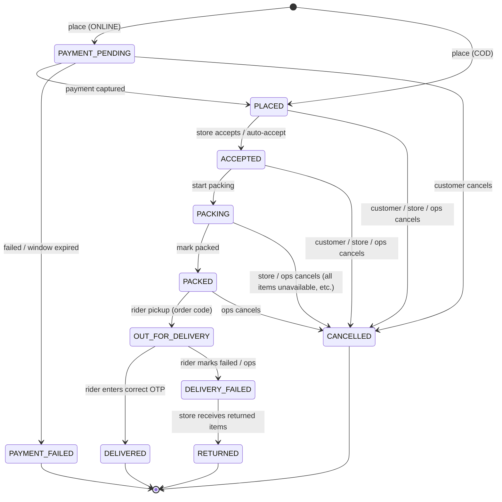
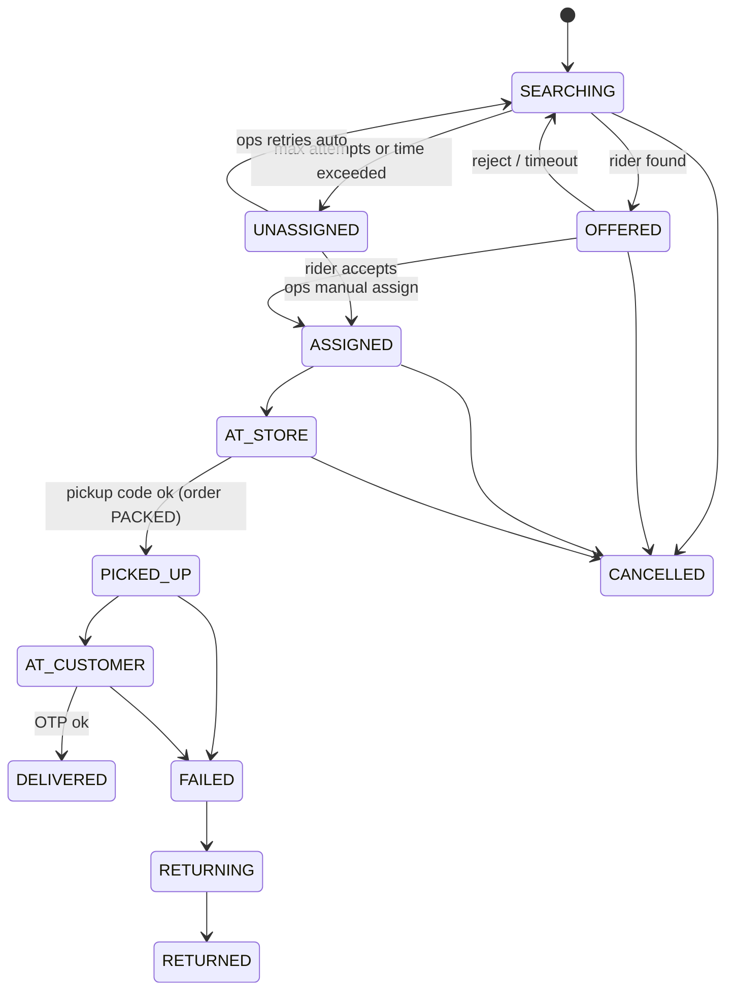

# 08: Order Lifecycle, Dispatch, Stock & Payments

This is the **behavioural contract** of the system. Backend services enforce it, apps display it, and every phase's tests check against it. Any change here must be agreed and reflected in tests.

## 1. Order states

| State | Meaning | Customer-facing label | Terminal? |
|-------|---------|----------------------|-----------|
| `PAYMENT_PENDING` | Online order created, awaiting payment | "Completing payment…" | No |
| `PLACED` | Paid (online) or confirmed (COD). Waiting for the store. | "Order placed" | No |
| `ACCEPTED` | Store accepted the order | "Order confirmed" | No |
| `PACKING` | Store staff are picking and packing | "Packing your order" | No |
| `PACKED` | Packed and waiting for rider pickup | "Packed, rider on the way to store" / "Ready for pickup" | No |
| `OUT_FOR_DELIVERY` | Rider picked up the order | "On the way" | No |
| `DELIVERED` | Delivered with OTP | "Delivered" | **Yes** |
| `CANCELLED` | Cancelled before pickup | "Cancelled" | **Yes** |
| `PAYMENT_FAILED` | Payment not completed within the window | "Payment failed" | **Yes** |
| `DELIVERY_FAILED` | Rider could not deliver. Items are returning to the store. | "Delivery unsuccessful" | No |
| `RETURNED` | Returned items received back at the store | "Delivery unsuccessful" | **Yes** |



## 2. Order transition table

Every transition goes through `orders.services.transition()`. Anything not listed is rejected with `INVALID_STATE_TRANSITION`. Every transition writes an `OrderStatusHistory` row and sets the matching timestamp field.

| # | From → To | Trigger / actor | Guards | Side effects |
|---|-----------|-----------------|--------|--------------|
| T1 | (new) → `PAYMENT_PENDING` | Customer places an ONLINE order | Cart not empty; address serviceable by the cart's store; store open and accepting; all lines available; qty ≤ max per order; item total ≥ min order; coupon (if any) valid; bill matches the client's displayed total (else `PRICE_CHANGED`) | Create Order + items (price snapshots); **reserve stock** with `expires_at = now + payment window (15 min)`; create Razorpay order + `Payment(CREATED)`; coupon is *held* (counted against limits) |
| T2 | (new) → `PLACED` | Customer places a COD order | Same as T1, plus COD enabled for the store and `grand_total ≤ cod_max_order_value`, and the user is not COD-blocked | Create Order; **reserve stock** (no expiry); redeem coupon; clear cart; payment_status `COD_PENDING`; notify store (sound) + customer; schedule the store-acceptance SLA alert; start dispatch if the trigger is `PLACED` |
| T3 | `PAYMENT_PENDING` → `PLACED` | Payment captured, confirmed by the verify API **or** webhook (whichever comes first; the second is a no-op) | Razorpay signature valid; captured amount = `grand_total`; order still `PAYMENT_PENDING` | `Payment(CAPTURED)`, payment_status `PAID`; reservation expiry cleared; coupon redeemed; cart cleared; notify store + customer; SLA alert scheduled; dispatch if the trigger is `PLACED` |
| T3a | `PAYMENT_FAILED`/`CANCELLED` + late capture | Webhook reports a capture after the order already failed | n/a | Do **not** revive the order. Auto-refund the full captured amount and alert ops. |
| T4 | `PAYMENT_PENDING` → `PAYMENT_FAILED` | `expire_unpaid_orders` job after the window, **after** confirming with the Razorpay API that nothing was captured | No captured payment | **Release stock**; release coupon hold; cart retained so the customer can try again; notify customer |
| T5 | `PAYMENT_PENDING` → `CANCELLED` | Customer abandons ("Cancel order" on the payment-failed screen) | No captured payment | Release stock and coupon hold |
| T6 | `PLACED` → `ACCEPTED` | Store staff accept, or auto-accept (store setting) | Store user has access to this store | Notify customer "Order confirmed"; start dispatch if the trigger is `ACCEPTED` (**default**) |
| T7 | `ACCEPTED` → `PACKING` | Store staff "Start packing" | | None (customer label update only) |
| T8 | `PACKING` → `PACKED` | Store staff "Mark packed" | Every line is either fully picked or marked unavailable (qty reduced); at least one unit remains | Print label with the pickup code; notify the assigned rider "Order ready"; if no rider yet, raise dispatch priority |
| T8a | (item adjustment while `ACCEPTED`/`PACKING`) | Store staff mark items/qty unavailable | Not yet PACKED | Recalculate the bill (see §6.3); release reserved qty for removed units; ONLINE → partial refund of the difference; COD → reduced amount due; notify the customer with details; if nothing remains, go to T11 |
| T9 | `PACKED` → `OUT_FOR_DELIVERY` | Rider "Picked up" with the correct pickup code | Rider is the assigned rider on an active task; task status `AT_STORE` | **Commit stock** (`on_hand −= qty`, `reserved −= qty`, `StockMovement(SALE)`); generate the **delivery OTP**; notify the customer with rider details + OTP; start live tracking |
| T10 | `OUT_FOR_DELIVERY` → `DELIVERED` | Rider enters the correct delivery OTP (≤ 5 attempts) | COD: rider confirms the collected amount = amount due (cash) or a UPI QR payment is confirmed | COD → `RiderCashLedger(+amount)` for cash, payment_status `COD_COLLECTED`; create rider earnings (+ tip); generate the invoice; notify the customer and ask for a rating; free the rider |
| T11 | `PLACED`/`ACCEPTED` → `CANCELLED` | Customer cancels | Before `PACKING` (configurable) | Release stock; reverse the coupon redemption; ONLINE → **full refund**; withdraw the pending offer / free the assigned rider; notify store + rider |
| T12 | `PLACED`/`ACCEPTED`/`PACKING`/`PACKED` → `CANCELLED` | Store manager / ops / support cancels (reason required) | Role permission | Same as T11. If already PACKED, store staff put items back (stock is still only reserved, so no restock movement is needed). Audit log. |
| T13 | `OUT_FOR_DELIVERY` → `DELIVERY_FAILED` | Rider marks failed (reason; "not reachable" requires call attempts + the 10-min wait timer) or ops marks it | | Task → `RETURNING`; notify the customer and ops; refund policy applies (§6.4) |
| T14 | `DELIVERY_FAILED` → `RETURNED` | Store staff "Receive return" | Rider is at the store | Good items → `StockMovement(RETURN)`, `on_hand += qty`; damaged → `StockMovement(DAMAGE)` record only; COD → nothing to collect; task `RETURNED`; rider freed |

**Phase 5 implementation notes (slice 5.3):**
- **T13 refund mapping (D-10 default, ⚠ to confirm):** "customer fault" (delivery fee kept) = CUSTOMER_NOT_REACHABLE and CUSTOMER_REFUSED; WRONG_ADDRESS and OTHER are refunded in full, following the §6.4 table literally.
- **T14 damaged items:** recorded as a RETURN followed by a DAMAGE of the same units, so `on_hand` is unchanged and both movements exist (the ledger refuses zero-delta rows).
- **T10:** the COD collection is validated before the OTP, so a wrong amount never uses an OTP attempt. After 5 wrong OTPs only ops can resolve the delivery.
- **T10 COD by UPI QR (Phase 5 slice 5.4):** the QR is for exactly `grand_total` and only the server marks it paid (webhook or gateway lookup). Cash taken while the QR is open closes it; cash is refused once the QR is paid (no double collection). Any QR payment that is not needed (QR closed or expired, wrong amount, delivery failed) is refunded in full to the UPI payment automatically. UPI collections do not enter the rider's cash ledger. Ops resolve a locked OTP by unlocking it (same OTP) or by checking the OTP with the customer and completing T10 themselves (actor `ops`).
- **Rider earnings (D-16 default ⚠, DL-61 c):** the per-delivery fee (base + distance pay on the server's route distance) is earned at pickup (T9) and kept for failed, returned and cancelled-after-pickup deliveries; nothing is earned before pickup. The tip is added on delivery (T10) only.
- **T13 by ops:** ops may mark a delivery failed without the rider's 10-minute wait; refunds as in §6.4. COD with a paid UPI QR: the QR payment is refunded (nothing is due).

### 2.1 Dispatch trigger
Setting `DISPATCH_TRIGGER` = `ACCEPTED` (default) or `PLACED`. Dispatching in parallel with packing keeps the overall time low. The rider usually arrives as packing finishes.

## 3. Delivery task states

| State | Meaning |
|-------|---------|
| `SEARCHING` | No rider yet. The dispatch engine is offering. |
| `OFFERED` | An offer is pending with one rider (30 s) |
| `ASSIGNED` | Rider accepted and is heading to the store |
| `AT_STORE` | Rider marked arrived at the store (within the geofence) |
| `PICKED_UP` | Order picked up (order is `OUT_FOR_DELIVERY`) |
| `AT_CUSTOMER` | Rider arrived at the drop location |
| `DELIVERED` | Done |
| `FAILED` → `RETURNING` → `RETURNED` | Failed delivery, items travelling back, received by the store |
| `UNASSIGNED` | Dispatch gave up after max attempts/time. **Ops alerted** for manual assignment. Ops can also retry auto-dispatch. |
| `CANCELLED` | Order cancelled before pickup |



Reassignment: ops may unassign a rider in `ASSIGNED`/`AT_STORE` (e.g., vehicle breakdown). The task goes back to `SEARCHING` and the previous rider is freed.

## 4. Payment states (online)

| Payment.status | Meaning |
|----------------|---------|
| `CREATED` | Razorpay order created, checkout not completed |
| `AUTHORIZED` | Authorised but not captured (should be brief; auto-capture is enabled on Razorpay) |
| `CAPTURED` | Money received |
| `FAILED` | Attempt failed. A retry creates a new Payment row. |

Rules:
1. The **server** decides payment success: signature verification on `/verify/` plus the webhook. The app's callback is never trusted alone.
2. Webhook processing is **idempotent** (`PaymentWebhookEvent.event_id` unique) and order-insensitive (a capture can arrive before or after verify).
3. Before failing an order on timeout, the job **queries Razorpay** for payments on that Razorpay order (handles missed webhooks).
4. Refunds always go back to the original payment via the Razorpay refund API. Order `payment_status` becomes `REFUND_PENDING`, then `REFUNDED` / `PARTIALLY_REFUNDED` on `refund.processed`.

## 5. Rider dispatch algorithm (v1)

When dispatch starts for an order:

1. **Candidate riders** = riders where: `status=ACTIVE`, `is_online=true`, `home_store = order.store`, no active task (v1: one order at a time), last ping ≤ 2 min old, not already offered this task in the current dispatch round (offers since the round's `search_started_at`; a re-dispatch after UNASSIGNED or an unassign starts a new round), and **for COD orders** `cash_in_hand + order.grand_total ≤ cash_limit` (DL-61 b: no ops override; a rider left out for cash gets a "deposit cash" flag, `deposit_required`, until a deposit).
2. **Rank** by: (a) riders *at the store* (within 200 m) first, ordered by longest idle time (fairness); then (b) others by distance to the store (PostGIS), nearest first.
3. **Offer** to the top candidate: create `DeliveryOffer(PENDING, expires_at=now+30s)`, task `OFFERED`, send FCM high-priority + WebSocket. Schedule `expire_offer` at expiry.
4. **Accept** (inside a transaction with a row lock on the task): task `ASSIGNED`, rider bound, all other pending offers withdrawn. A late accept after expiry returns `OFFER_EXPIRED`.
5. **Reject / expire**: offer closed, task back to `SEARCHING`, go to step 1.
6. **Give up** after `MAX_OFFER_ATTEMPTS` (default 5) or `DISPATCH_TIMEOUT` (default 3 min) with no acceptance: task `UNASSIGNED`, ops alert on the live board (red), and the auto-retry loop pauses for 60 s then resumes until ops assigns manually.
7. **Manual assignment** by ops bypasses the offer: the task becomes `ASSIGNED` immediately and the rider is notified.

v2 ideas (not v1): batching two orders on one trip, predictive ETA, multi-store riders.

## 6. Stock, pricing & money rules

### 6.1 Stock movements per event
| Event | `on_hand` | `reserved` | Ledger |
|-------|-----------|-----------|--------|
| Order placed (T1/T2) | – | + qty | – |
| Payment failed / order cancelled before pickup / item marked unavailable | – | − qty | – |
| Picked up (T9) | − qty | − qty | `SALE` |
| Returned, good (T14) | + qty | – | `RETURN` |
| Returned, damaged | – | – | `DAMAGE` (record) |
| Store inward / audit / damage adjustment | ± qty | – | `INWARD` / `AUDIT_ADJUSTMENT` / `DAMAGE` |

Customers can add to the cart up to `available`. The cart **does not** reserve stock. Only order placement does.

### 6.2 Bill calculation (pricing engine, `cart.services.compute_bill`)
```
mrp_total        = Σ mrp × qty
item_total       = Σ selling_price × qty          (store price_override if set)
product_discount = mrp_total − item_total
coupon_discount  = coupon rule on eligible item subtotal, capped by max_discount, ≤ item_total
delivery_fee     = 0 if item_total ≥ free_delivery_threshold else delivery_fee
small_cart_fee   = small_cart_fee if item_total < small_cart_threshold else 0
handling_fee     = handling_fee
tip              = customer-chosen
grand_total      = item_total − coupon_discount + delivery_fee + small_cart_fee + handling_fee + tip
```
- Thresholds compare against `item_total` (before the coupon). This must be confirmed with Jivo (D-09).
- Rounding: all amounts are rounded to 2 decimals, half-up. `grand_total` is not rounded to the rupee in v1.
- The same function is used for the cart display, order creation and partial-unavailability recalculation. The client never computes money.

### 6.3 Partial unavailability (T8a)
- Removed units → recalculate `item_total`. Coupon: keep the original discount, capped at the new `item_total` (customer is not penalised for store stock errors). Fees: recalculate, but **never increase** the amount payable.
- ONLINE: refund `old grand_total − new grand_total`. COD: the new amount due is shown to the rider.
- **Implementation (Phase 4, PM default ⚠ to confirm with D-10):** "never increase" is applied per fee: each fee (delivery, small cart, handling) is recalculated and capped at the fee the order already had, so a fee that removing items would newly trigger (e.g. falling below free delivery) is not charged. Prices are the order's own snapshot; the tip is unchanged. Removing the last units does not leave an empty order: the whole order is cancelled (T12, reason `ITEMS_UNAVAILABLE`, full refund) and its lines keep their quantities. `Order.amount_paid` records what was captured, so refunds after a lower `grand_total` stay bounded by what was paid.

### 6.4 Refund policy (defaults, to be confirmed in D-10)
| Situation | Online paid | COD |
|-----------|-------------|-----|
| Customer cancels before packing | Full refund | Nothing due |
| Store/ops cancels | Full refund | Nothing due |
| Item unavailable | Refund difference | Reduced due |
| Delivery failed: customer not reachable / refused | Refund item value; delivery fee kept (configurable) | Nothing due; after 2 refused COD deliveries the user is blocked from COD (online only; DL-61 d; ops can lift it, and the count restarts) |
| Delivery failed: Jivo's fault (wrong address resolved by ops, rider issue) | Full refund | Nothing due |
| Late capture on a failed/cancelled order (T3a) | Full auto-refund | n/a |

Phase 4 defaults (D-10 not decided, DL-47): the table is implemented as written. "Full refund" on a cancellation = everything still refundable (after a T8a partial refund, the rest). The failed-delivery "item value" is implemented as everything still refundable minus the delivery fee when `REFUND_KEEP_DELIVERY_FEE_ON_CUSTOMER_FAULT` is true (tip and other fees refunded) — ⚠ to confirm. A cancelled COD order gets `payment_status` FAILED ("Not paid"). Staff refunds outside these rules (05 §3 Refund) are capped by what is still refundable.

## 7. Customer cancellation window
Allowed in `PAYMENT_PENDING`, `PLACED` and `ACCEPTED`. Blocked from `PACKING` onward (setting `CUSTOMER_CANCEL_UNTIL = ACCEPTED`). After that, the app shows "Contact support".

## 8. ETA (v1)
```
eta_minutes = store.avg_prep_minutes
            + rider_to_store_minutes (0 if dispatch not started; else distance / avg speed)
            + store_to_customer_distance_km / avg_speed_kmph × 60
            + buffer (2 min)
```
- `avg_speed_kmph` is configurable (default 20). Distance is a straight line × a road factor (1.3).
- The serviceability ETA uses the same formula with the typical rider wait.
- Recomputed on status changes and on each rider location update while out for delivery. Displayed as a range if confidence is low (v2).

## 9. Notifications per transition

| Transition | Customer | Store console | Rider | Ops |
|------------|----------|---------------|-------|-----|
| T2/T3 → PLACED | Push + SMS "Order placed" | New-order alert (sound) | – | Board update |
| T4 PAYMENT_FAILED | Push | – | – | – |
| T6 ACCEPTED | Push | – | – | Board |
| Offer created | – | – | Offer (FCM + WS) | – |
| Task ASSIGNED | (rider name shown in tracking) | Rider en route | – | Board |
| T8 PACKED | – | – | Push "Order ready" | Board |
| T8a items adjusted | Push + SMS with refund/new amount | – | Updated amount due | Board |
| T9 OUT_FOR_DELIVERY | Push (+SMS) with OTP | Handover done | – | Board |
| AT_CUSTOMER | Push "Rider has arrived" | – | – | – |
| T10 DELIVERED | Push + rating prompt | – | Earnings shown | Board |
| T11/T12 CANCELLED | Push + SMS (+ refund info) | Alert | Offer withdrawn / task cancelled | Board |
| T13 DELIVERY_FAILED | Push | Expect return | Return instructions | **Alert** |
| Dispatch UNASSIGNED | – | – | – | **Alert** |
| Store not accepting within SLA (60 s) | – | Re-alert | – | **Alert** |
| Refund processed | Push + SMS | – | – | – |
