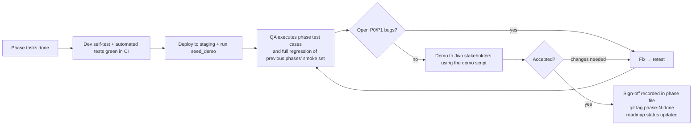

# 10: Testing Strategy

Every phase ends with a **test gate**. A phase is not done until its automated tests pass in CI, its manual test cases are executed on staging, and its exit criteria are met.

## 1. Test levels & tools

| Level | Backend (Django) | Mobile (Flutter) | Web panel |
|-------|------------------|------------------|-----------|
| **Unit** | pytest + pytest-django; services, pricing engine, state machine, dispatch ranking, permissions. factory_boy for data, freezegun for time. | `flutter_test` + mocktail: controllers/notifiers, repositories, formatters, validators | pytest for view logic and permission scoping |
| **API / integration** | DRF `APIClient` tests per endpoint: happy path, validation, auth, **IDOR**, state guards. Real Postgres+PostGIS (not SQLite) and Redis in CI via services. | Repository tests against a mocked dio adapter using fixtures generated from the OpenAPI examples | Django test client for ops views (HTMX endpoints) |
| **Contract** | `drf-spectacular` schema generated in CI and diffed. Breaking changes fail CI unless approved. | Generated client compiles against the schema (if codegen is used) | n/a |
| **Widget** | n/a | Key screens: login, OTP, product tile/stepper, cart bill, tracking timeline, rider offer, OTP entry | n/a |
| **End-to-end** | Scenario tests in pytest that drive a full order through services (place → pay → accept → pack → dispatch → pickup → deliver) | `integration_test` on emulator against the **staging** API for critical flows | Manual (scripted) in each phase |
| **Real-time** | Channels `WebsocketCommunicator` tests for consumers and auth | Manual on devices + integration test with a mock socket | Manual |
| **Performance** | Locust (or k6) load scripts in Phase 8. Query-count assertions from Phase 2. | Flutter DevTools profiling of home/list scroll (60 fps target) | n/a |
| **Security** | IDOR tests, throttle tests, webhook signature tests, `check --deploy`, pip-audit | Static checks for secrets, obfuscation verified | Permission matrix tests per role |
| **Manual / exploratory** | n/a | Real devices (see §4), network throttling, permission denial, background/kill | Browser matrix (§4) |
| **UAT** | n/a | Jivo business users on staging builds | Jivo ops/store staff |

## 2. Coverage & quality gates (CI)

| Gate | Threshold |
|------|-----------|
| Backend line coverage (overall) | ≥ 80% |
| Coverage on `orders`, `payments`, `inventory`, `cart` (pricing), `delivery` (dispatch) services | ≥ 90% |
| Flutter unit/widget coverage (`lib/features/**/domain` + controllers) | ≥ 60% |
| Lint | `ruff check`, `ruff format --check`, `flutter analyze`: zero errors |
| Migrations | `makemigrations --check` clean. Migrations apply on a fresh DB. |
| Schema | OpenAPI schema generation succeeds with no warnings on public endpoints |
| Security | `pip-audit` with no known high/critical vulnerabilities (or an explicit waiver) |

## 3. Test data
- `python manage.py seed_demo`: creates a demo dark store with a service polygon, categories, ~20 Jivo products with variants and images, stock, coupons, banners, staff users per role, 2 riders (approved), 1 test customer. **Idempotent.** It is extended every phase.
- Razorpay **test mode** keys on local/staging. Use Razorpay test cards and UPI test IDs.
- SMS: local and CI use a console/fake SMS backend. Staging uses a real gateway with an allow-list of test numbers, or a fixed OTP for allow-listed test phones.
- Location: a GPX route for the emulator/mock location to simulate rider movement (Phase 5/6). A script `simulate_rider` sends location pings for a task along a route (backend management command).

## 4. Device & browser matrix

| Category | Minimum set |
|----------|-------------|
| Android | One low-end (2–3 GB RAM, Android 10/11), one mid-range Xiaomi/Realme (aggressive battery management), one recent Samsung/Pixel (latest Android) |
| iOS (customer app) | One older supported iPhone, one recent iPhone |
| Network | Wi-Fi, 4G, throttled 3G profile, airplane-mode toggling mid-flow |
| Browsers (panel) | Latest Chrome (primary, used in stores), Firefox, Edge. Tablet Chrome for the packing console. |

## 5. Phase gate process



### 5.1 Entry criteria for a phase
- The previous phase is signed off (or the exceptions are written down).
- Open decisions that block this phase are resolved (see each phase file's "Depends on").
- Designs for the phase's screens are available (or the team agrees to build with design-system defaults).

### 5.2 Exit criteria (common to all phases, plus phase-specific ones)
1. All tasks in the phase checklist are done or explicitly deferred (with an owner and target phase).
2. CI green: lint, tests, coverage gates, migration check, schema check.
3. All phase test cases executed on **staging**: 100% of P0/P1 cases passed, ≥ 95% of all cases passed. Remaining failures are only P3/P4 with tickets.
4. **Regression smoke set** from all previous phases passed (each phase file marks its smoke cases with 🔥).
5. No open P0/P1 bugs.
6. Documentation updated (feature docs + this phase file + API schema).
7. Demo completed and sign-off recorded.

### 5.3 Bug severity

| Severity | Definition | Example | Blocks phase exit? |
|----------|------------|---------|-------------------|
| **P0 – Blocker** | Crash, data loss, money error, security hole, core flow impossible | Customer charged but order not placed; stock goes negative; user sees another user's order | Yes |
| **P1 – Critical** | Core flow broken with no reasonable workaround | Coupon applies but the total is wrong; rider cannot mark pickup | Yes |
| **P2 – Major** | Feature partly broken, workaround exists | Search suggestions missing; filter not applied | No (if ≤ 5 open and planned) |
| **P3 – Minor** | Cosmetic / minor UX | Misaligned text, wrong icon | No |
| **P4 – Trivial** | Nice-to-have | Copy tweak | No |

### 5.4 Test case format (used in every phase file)

| Column | Meaning |
|--------|---------|
| ID | `P<phase>-TC-<nn>`. 🔥 marks a regression smoke case. |
| Area | BE (backend/API), ADM (admin/ops panel), CUS (customer app), RID (rider app), E2E |
| Pri | P0–P2 test priority |
| Steps | Concise steps or preconditions → actions |
| Expected | Observable result |
| Status | ⬜ not run · ✅ pass · ❌ fail (bug link) · ⏭ deferred |

## 6. Regression suite growth
- Automated backend tests always run in full on every PR.
- The Flutter `integration_test` suite grows with critical flows: login (P1), browse + add to cart (P2), checkout COD + online test payment (P3), cancel order (P4), rider accept → deliver (P5), tracking updates (P6).
- Manual regression = all 🔥 smoke cases from previous phases, re-run at every gate (~30–60 min by Phase 8).

## 7. UAT (Phase 8, with mini-UAT at the end of Phases 4 and 5)
- Participants: Jivo ops lead, a store manager, 2–3 store staff, 3–5 riders, 10+ internal customers (employees).
- Run a **pilot**: real orders to employees' addresses within the first store's area for a week on staging/production-pilot. Measure SLA timings and collect feedback.
- UAT sign-off by a Jivo business owner is required before public launch.

## 8. Sign-off template (copy into each phase file)

```
Phase N sign-off
- Test run date:        YYYY-MM-DD
- Build / commit:       backend <sha>, customer_app <version+build>, rider_app <version+build>
- Cases executed:       X / Y   Passed: X   Failed: X   Deferred: X
- Open bugs:            P0: 0  P1: 0  P2: n  P3: n
- Demo given to:        <names, roles>
- Approved by:          <name, role>  on  YYYY-MM-DD
- Notes / deferrals:
```
