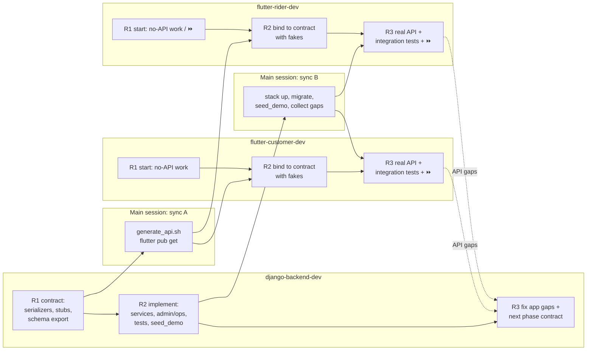

# Development Phases: Parallel Plan for Three Agents

This document says **how Phases 0–8 are built by three agents working at the same time**:

| Agent | Owns |
|-------|------|
| `django-backend-dev` | `backend/`, `infra/`, backend CI, `backend/openapi/schema.yaml` |
| `flutter-customer-dev` | `customer_app/`, plus the shared Flutter code in `packages/`: `jivo_core`, `jivo_api`, `tool/generate_api.sh`, the shared `analysis_options.yaml`, and the Flutter CI |
| `flutter-rider-dev` | `rider_app/` |

**Scope of this document:**
- **What it covers:** sequencing and coordination only. The *what* of each feature stays in the feature docs (`03`–`08`).
- **Phase tags are unchanged.** The `[P#]` tag on a feature remains the phase in which it is **accepted** at the gate.
- **What it does not replace:** the per-phase files in `docs/plan/` (task checklists, test cases `P<n>-TC-<nn>`, exit criteria, sign-off). Those files don't exist yet. See §8.
- **No dates or durations.** The docs give no basis for them.

---

## 1. Principles

### 1.1 The backend is the critical path
Every app feature needs an API, and only one agent builds the backend, so total time is roughly the backend's own work plus the integration tail at the end of each phase. "Fast" therefore means two things:
1. **The app agents never wait on the backend.** They always have work that doesn't need a finished API.
2. **The backend never does work that blocks on the apps.** App feedback is batched into one fix run per phase.

### 1.2 Contract first, fakes second, real API last
Each phase has three stages per agent:

| Stage | Backend | App agents |
|-------|---------|------------|
| **Start** (no dependency) | Define serializers, routes and stub views. Export `openapi/schema.yaml` with request/response examples. | Build UI, navigation, local state and device features that need no API. |
| **After the contract (S-A)** | Implement the internals, admin and ops screens, tests and seed data. | Bind screens to the generated `jivo_api` types through **fake repositories** that return the schema examples, marked `// TODO(api)`. |
| **After the backend is done (S-B)** | Fix the API gaps the apps reported. Publish the **next phase's contract** (pipelining, §1.4). | Swap fakes for the real API, then run integration tests against the local stack. |

Fakes are wired only through Riverpod provider overrides, in tests and the `dev` flavor. Once S-B passes, the `dev` flavor uses the real API, and the fakes stay only as test doubles.

### 1.3 Lookahead: build early, accept at the tagged gate
The feature docs leave idle capacity, and the plan uses it:
- **Rider app:** almost nothing from P2 to P4. Its features are tagged P5–P7 in `04 §4`.
- **Customer app:** light in P4, P6 and P7. In `03 §3` it has only 3, 2 and 3 screens in those phases.

Lookahead work (⏩ below) is built in an earlier phase against fakes or a contract preview, then accepted at the gate of its tagged phase. This is a sequencing change, not a scope change. Device-only work, such as permissions, the foreground service, the QR scanner and the offer ringtone, goes first because it needs no API at all.

### 1.4 Pipelining across phases
Once the backend finishes phase N (stage S-B), it publishes the **phase N+1 contract** while the apps are still integrating phase N and while N is in its gate (QA, demo). App agents therefore start phase N+1 already holding a contract.

- **Sign-off stays strictly sequential:** N+1 is never signed off before N.
- **The current gate takes priority.** P0 and P1 bugs found in phase N's gate preempt the backend's N+1 work. The single backend agent must never leave a gate blocked while it builds ahead.
- **Why this is allowed:** the overlap is the "exceptions written down" case in `10 §5.1`.
- **Conflict with the README:** `README.md` ("one phase at a time") doesn't mention this overlap. See §8.

### 1.5 Sync points are run boundaries
A subagent reports only when its run ends, so the main session cannot see "contract ready" in the middle of a run. Each agent's phase work is therefore split into short runs:



With pipelining (§1.4), the phase's contract usually already exists from the previous phase's backend R3, so the app agents can merge R1 and R2.

---

## 2. Overview matrix

⏩ marks lookahead work: built early and accepted at its tagged phase.

| Phase | Backend (critical path) | Customer app | Rider app |
|-------|------------------------|--------------|-----------|
| **0** Foundation | Django skeleton, compose stack, CI, first schema | **Shared scaffolding first**, then the app skeleton, generator and CI | App skeleton · ⏩ background-location spike |
| **1** Auth & users | OTP, JWT, users, addresses, staff roles, app config | **`jivo_core` session first**, then login, profile, addresses, app control | Login · ⏩ permissions gate, location module |
| **2** Stores, catalog, inventory | Serviceability, catalog, inventory, admin, seed · ⏩ P3 contract, rider contract preview* | Location, home, catalog, search | ⏩ registration, KYC, bank, status screens |
| **3** Cart & payments | Cart and pricing, coupons, orders T1–T5, Razorpay · ⏩ P4 contract | Cart, checkout, payments | ⏩ offer screen, task flow, pickup, OTP, COD |
| **4** Order processing | Transitions T6–T8a/T11/T12, packing console, refunds, invoices · ⏩ final P5 contract | Orders, cancel, reorder · ⏩ tracking UI, inbox UI | ⏩ earnings, cash, history; GPX test harness |
| **5** Rider & delivery | Delivery and dispatch in **4 slices** · ⏩ WS contract | Delivery OTP on order detail (polling) · ⏩ P7 screens | Integrate slice by slice |
| **6** Real-time | Channels, ETA, notifications | Live tracking, push, inbox | WS offers, inbox |
| **7** Dashboard & support | Dashboard, reports, support, CMS, Jivo Auth | Bind P7 screens · release prep | Support · release prep |
| **8** Hardening & launch | Security, load, restore, production | Store releases | Play review, device matrix |

\* This needs approval. See §7.

---

## 3. Phase by phase

Feature content is cited, not repeated. "Needs" lists the decisions from `11` that each phase depends on. Until Jivo confirms a decision, work continues on its recommended default.

### Phase 0: Foundation
**Goal:** the local stack runs, CI is green, and the schema → `jivo_api` pipeline works end to end.
**Needs:**
- D-05 (staging hosting)
- D-06 (package IDs; default `in.jivo.quick` / `in.jivo.rider`)
- D-13 (generate the client)
- D-18 (GitHub). The repo is not under git yet. `git init` is a user-approved step.
- D-19 (Firebase + Sentry)
- D-23 (unfold)

Long-lead items to start now (owned by Jivo): DLT, Razorpay, Play and Apple accounts, domains.

**Hard dependency:** the rider agent cannot create `rider_app` until the workspace root exists, so the customer agent runs a short **scaffold-only run first**. (Done 2026-11-02. Phase 0 was built as a `mobile/` pub workspace; at the user's request it was then moved to top-level `customer_app/`, `rider_app/` and `packages/` with path dependencies. See `02 §2.2`, `§3`.)

- **Backend.** Starts immediately and in parallel with the customer agent's scaffold run.
  - **Project skeleton** (`02 §3`):
    - settings split, Celery, beat and Channels wiring
    - `apps/core`: error envelope, pagination, client-info middleware
    - `apps/accounts` with the custom `User`, including the reserved `auth_id`, in the first migration
  - **Endpoints and admin:**
    - `/health/live` and `/health/ready`
    - drf-spectacular at `/api/schema/` and `/api/docs/`
    - django-unfold admin
  - **Local stack:** `infra/docker-compose.yml` and `infra/env/*.env.example`, the Dockerfile, and `uv` with pinned versions.
  - **Tooling and CI:** ruff/pytest config, a `seed_demo` skeleton, and backend CI (Postgres+PostGIS and Redis services, ruff, `makemigrations --check`, schema diff).
  - **First contract:** `GET /api/v1/config/app/` as a stub, which proves the pipeline. It's a tag change (§7).
- **Customer.**
  - **R0 (blocks the rider agent):** the workspace `mobile/pubspec.yaml` plus empty `packages/jivo_core` and `packages/jivo_api`.
  - **Afterwards:**
    - `jivo_core`: theme tokens, dio client with the client-info header interceptor, env/flavor config, error-envelope mapping skeleton, analytics wrapper (`03 §4`), Sentry init
    - `customer_app`: flavors `dev`/`staging`/`prod`, router, l10n ARB setup
    - Flutter CI, which iterates over the workspace so `rider_app` is picked up automatically
  - **After the backend's first schema export (S0-A):** the D-13 spike, then `tool/generate_api.sh` and a compiling `jivo_api`.
- **Rider.** Starts after the customer's R0.
  - `rider_app` skeleton: flavors, bootstrap, router, l10n.
  - ⏩ **Risk spike:** an Android foreground service with background location, plus a high-priority full-screen notification (needed for offers, `04 §2.4`, `§3`). Report what works on the emulator. Real-device testing is a human step (§6).
- **Exit:**
  - `docker compose -f infra/docker-compose.yml up` is healthy.
  - Both CIs are green.
  - The generated client compiles.
  - Both apps build the `dev` flavor and reach the backend on the local stack. They call `/health/live` until §7 row 1 is approved, then `config/app`.

### Phase 1: Auth & users
**Goal:** OTP login works on both apps, and staff log in with roles.
**Needs:**
- D-02 (SMS; use the console backend meanwhile)
- D-04 (decide only. Use staff session login now and integrate by P7.)
- D-15 (fixed-OTP test numbers on staging)

**Hard dependency:** rider login reuses the session/auth code in `jivo_core`, which the customer agent owns. The customer agent therefore builds it **first, as its own short run R1a**. That run's report is sync point **S1-core**.

- **Backend.**
  - **R1 contract:** the `06 §2.1` auth and account endpoints, the `06 §2.2` address endpoints, and the final `config/app`.
  - **R2:**
    - OTP rules (`09 §3.1`: hashed, limits, throttles), with SMS behind an interface plus a console backend and `send_otp_sms`
    - simplejwt rotation and blacklist
    - `Device`, `Address` (soft delete) and `StaffStoreAccess`
    - Groups per `05 §3`, staff session login with throttling
    - Admin: Users & roles, Customers (basic), CMS app config
    - `anonymise_deleted_accounts`
    - `seed_demo`: staff per role, a test customer and fixed-OTP phones
    - IDOR tests on addresses
- **Customer.**
  - **R1a (session only):** the `jivo_core` session: secure storage, refresh once on 401, logout on refresh failure, and the `426` handler. The run ends when the session works, which marks S1-core.
  - **Start (next run):** splash, onboarding, login and OTP UI, SMS Retriever autofill, +91 validation, consent.
  - **After S1-A:**
    - the screens in `03 §2.1`, `§2.2` and `§2.11`
    - basic addresses (no map) per `03 §2.4`
    - logout and delete account, offline banner
  - **After S1-B:** an integration test of the login flow.
- **Rider.**
  - **Start:**
    - ⏩ the permissions gate (`04 §2.1`: prominent disclosure, "Allow all the time", notifications, battery exemption, GPS, OEM auto-start guidance)
    - ⏩ the location module (`04 §3`): service lifecycle tied to online state, batching, offline buffer, server-provided intervals. It uses a fake uploader and has unit tests.
  - **After S1-core and S1-A:**
    - login and OTP with `X-App-Name: rider`
    - force update and maintenance
    - routing by `rider_status`, with a placeholder screen when no profile exists (see §8, item 1)
  - **After S1-B:** an integration test of the login flow.

### Phase 2: Stores, catalog, inventory, home
**Goal:** a customer picks a location, sees whether it is serviceable, and browses the store's catalog with live stock.
**Needs:** D-03 (Google Maps), D-08 (1–2 stores), D-17 (CSV format), D-21 (sample of ~20 products).

- **Backend.**
  - **R1 contract:** the `06 §2.3` and `§2.4` endpoints (taking `X-Store-Id`).
  - **R2:**
    - stores with polygons and timings, PostGIS serviceability (p95 < 150 ms, `09 §1`), notify-me
    - catalog with the FSSAI / Legal Metrology attributes (`09 §4`), upload validation and thumbnails (`09 §3.6`)
    - inventory with DB constraints and `StockMovement`, CSV import/export
    - per-store Redis caching, query-count tests
    - the P2 admin modules in `05 §2`
    - `seed_demo` (`10 §3`)
  - **R3:** ⏩ the **rider contract preview** (§7, needs approval), and the P3 contract.
- **Customer.**
  - **Start:**
    - the product tile and ADD stepper behind a `CartRepository` interface, with a fake until P3
    - home, category and product list layouts
    - search UI (300 ms debounce, local recent searches)
    - location permission and the map pin picker (device only)
  - **After S2-A:**
    - the screens in `03 §2.3`–`§2.7`
    - the map address form
    - sending `X-Store-Id` on catalog and cart calls
    - the store-closed banner
  - **After S2-B:** real API, plus an integration test of browsing. The add-to-cart half moves to P3 (§8, item 2).
- **Rider.**
  - ⏩ registration, document upload (camera or gallery, compressed to ≤ 1 MB), bank details and approval status (`04 §2.2`), all with fakes.
  - Bind to the generated types once the preview lands. If the preview is not approved, bind at the end of P4 (see §7).

### Phase 3: Cart, checkout, payments
**Goal:** a customer places a COD order and a Razorpay test-mode order, and the money is correct.
**Needs:** D-01 (Razorpay test keys; a long-lead item), D-09 (business rule values).

- **Backend.**
  - **R1 contract:** the `06 §2.5` endpoints, plus `POST /orders/`, verify, retry-payment, the webhook and the active-order list (`06 §2.6`).
  - **R2:**
    - `compute_bill` (`08 §6.2`) with `PRICE_CHANGED`
    - coupons with holds
    - `place_order` for T1/T2 with reservations (`08 §6.1`) and `Idempotency-Key`
    - `transition()` with T1–T5 and T3a
    - Razorpay behind an interface with a fake backend, signature checks, idempotent webhooks
    - `expire_unpaid_orders`
    - admin: pricing config, coupons, payments
    - coverage ≥ 90% on the cart, payments and inventory services
  - **R3:** ⏩ the P4 contract.
- **Customer.**
  - **Start:**
    - cart, bill breakdown (rendering the server's bill), coupon sheet, tip and instructions chips
    - payment method, success and failure screens
    - `razorpay_flutter` wiring
  - **After S3-A:**
    - the `03 §2.8` and `§2.9` flows
    - `Idempotency-Key` and double-tap protection
    - `PRICE_CHANGED` / `STOCK_UNAVAILABLE` handling
    - recovering a `PAYMENT_PENDING` order on launch
    - the real server cart behind the P2 stepper
  - **After S3-B:** integration tests for browse plus add to cart, and checkout with COD and a test payment.
- **Rider.** ⏩ All with fakes, with the unit and widget tests from the rider agent's definition of done:
  - the full-screen offer (`04 §2.4`; countdown from `expires_at`; `OFFER_EXPIRED` / `OFFER_TAKEN` / withdrawn)
  - a task-flow controller covering every state in `08 §3`, which restores its step from `rider/tasks/current/`
  - pickup with QR scan or the 4-character code
  - delivery OTP with lock
  - the COD screen
  - failed delivery with the 10-minute timer

### Phase 4: Order processing & store ops
**Goal:** the store accepts, packs and cancels orders, refunds and invoices work, and customers see their orders.
**Needs:** D-10 (refund policy), D-12 (GST details), D-22 (store hardware for the pilot).

- **Backend.**
  - **R1 contract:** the order list, detail, cancel, reorder and invoice endpoints (`06 §2.6`).
  - **R2:**
    - transitions T6, T7, T8, T8a, T11 and T12, with partial unavailability (`08 §6.3`)
    - `process_refund` and `sync_refund_status`
    - invoices with WeasyPrint (on demand; on DELIVERED from P5)
    - auto-accept and the acceptance SLA alert
    - Ops Console: the **packing console** (`05 §1.3`, except returns) and the live board with HTMX polling (`05 §1.2`)
    - admin: orders, customer detail, refunds, audit log
    - role-matrix tests (`05 §3`)
  - **R3:** ⏩ the **final P5 contract**, built out from the preview if it was approved, otherwise written from scratch.
- **Customer.**
  - **After S4-A:** order list, order detail with timeline and invoice download, the cancel sheet with refund info, reorder, and the "previously bought" rail (`03 §2.10`, `§2.5`).
  - **After S4-B:** an integration test of cancelling an order.
  - ⏩ **Lookahead:**
    - the live tracking screen UI with fake track data
    - the notification inbox UI
    - the go_router deep-link routes
- **Rider.**
  - ⏩ earnings, cash ledger, history, payouts, profile and documents (`04 §2.7`–`§2.9`)
  - ⏩ an integration-test harness that drives accept → deliver with a mock location or GPX route against fakes
  - Bind every rider fake to the final P5 contract when the backend's R3 lands.
- **Gate extra:** a mini-UAT with store staff on the packing console (`10 §7`).

### Phase 5: Rider app & delivery
**Goal:** an order is delivered end to end: dispatch → accept → pickup → OTP → COD, with returns.
**Needs:**
- D-07 (Android only)
- D-11 (Play Console; the background-location declaration)
- D-14 (KYC policy)
- D-16 (rider pay)

The rider contract already exists, so no agent waits at the start of this phase. The backend implements it in **four slices**, and the rider agent integrates each slice while the backend builds the next. This turns the heaviest phase into a pipeline.

| Slice | Backend run | Rider integrates (next run) |
|-------|-------------|-----------------------------|
| 5.1 | Registration, KYC (private bucket, encrypted numbers), bank, admin approval | Onboarding and status screens |
| 5.2 | Shifts and guards, location ingestion (Redis latest + history), heartbeat auto-offline, `simulate_rider` | Online toggle with the real foreground service |
| 5.3 | Dispatch (`08 §5`), offers and `expire_offer`, tasks with T9/T10/T13/T14 and geofences, delivery OTP, FCM sender interface, `GET /orders/{id}/track/` (polling) | Offers (FCM + polling), the whole task flow |
| 5.4 | Cash ledger and `cod-qr`, earnings, payouts admin. Ops: rider map with polling (`05 §1.4`), cash deposits (`05 §1.5`), receiving returns. Invoices on DELIVERED. ⏩ the WS contract (§3, Phase 6) | Cash, earnings, history. Integration test accept → deliver with GPX. |

- **Customer.**
  - Show the rider and the **delivery OTP on order detail** by polling `track/`. Without this, the P5 end-to-end delivery cannot run (§7).
  - Register the FCM token via `/me/devices/`.
  - ⏩ the P7 screens with fakes: rating, help/FAQ/tickets, CMS page viewer.
- **Gate extra:** a mini-UAT with riders (`10 §7`). The Play background-location video is a human step (§6).

### Phase 6: Real-time tracking & notifications
**Goal:** live tracking within 5 s, push for every event in `08 §9`, and live ops screens.
**Needs:** D-11 (Apple account for TestFlight), D-19 (FCM projects).

**WebSocket contract:** OpenAPI does not describe socket messages. In this phase's contract run, which happens in P5's slice 5.4, the backend adds **JSON payload examples for every message type** in `06 §4`, next to the inbox endpoints in the schema. The app agents build against those examples.

- **Backend.**
  - the `realtime` app with the consumers in `06 §4` and socket auth (first message or subprotocol for JWT; session for staff)
  - `broadcast_ws`, rider-location fan-out, ETA (`08 §8`)
  - notification templates and `send_push` / `send_sms` with retries, mapped per `08 §9`
  - inbox endpoints, `purge_old_locations`
  - the ops board and rider map go live (polling stays as the fallback)
  - `WebsocketCommunicator` tests
- **Customer.**
  - bind the P4 tracking UI to WS with a 10 s polling fallback
  - FCM and local notifications, deep links (`03 §2.12`)
  - bind the inbox
  - an integration test of tracking updates using `simulate_rider`
- **Rider.**
  - `/ws/v1/rider/` for `offer.*` and `task.updated`, with polling and FCM as fallbacks
  - the inbox
  - check offer latency (< 3 s, `09 §1`)

### Phase 7: Dashboard, promotions, support, reports
**Goal:** ops and finance have their dashboard, reports and support tools, and the legal pages are live.
**Needs:**
- D-04 (Jivo Auth: integrate now with the `integrate-jivo-auth` skill)
- D-20 (support contacts, grievance officer)
- the legal pages (a long-lead item)

- **Backend:**
  - the dashboard and alerts panel (`05 §1.1`)
  - reports and exports, with Celery for exports over 10k rows (`05 §4`)
  - ratings, support tickets and FAQs, CMS pages
  - notification campaigns
  - `reconcile_payments`, `daily_reports_email`, payout batches
  - Jivo Auth for staff
- **Customer:**
  - bind the P7 screens built in P5 (`03 §2.10` rate, `§2.11` help, legal, grievance officer)
  - Phase 8 prep: release config (`--obfuscate --split-debug-info`), size budget, cold-start profiling (`09 §1`)
- **Rider:**
  - support, FAQ and tickets (`04 §2.9`)
  - Phase 8 prep: release config, battery and memory profiling

### Phase 8: Hardening & launch
**Goal:** production go-live after the pilot and UAT. Each agent hardens its own area in parallel.
**Needs:**
- D-05 (production)
- D-15 (the reviewer account)
- every long-lead item in `11 §2`, which must be complete

- **Backend:**
  - OWASP API Top 10 review and fixes
  - a Locust load test (50 orders/min, 500 sessions)
  - `check --deploy` and `pip-audit`
  - a **backup restore test**
  - production infrastructure, alerts and metrics (`09 §2`, `§5`)
- **Customer:** device and network matrix (`10 §4`), Android release, iOS submission (§6).
- **Rider:** low-end and aggressive-OEM device runs, the Play background-location review, the release build.
- **Joint:** a pilot with real orders and UAT sign-off (`10 §7`).

---

## 4. Coordination rules (avoid collisions)

| Resource | Rule |
|----------|------|
| Directories | Ownership is as in `.claude/agents/*.md`, with no overlap. No agent edits another agent's tree. |
| `backend/openapi/schema.yaml` | Written only by the backend agent. |
| `packages/jivo_api` | Regenerated **once per sync point, by one actor**: the main session, or the customer agent when it is the only mobile agent running. App agents never run `generate_api.sh` during a parallel run. |
| Lockfiles | Each app and package has its own `pubspec.lock` (no pub workspace), so the two app agents no longer race on a shared lockfile. After `packages/` changes (e.g. `jivo_api` regenerated), the main session runs `flutter pub get` in both apps at the sync point. CI checks that both apps resolve the same versions of shared libraries. |
| `jivo_core` | Owned by the customer agent, and changes are additive only. During parallel runs, the rider agent puts candidate shared code in `rider_app` and proposes moving it. The customer agent promotes it at phase end, after which the rider agent switches imports. |
| Local stack (`infra/docker-compose.yml`) | Owned by the backend agent. Only the backend agent (or the main session at a sync point) runs migrations and `seed_demo`. App agents use the stack and never restart or reset it. |
| Phase checklists (`docs/plan/phase-N-*.md`) | Each agent ticks only items in its own area (BE/ADM, CUS or RID). |
| Feature docs | Backend: `05`–`07`. Customer: `03`. Rider: `04`. `08-order-lifecycle.md` changes only with approval from the user or the main session, because all three agents depend on it. |
| API gaps | App agents list them precisely in their report (endpoint, request, response). The main session batches them into the backend's R3. The backend never waits on the apps. |
| Git / isolation | Don't use worktree isolation: the tracks consume each other's outputs (schema → `jivo_api`, `jivo_core`), and ownership is disjoint, so one shared tree is safe. No agent commits unless asked. |

---

## 5. Running a phase from the main session

1. **Before the phase:**
   - Check the phase's "Needs" against `11`, and use the defaults where decisions are open.
   - Confirm the previous phase is signed off, or that the overlap exception (§1.4) applies.
2. **Kickoff:** launch all three agents **in one message** so they run concurrently, each with the brief below.
   - The backend starts with R1 (contract) unless the contract was already published in the previous phase.
   - The app agents start with their "Start" and ⏩ items.
   - **Two exceptions:**
     - **Phase 0:** launch only backend R1 and the customer agent's scaffold-only R0. Launch the rider agent after R0 reports.
     - **Phase 1:** launch backend R1, the rider agent's ⏩ items, and a short customer run R1a (the `jivo_core` session only). Rider login starts only after R1a reports (S1-core).
3. **Sync A** (backend R1 done):
   - run `packages/tool/generate_api.sh`, then `flutter pub get` in `customer_app/` and `rider_app/`
   - continue the backend agent with `SendMessage` for R2
   - continue each app agent with `SendMessage` (this keeps its context) for R2
4. **Sync B** (backend R2 done):
   - bring the stack up, migrate and seed
   - continue the app agents for R3 (real API, integration tests, ⏩)
   - collect API gaps from all the reports
5. **Backend R3:** gap fixes plus the next phase's contract. Regenerate `jivo_api` once more if it changed.
6. **Gate (`10 §5`):** CI green, then the human steps in §6, then sign-off. The next phase's kickoff can start once step 5 is done.

**Brief template.** The agents' own rules forbid fakes and out-of-phase work unless the brief explicitly allows them, so always state the allowances:

```
Phase <N>, run R<1|2|3> for <agent>.
Scope: docs/development-phase.md §3 "Phase <N>", your section, the <Start | After S-A | After S-B> items.
Authorised early work (lookahead): <list ⏩ items>. These are accepted at their tagged phase gate; do not tick their checklist items yet.
Fakes: <allowed | not allowed>. If allowed, implement the repository interface with schema examples, mark // TODO(api), and wire them only via provider overrides in tests and the dev flavor.
Contract: backend/openapi/schema.yaml as of <sync point>; jivo_api is already regenerated. Do NOT run generate_api.sh or edit jivo_api.
Shared files: follow docs/development-phase.md §4.
Report: what you built, test command output, jivo_core changes proposed, API gaps (endpoint + request + response), deviations.
```

---

## 6. Steps that need a human (not agent work)

- **Real-device testing** of background location, battery behaviour and OEM quirks (`04 §3`, `10 §4`), from P0 onwards. Also the Play background-location **declaration video** (D-11).
- **iOS builds and TestFlight/App Store.** This dev machine runs Linux, so iOS needs a Mac with Xcode.
- **Third-party keys and accounts:** Razorpay, Maps, Firebase, SMS/DLT, Play, Apple (`11 §2`).
- **The gate itself:** staging deploy, QA execution of the test cases, the demo to Jivo, sign-off, and the `phase-N-done` tag (`10 §5`).
- **`git init`** and choosing code hosting (D-18).

---

## 7. Proposed doc changes (need approval)

This plan relies on these changes. Until they are approved, each row's fallback applies.

| # | Change | Current docs | Proposal | Fallback if not approved |
|---|--------|--------------|----------|--------------------------|
| 1 | `GET /api/v1/config/app/` contract | P1 (`06 §2.1`) | Stub in P0, implemented in P1 | Prove the pipeline in P0 with any minimal endpoint |
| 2 | Rider contract preview | P5 | In P2's backend R3, add every `06 §3` endpoint as serializers plus stub views returning `501` | The rider agent builds against hand-written domain models from `06 §3` and binds at P4 R3. That risks more drift. |
| 3 | New error code `NOT_IMPLEMENTED` (501) | Not in `06 §6` | Add it, used only by preview stubs | Not needed without row 2 |
| 4 | `GET /orders/{id}/track/` (polling) | Live tracking is P6 (`03 §2.10`) | Polling endpoint plus the OTP on order detail in **P5**. Live WS stays in P6. | The P5 end-to-end test uses the OTP from `seed_demo` or the admin view |
| 5 | Phase overlap | `README.md`: one phase at a time | Next-phase contract and ⏩ work run during the current gate. Sign-off stays sequential (`10 §5.1` exception). | Strict sequence. The app agents lose the head start. |
| 6 | WS payload examples | `06 §4` lists message types only | Add a JSON example per message type in P5's slice 5.4 | The apps wait for backend R2 in P6 |

---

## 8. Inconsistencies found while writing this plan (unresolved)

1. **Rider login.** *(Settled in Phase 1: any phone can log in, and `rider_status` routes the rider app. `02 §6` was updated.)*
   - `02 §6` says rider login is allowed only if a rider profile exists.
   - `04 §1` and `06 §3` (`/rider/register/` for "any logged-in user") let a user with no profile log in and register.
   - This plan assumes the second reading. Confirm and fix `02 §6`.
2. **Add-to-cart test.** `10 §6` puts the "browse + add to cart" integration test in P2, but the server cart is P3 (`06 §2.5`). This plan splits the test across P2 and P3.
3. **Delivery OTP in P5.** A P5 end-to-end delivery needs the customer to read the delivery OTP, but tracking and push are P6. See §7, row 4.
4. **One phase at a time.** `README.md` says work happens one phase at a time. §1.4 depends on the `10 §5.1` exception.
5. **Missing phase files.** `docs/plan/` (the roadmap and phase files) is still missing. This document does not replace them. Each phase file still needs its task checklist, test cases, exit criteria, demo script and sign-off.
6. **Not linked yet.** `README.md` does not link to this document.
