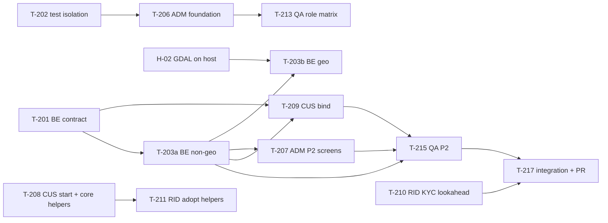

# Central Task Tracker

**Only the main session (Project Manager) edits this file.** Agents report in the [`development-phase.md`](development-phase.md) §9.3 format, and the PM updates the tracker after every report, so several agents never write one file at the same time.

**Statuses:**
- **Not Started**
- **In Progress**
- **Blocked**
- **In Review:** the PM is reviewing a module branch before merging it to `develop`.
- **Testing:** QA is verifying.
- **Completed:** only after QA has verified it. An agent's own report is never enough.

**Priority:** P0 critical path · P1 needed this phase · P2 nice to have.

**Owners:**
- `BE` = `django-backend-dev`
- `ADM` = `admin-panel-dev`
- `CUS` = `flutter-customer-dev`
- `RID` = `flutter-rider-dev`
- `QA` = `qa-engineer`
- `DEVOPS` = `devops-engineer`, `REVIEW` = `code-reviewer`, `CATALOG` = `catalog-data`, `DESIGN` = `ui-designer`
- `PM` = the main session
- `USER` = you or Jivo

Last updated: 2026-11-04 (P4 backend and customer merged, migrations applied; Phase 5 started, DL-54).

## Phase 1: built, awaiting QA verification
| ID | Task | Owner | Pri | Deliverables | Acceptance criteria | Status |
|----|------|-------|-----|--------------|---------------------|--------|
| T-101 | P1 backend: OTP auth, JWT, `me`, devices, addresses, deletion, config 426/503, staff roles, lockout | BE | P0 | `apps/accounts`, `apps/cms`, `apps/notifications` | 318 tests green; QA verifies the API, security and DB | Testing: QA found 7 bugs (B-items below); P2 bugs block sign-off |
| T-102 | P1 `jivo_core` session layer | CUS | P0 | Session manager, refresh interceptor, app-control signals | 75 tests green; QA verifies | Testing |
| T-103 | P1 customer app: login, profile, addresses, delete account | CUS | P0 | `customer_app` P1 screens | 62 tests and the real-API itest green; QA functional check | Testing |
| T-104 | P1 rider app: login, routing by status | RID | P0 | `rider_app` P1 screens | 112 tests and the real-API itest green; QA functional check | Testing |

## Phase 6: Real-time & notifications (started in part 2026-11-04, DL-55)
| ID | Task | Owner | Pri | Depends on | Deliverables | Acceptance criteria | Status |
|----|------|-------|-----|-----------|--------------|---------------------|--------|
| T-611 | WS contract examples (`06 §4`) + inbox API; `realtime` app (order/ops consumers, first-message JWT, `broadcast_ws`); `notifications` (`08 §9` templates, `send_push` no-op until D-19, `send_sms`, retries); purge jobs | BE | P0 | – | Apps, migrations, tests | `WebsocketCommunicator` tests; IDOR/scoping | In Progress (`backend/phase-6`, `.worktrees/backend6`) |
| T-612 | Rider location fan-out, ETA (`08 §8`), rider socket `offer.*`/`task.updated` | BE | P0 | T-611, P5 5.3 | – | Offer latency < 3 s | Not Started |
| T-613 | Customer: tracking over WS with polling fallback, inbox bind, FCM adapter (D-19) | CUS | P0 | T-611 | – | Tests green | Not Started |
| T-614 | Rider: `/ws/v1/rider/` with polling and FCM fallback, inbox | RID | P0 | T-612 | – | – | Not Started |
| T-711 | ⏩ P7 lookahead: support tickets, FAQs, CMS pages API | BE | P1 | – | `cms` and `support` apps | IDOR tests | In Progress (`backend/p7-support`) |

## Phase 5: Rider & delivery (started 2026-11-04, DL-54)
| ID | Task | Owner | Pri | Depends on | Deliverables | Acceptance criteria | Status |
|----|------|-------|-----|-----------|--------------|---------------------|--------|
| T-511 | Final P5 rider contract (`06 §3`) + `GET /orders/{id}/track/`; answers to api-requests #2–#28 | BE | P0 | – | Serializers, routes, examples, schema | Additive; schema re-exported | Testing (contract exported; jivo_api generated into the rider and customer worktrees; full run, then review) |
| T-512 | Slice 5.1: registration, KYC (private bucket, masked/encrypted numbers), bank, admin approval services | BE | P0 | T-511 | Models, services, migrations, tests | D-14 defaults; DPDP | In Progress |
| T-513 | Slice 5.2: shifts, location ingestion, heartbeat auto-offline, `simulate_rider` | BE | P0 | T-512 | Services, tasks | – | Not Started |
| T-514 | Slices 5.3/5.4: dispatch, offers, T9–T14, delivery OTP, cash ledger, earnings (D-16 defaults), payouts; invoices on DELIVERED | BE | P0 | T-513 | – | `08` exactly | Not Started |
| T-515 | Rider P5: foreground location service, background-location disclosure, FCM plumbing; bind slices 5.1–5.4 | RID | P0 | T-511 | – | Tests green | In Progress (`rider/phase-5`) |
| T-516 | Customer P5: FCM token, rider + delivery OTP via `track/`; ⏩ P7 rating/help/CMS on fakes | CUS | P0 | T-511 | – | Tests green | Testing (run 1 merged `efd4a1f`; tracking bound to track/ `1da5991`, merges with the P5 backend) |
| T-517 | Admin P5: riders, KYC review, rider map, cash deposits, returns | ADM | P0 | T-512 | – | Role matrix | Not Started (after admin P4 merge and slice 5.1) |
| T-518 | QA P5 + rider mini-UAT | QA | P0 | T-514 | – | P5 verdict | Not Started |

## Phase 4: Order processing & store ops (started 2026-11-04, DL-47)
| ID | Task | Owner | Pri | Depends on | Deliverables | Acceptance criteria | Status |
|----|------|-------|-----|-----------|--------------|---------------------|--------|
| T-411 | P4 R1 contract: order list, detail, cancel, reorder, invoice (`06 §2.6`) | BE | P0 | – | Serializers, routes, examples, schema | Additive; schema re-exported | Completed (merged `ef4199f`) |
| T-412 | P4 R2: T6–T8a/T11/T12 with partial unavailability, cancel window, refunds (`08 §6.4` defaults), `sync_refund_status`, invoices (WeasyPrint, placeholder GST), auto-accept + SLA alert, packing services; carry-overs T-401c..T-403c, T-405c, T-406c | BE | P0 | T-411 | Services, migrations, tasks, tests | `08` exactly; coverage ≥ 90% on services | Testing (merged `ef4199f`, migrations applied DL-53; 2427 passed / 96.92%; review fixes applied; open: placement gateway call under the cart lock, OBS-P3-05 → T-409c) |
| T-413 | P4 admin + Ops Console: live board (HTMX polling), packing console (`05 §1.3`), customer detail, audit log, refund retry screen; T-304 coupon-form minors | ADM | P0 | T-412 services | Admin/ops screens and tests | Role matrix; state changes only via services | In Progress (`admin/phase-4`) |
| T-414 | Customer P4: order list/detail/timeline, invoice download, cancel sheet, reorder, previously-bought rail; lookahead tracking, inbox, deep links | CUS | P0 | T-411 | Screens on fakes, then real API | No client-side money; tests green | Testing (merged `74f47d1`; 295 tests; installed on the user's phone) |
| T-415 | Rider P4 lookahead: gaps in `04 §2.7–2.9` (documents), accept→deliver integration harness with GPX | RID | P1 | – | Screens and harness on fakes | Tests green | Testing (merged; review: Approve; 351 tests; API requests #25-#27; P5 follow-ups: guard `/profile/documents/:type` for approved docs, share the dev-tools and support-phone helpers) |
| T-416 | QA: P4 test plan and verification; mini-UAT with store staff | QA | P0 | T-412, T-413 | P4 reports | P4 readiness verdict | In Progress (plan and 60 cases plus UAT-P4-01..13 merged `69fe035`; execution after the backend R2 and admin merges) |

## Phase 3: Cart, checkout, payments (started 2026-11-03, DL-42)
| ID | Task | Owner | Pri | Depends on | Deliverables | Acceptance criteria | Status |
|----|------|-------|-----|-----------|--------------|---------------------|--------|
| T-301 | P3 API contract (R1): `06 §2.5` cart and coupons, P3 rows of `§2.6` (orders, verify, retry, webhook, active orders); apps `cart`, `promotions`, `orders`, `payments`; fake-gateway scheme | BE | P0 | – | Serializers, routes, examples, schema | Schema validates with no warnings; examples for every error code; deployed settings refuse the fake gateway | Testing (merged to `develop` in `cd5e53e`; review Approve with fixes: 1 Major (non-ASCII webhook signature 500) + 2 Minor + 1 Nit, sent to R2a; `jivo_api` regenerated `48aaddd`) |
| T-302 | P3 R2a: models and migrations (pricing config, coupons, cart, orders, payments), `compute_bill`, cart | BE | P0 | T-301 | Models, `compute_bill` (`08 §6.2`), cart API | D-09 defaults; thresholds before coupon; coverage ≥ 90% on cart | Testing (merged `c4ff7d9`; review Approve with fixes, no Blocker, 3 Major sent to R2b; 12 migrations + `seed_demo` applied to the shared DB on 2026-11-03 with the user's approval (only GGN-01's all-zero pricing changed); live cart smoke-tested on :8001; `jivo_api` regenerated `fcd4e7a`) |
| T-303 | P3 R2b: `place_order` with reservations and `Idempotency-Key`, `transition()` T1–T5 + T3a, Razorpay verify, webhook, retry, `expire_unpaid_orders`; BUG-0008 fix | BE | P0 | T-302 | Services, tasks, tests | `08` exactly; coverage ≥ 90% on payments and inventory; retry-payment rejects PAID or expired orders (server time is authoritative; from the T-305 review) | Testing (review fixes merged `476dfd5`: refund webhook never lost, lookup-first refund guard; 2300 passed / 97.27%; follow-up running: bound the webhook 503 by refund age, refunds list count=100) |
| T-304 | P3 admin: pricing config, coupons, read-only orders and payments, `cod_blocked` | ADM | P1 | T-302 (models) | `admin.py` for the P3 apps | Role matrix; state changes only through services | Testing (merged `984e634`; review: Approve with fixes, minors in T-405c..T-407c; QA stage 2 checks the role rows) |
| T-305 | Customer P3 Start: cart, bill breakdown (server bill), coupon sheet, tip and instructions, payment method, success/failure, `PaymentLauncher` + `razorpay_flutter` (dev fake launcher) | CUS | P0 | – | Screens with fakes | Widget tests; no client-side money; fakes only in tests and dev; R8 release build works | Testing (merged to `develop` in `9dbe11c`; both reviews' findings fixed; device launch check passed 2026-11-03: 0 FATAL) |
| T-306 | Customer P3 after S3-A/S3-B: real API, `Idempotency-Key`, `PRICE_CHANGED`/`STOCK_UNAVAILABLE`, `PAYMENT_PENDING` recovery, server cart behind the stepper, integration tests | CUS | P0 | T-301, T-303 | Real repositories, integration tests | COD and test-payment checkout pass on the phone | Testing (P3-TC-64 passed on the user's phone 2026-11-04: COD JV-261104-000135 PLACED/COD_PENDING, online JV-261104-000136 PLACED/PAID, no 5xx, no crashes) |
| T-307 | Review of T-225 (incl. the unreviewed `b6b6eff`) and of each P3 module branch before merge | REVIEW | P0 | each run | Review verdicts | No Blockers before merge | In Progress (T-225/T-211: Approve with fixes, all fixed, merged; open for CUS: add jivo_core `isVersionBelow` tests for build suffix and short versions) |
| T-308 | Twilio SMS backend for OTP (`TwilioSmsBackend`, settings, system check, no secrets in logs) at the user's request; production gateway stays D-02 | BE | P1 | – | Backend, tests, `.env.example` | Test numbers send no SMS; live OTP on the user's phone | Testing (merged `88692a1`; review fixes applied. Live SMS off: the Twilio trial account only allows predefined templates (error 572006). User chose to skip real SMS for now; console backend on :8001) |
| T-309 | New Windows dev machine: worktrees, native Redis 6380, :8001, Celery worker + beat (separate processes: no `-B` on Windows), `C:\dev\flutter` junction (space in the user path breaks native-asset hooks) | PM | P0 | – | Running stack | API ready check OK | Completed (2026-11-04; MinIO/Mailpit not running: no Docker) |
| T-310 | QA: verify P3 | QA | P0 | T-303, T-304, T-306 | P3 test plan, black-box suite, verdict | P3 readiness verdict | Completed (QA verdict: ready for sign-off; 66/69 pass, 0 fail; refund re-check passed `69fe035`; P3-TC-64 passed on the phone; formal gate = CI on the develop -> main PR, waiting on the GitHub login) |

### Phase 4 carry-overs from the P3 reviews
| ID | Item | Owner | Status |
|----|------|-------|--------|
| T-401c | Ops view for FAILED/PENDING refunds with manual retry (R2b review M2) | BE + ADM | Not Started |
| T-402c | `payment_status` for mismatch/duplicate refunds; cap total refunds ≤ captured before partial refunds (R2b review Minor 7) | BE | Not Started |
| T-403c | Gateway calls outside row locks; `skip_locked`/task lock on `expire_unpaid_orders` (R2b review Minors 6, 8) | BE | Not Started |
| T-404c | Mirror new env vars (`CART_MAX_TIP`, `PAYMENT_GATEWAY`, `RAZORPAY_*`, `ORDERS_CREATE_RATE`, `PAYMENTS_RATE`, `RAZORPAY_TIMEOUT_SECONDS`) into `infra/env/backend.env.example`; Celery beat in every environment; Razorpay webhook config on staging; CI check for the Razorpay native pins | DEVOPS | Completed (merged 2026-11-04) |
| T-405c | Move `set_cod_blocked` from `accounts/admin.py` into an `accounts` service and have the admin call it (T-304 review Minor 1) | BE + ADM | Not Started |
| T-406c | `PricingConfig` sanity bounds and cross-field checks; coupon edits guarded against live usage (limit below uses, code rename once used); catch the code-uniqueness race (T-304 review Minors 2-4) | BE + ADM | Not Started |
| T-407c | Confirm Store Staff `ORDER_VIEW` against `05 §3` in the P4 role refinement (T-304 review Minor 5) | PM | Not Started |
| T-408c | `pytest-xdist` for the backend suite (single-threaded runs against the remote DB take 40+ min) | BE + DevOps | Completed (merged 2026-11-04) |

## Phase 2: Stores, catalog, inventory, home
| ID | Task | Owner | Pri | Depends on | Deliverables | Acceptance criteria | Status |
|----|------|-------|-----|-----------|--------------|---------------------|--------|
| T-201 | P2 API contract | BE | P0 | – | Serializers, routes and examples for serviceability, notify-me, home, categories, products, search, suggest, collections (`X-Store-Id`); `Address.is_serviceable`; schema re-exported | Schema validates with no warnings; examples for every error code; existing tests green | Testing (PM reviewed: 9 operations, 407 tests green; QA to verify in T-215) |
| T-202 | Test isolation env vars | BE | P0 | – | `POSTGRES_TEST_DB` (guarded) and `TEST_REDIS_DB` | The admin agent's tests run in parallel without collisions | Testing (guarded prefix; tested in `tests/test_wiring.py`) |
| T-203a | P2 internals, non-geo (R2a) [code review: Approve with fixes; 3 Major (Unicode-digit 500, `stores_for` over-grant, override > MRP) + 4 Minor sent to BE]: catalog, inventory and services, non-geo stores, `StaffStoreAccess`, caching, seed | BE | P0 | T-201 | Models, migrations, services, catalog API, `seed_demo` (~20 products) | `08 §6` stock rules; query-count tests; coverage ≥ 80% (inventory ≥ 90%) | Testing (merged in `0b801d1`/`96a2117` with the code-review fixes; QA run 2 verifying) |
| T-203b | P2 geo (R2b): `DarkStore` location and MultiPolygon area, serviceability query, `Address` → PointField migration, `is_serviceable` | BE | P0 | T-203a, H-02 | GeoDjango engine switch, migrations, serviceability service | Serviceability p95 < 150 ms; backward-compatible address migration | Testing (merged in `0b801d1`; QA run 2 verifying) |
| T-204 | ER diagram update | BE | P1 | – | `07 §1` mermaid with the P1 entities (`OTPRequest`, `AppConfig`, `AppVersionPolicy`) | Diagram matches the models | Not Started |
| T-205 | Address PATCH can clear the receiver name and phone | BE | P2 | – | Null or clear semantics in the contract | The CUS form can reset to "the user's own" | Not Started |
| T-206 | Admin architecture + `/ops/` foundation + P1 admin polish | ADM | P0 | T-202 (tests) | `docs/admin-panel-architecture.md`, `config/admin_ui.py`, `ops_console` app, components, real-data dashboard, role tests | 05 §3 matrix tests per role; no fake KPIs; vendored JS pinned | In Review (code review: Approve with fixes, 2 Major + 4 Minor/Nit, folded into the T-207 run) |
| T-207 | P2 admin screens: stores (map polygon), categories, products/variants/images, collections, banners, inventory, serviceability leads | ADM | P0 | T-203a (polygon widget: T-203b) | `admin.py` for the P2 apps, inventory adjustments through the service | Role matrix; stock changes only through the service; CSV import/export | Testing (merged `28a3433` with follow-up `74b453e`; QA run 2 verifying, incl. the role matrix) |
| T-208 | Customer P2 start: tile and stepper, home/catalog/product/search/collection layouts, map picker, not-serviceable screen; promote rider helpers into `jivo_core` | CUS | P0 | – | Screens with fakes; `jivo_core` helpers | Widget tests; no client-side money; works without a Maps key | Testing (merged `2274875`; Mappls launch-crash fix `746288c`) |
| T-209 | Customer binds P2 to the real contract and API | CUS | P0 | T-201, T-203 | Generated types and real repositories | Real-API integration test: browse | Testing (merged `2274875`; `jivo_api` regenerated from the close-out schema `4d6f5fa`) |
| T-210 | Rider lookahead: registration, KYC (≤ 1 MB), bank details, status | RID | P1 | – | Screens and local models with fakes | Tests; masking; accepted at the P5 gate | Testing (201 tests green; merged to `develop` in `84bad46`; device test pending) |
| T-224 | Rider P3 lookahead: offers, task flow, pickup, OTP, COD, failed delivery (fakes) | RID | P1 | – | Screens and controller | 300 tests; code review fixes applied; accepted at the P5 gate | Testing (merged `7dbce4f`) |
| T-225 | Rider P4 lookahead: earnings, cash ledger, history, payouts, profile and documents; accept → deliver integration harness with GPX | RID | P2 | – | Screens with fakes, an integration test | Tests green; accepted at the P5 gate | Testing (merged to `develop`; review Approve with fixes, all fixed in `8f4e040`; 342 tests; device run of the GPX harness pending; accepted at the P5 gate) |
| T-211 | Rider adopts the promoted `jivo_core` helpers | RID | P2 | T-208 merged | Imports switched | Tests green | Testing (merged to `develop` with T-225) |
| T-212 | QA run 1: verify P0/P1, create the QA docs and black-box suite | QA | P0 | – | `qa/` (10 docs, suite, bugs) | P1 readiness verdict with evidence | Completed (`94854f7`: 130 cases, 7 bugs, verdict **P1 Not ready**) |
| T-213 | QA: admin role-matrix tests | QA | P1 | T-206 | Test results | Every role tested | In Progress (folded into QA run 2) |
| T-214 | QA: device test of the P1 apps | QA | P1 | free emulator | Functional report | Cases executed | Not Started |
| T-215 | QA: verify P2 | QA | P0 | T-203, T-207, T-209 | P2 reports | P2 readiness verdict | In Progress (QA run 2 resumed 2026-11-03 after the partial `eb69ccf`) |
| T-216 | Git transition: commit current runs onto `develop`, create per-agent worktrees and module branches | PM | P0 | each agent's current run | Commits, `.worktrees/<agent>` | Every agent's next run starts in its worktree | Completed 2026-11-03: the user committed all in-progress work (`fba7888`) and merged `develop` → `main` (PR #1). Worktrees now exist for backend, admin, customer, rider and qa. |
| T-217 | P2 integration and PR `develop` → `main` | PM | P0 | all P2 tasks | Regenerated `jivo_api`, merges, PR | `integration-checklist.md` §E | Not Started |

### QA bugs (QA runs 1 and 2; owner BE; QA re-verifies each fix)
| ID | Bug | Sev | Status |
|----|-----|-----|--------|
| BUG-0002 | Numeric validators (phone, OTP, PIN code) accept non-ASCII digits (security details in `qa/private/`) | P2 | Completed (fixed `96a2117`; QA verified in run 2) |
| BUG-0003 | The refresh-token single-use rule is not enforced in all conditions (security details in `qa/private/`) | P2 | Completed (fixed `96a2117`; QA verified in run 2) |
| BUG-0007 | Concurrent set-default calls can leave a user with no default address (the address is read before the lock) | P2 | Completed (fixed `96a2117`; QA verified in run 2) |
| BUG-0001 | A request body over 2.5 MB returns 500 instead of a 4xx | P3 | Completed (fixed `96a2117`; QA verified in run 2) |
| BUG-0004 | `addresses_list` returns 404 for an invalid page, which the contract doesn't document | P3 | Completed (fixed `96a2117`; QA verified in run 2) |
| BUG-0005 | Production settings silently default to the console SMS backend, which would log OTPs | P3 | Completed (fixed `96a2117`; QA verified in run 2) |
| BUG-0008 | An anonymous notify-me repeat echoes an earlier lead's stored data (privacy; details in `qa/private/`) | P2 | Testing (fixed in `89edcbb`; residual id/created_at hint in the fix run; QA to re-run its private guard test) |
| BUG-0006 | Staff sessions last a fixed 12 h; 05 §5 needs 8 h, and 2 h idle for admin roles | P3 | Testing (fixed `96a2117`; QA re-verification pending) |
| T-218 | DB connection reuse/pooling (`CONN_MAX_AGE` or a psycopg pool): new connections to the remote DB take about 99 ms, with occasional > 5 s timeouts returning 500s | P1 | In Progress (optional psycopg pool added in `96a2117`; not yet enabled or load-checked) |
| T-219 | Enforce the token `app` claim (a customer token currently works with `X-App-Name: rider`); retest in P5 | P2 | Not Started |

### Support agents (added 2026-11-02)
| ID | Task | Owner | Pri | Depends on | Deliverables | Acceptance criteria | Status |
|----|------|-------|-----|-----------|--------------|---------------------|--------|
| T-220 | Staging readiness without spending money: production image hardening, compose/IaC templates, deploy and rollback scripts, a backup/restore runbook, CI caching; recommend a least-privilege DB role | DEVOPS | P1 | – (actual hosting waits on D-05 and the user's approval) | `infra/` and runbooks in `docs/deployment.md` | Images build; scripts idempotent; no secrets | Not Started |
| T-221 | Review each module branch before merge (backend, admin and customer Phase 2; rider P3 lookahead) | REVIEW | P0 | each agent's run | Review verdict and findings | No Blockers before merge | In Progress (rider P3 reviewed: Approve with fixes; all 8 fixed; merged `7dbce4f`) |
| T-222 | Turn Jivo's real product data into import files (≈ 20 products for the P2 demo) | CATALOG | P1 | H-18 (product data from Jivo) | `data/catalog/`, report, image manifest | Validation passes; nothing raw committed | Blocked (no data yet) |
| T-223 | Design system and tokens from the brand kit; UX audit of the P1/P2 screens | DESIGN | P2 | H-19 (brand kit, D-06) for brand values; the audit can start now | `design/system`, `design/tokens`, `design/audits` | AA contrast documented; specs for every state | Not Started |

### Phase 2 dependency map

## Open API requests
These are tracked in [`api-requests.md`](api-requests.md): rider requests #2–#24, all targeted at the P5 contract.

## Waiting on you or Jivo
| ID | Item | Status | Needed by |
|----|------|--------|-----------|
| H-01 | Install PostGIS on the DB server | Completed 2026-11-02 (3.4.2, enabled, verified) | P2 |
| H-02 | Install GDAL/GEOS on the dev machine | Completed 2026-11-02 (GDAL 3.12.2, GEOS 3.14.1; verified with Django) | T-203b |
| H-03 | Make the GitHub repo private | Not Started (recommended) | now |
| H-04 | Maps provider and config (D-03) | Completed for Android: switched to Mappls; config stored outside the repo (DL-29) | P2 map |
| H-15 | Register `in.jivo.quick.dev`, `in.jivo.quick.staging` and `in.jivo.quick` with signing SHA-1 `76:E3:69:C1:88:DB:10:1F:AA:5C:88:FC:3B:10:FD:01:D8:FE:0A:1A` (the debug key; the release key comes later) in the Mappls console | Not Started | P2 map |
| H-16 | Mappls iOS config (`.i.olf`/`.i.conf`) and a Mappls web/REST key for the admin and ops maps | Not Started | iOS build / P5 rider map |
| H-17 | Rider KYC policy answers (D-14): the 18+ rule; whether an e-bike counts as motorised; full or masked Aadhaar; selfie camera-only; bank details required before review; account-number length; replacing documents in review | Not Started | P5 |
| H-05 | Real config values: support phone and email, policy URLs, store URLs, terms version | Not Started | staging |
| H-06 | SMS provider and DLT (D-02) | Not Started | staging/P8 |
| H-07 | OTP per-IP limits (currently 30/60 per hour) | Not Started | staging |
| H-08 | Rider: "Allow all the time"; whether full-screen alerts are mandatory; ringing in DND | Not Started | P5 |
| H-09 | Consent at login: text or checkbox | Not Started | staging |
| H-10 | MinIO image (`pgsty/minio`) approval | Not Started | P2 images |
| H-11 | Formal gate for P0/P1 (staging, demo, sign-off) | Not Started | P2 gate |
| H-12 | Git branch strategy | Completed: module branches + `develop` (DL-24) | – |
| H-13 | Confirm the PM defaults marked ⚠ in [`decision-log.md`](decision-log.md) | Not Started | anytime |
| H-14 | Rotate the DB server SSH password (it was shared in chat) and prefer SSH keys | Not Started | soon |
| H-18 | Real product data from Jivo (D-21): product list, variants, MRP/price, GST/HSN, FSSAI and label info, photos. Put it in `data/incoming/` (gitignored). | Not Started | P2 demo |
| H-19 | Brand kit from Jivo marketing (D-06): logo, colours, fonts. Put it in `design/incoming/` (gitignored). | Not Started | P2 brand UI |
| H-20 | Jivo/PM: the failed-delivery rule: minimum call attempts (2 assumed) and whether the 10-minute wait starts at arrival or at the first call. Also approve adding UNASSIGNED → CANCELLED to the `08 §3` task diagram (missing today). | Not Started | P5 |
| H-21 | Confirm that Google ML Kit's licence terms (used by the rider QR scanner) are acceptable for distribution | Not Started | P5 |
