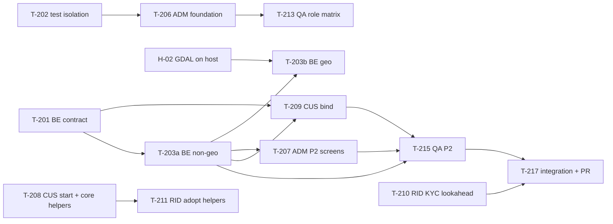

# Central Task Tracker

**Only the main session (Project Manager) edits this file.** Agents report in the [`development-phase.md`](development-phase.md) §9.3 format, and the PM updates the tracker after every report, so several agents never write one file at the same time.

**Statuses:**
- **Not Started**
- **In Progress**
- **Blocked**
- **In Review:** the PM is reviewing a module branch before merging it to `develop`.
- **Testing:** QA is verifying.
- **Completed:** only after QA has verified it. An agent's own report is never enough.

**Priority:** P0 critical path · P1 needed this phase · P2 nice to have.

**Owners:**
- `BE` = `django-backend-dev`
- `ADM` = `admin-panel-dev`
- `CUS` = `flutter-customer-dev`
- `RID` = `flutter-rider-dev`
- `QA` = `qa-engineer`
- `DEVOPS` = `devops-engineer`, `REVIEW` = `code-reviewer`, `CATALOG` = `catalog-data`, `DESIGN` = `ui-designer`
- `PM` = the main session
- `USER` = you or Jivo

Last updated: 2026-11-02 (Phase 2 kickoff).

## Phase 1: built, awaiting QA verification
| ID | Task | Owner | Pri | Deliverables | Acceptance criteria | Status |
|----|------|-------|-----|--------------|---------------------|--------|
| T-101 | P1 backend: OTP auth, JWT, `me`, devices, addresses, deletion, config 426/503, staff roles, lockout | BE | P0 | `apps/accounts`, `apps/cms`, `apps/notifications` | 318 tests green; QA verifies the API, security and DB | Testing: QA found 7 bugs (B-items below); P2 bugs block sign-off |
| T-102 | P1 `jivo_core` session layer | CUS | P0 | Session manager, refresh interceptor, app-control signals | 75 tests green; QA verifies | Testing |
| T-103 | P1 customer app: login, profile, addresses, delete account | CUS | P0 | `customer_app` P1 screens | 62 tests and the real-API itest green; QA functional check | Testing |
| T-104 | P1 rider app: login, routing by status | RID | P0 | `rider_app` P1 screens | 112 tests and the real-API itest green; QA functional check | Testing |

## Phase 2: Stores, catalog, inventory, home
| ID | Task | Owner | Pri | Depends on | Deliverables | Acceptance criteria | Status |
|----|------|-------|-----|-----------|--------------|---------------------|--------|
| T-201 | P2 API contract | BE | P0 | – | Serializers, routes and examples for serviceability, notify-me, home, categories, products, search, suggest, collections (`X-Store-Id`); `Address.is_serviceable`; schema re-exported | Schema validates with no warnings; examples for every error code; existing tests green | Testing (PM reviewed: 9 operations, 407 tests green; QA to verify in T-215) |
| T-202 | Test isolation env vars | BE | P0 | – | `POSTGRES_TEST_DB` (guarded) and `TEST_REDIS_DB` | The admin agent's tests run in parallel without collisions | Testing (guarded prefix; tested in `tests/test_wiring.py`) |
| T-203a | P2 internals, non-geo (R2a): catalog, inventory and services, non-geo stores, `StaffStoreAccess`, caching, seed | BE | P0 | T-201 | Models, migrations, services, catalog API, `seed_demo` (~20 products) | `08 §6` stock rules; query-count tests; coverage ≥ 80% (inventory ≥ 90%) | In Progress |
| T-203b | P2 geo (R2b): `DarkStore` location and MultiPolygon area, serviceability query, `Address` → PointField migration, `is_serviceable` | BE | P0 | T-203a, H-02 | GeoDjango engine switch, migrations, serviceability service | Serviceability p95 < 150 ms; backward-compatible address migration | In Progress (queued in the backend's current run, after R2a) |
| T-204 | ER diagram update | BE | P1 | – | `07 §1` mermaid with the P1 entities (`OTPRequest`, `AppConfig`, `AppVersionPolicy`) | Diagram matches the models | Not Started |
| T-205 | Address PATCH can clear the receiver name and phone | BE | P2 | – | Null or clear semantics in the contract | The CUS form can reset to "the user's own" | Not Started |
| T-206 | Admin architecture + `/ops/` foundation + P1 admin polish | ADM | P0 | T-202 (tests) | `docs/admin-panel-architecture.md`, `config/admin_ui.py`, `ops_console` app, components, real-data dashboard, role tests | 05 §3 matrix tests per role; no fake KPIs; vendored JS pinned | In Progress |
| T-207 | P2 admin screens: stores (map polygon), categories, products/variants/images, collections, banners, inventory, serviceability leads | ADM | P0 | T-203a (polygon widget: T-203b) | `admin.py` for the P2 apps, inventory adjustments through the service | Role matrix; stock changes only through the service; CSV import/export | Not Started |
| T-208 | Customer P2 start: tile and stepper, home/catalog/product/search/collection layouts, map picker, not-serviceable screen; promote rider helpers into `jivo_core` | CUS | P0 | – | Screens with fakes; `jivo_core` helpers | Widget tests; no client-side money; works without a Maps key | In Review (code review: Approve with fixes, 1 Major (fakes in every flavor) + 4 Minor sent back; 108 tests) |
| T-209 | Customer binds P2 to the real contract and API | CUS | P0 | T-201, T-203 | Generated types and real repositories | Real-API integration test: browse | In Progress (`jivo_api` regenerated with `CatalogApi` and `ServiceabilityApi`; the P2 API is live on 8001) |
| T-210 | Rider lookahead: registration, KYC (≤ 1 MB), bank details, status | RID | P1 | – | Screens and local models with fakes | Tests; masking; accepted at the P5 gate | Testing (201 tests green; merged to `develop` in `84bad46`; device test pending) |
| T-224 | Rider P3 lookahead: offers, task flow, pickup, OTP, COD, failed delivery (fakes) | RID | P1 | – | Screens and controller | 300 tests; code review fixes applied; accepted at the P5 gate | Testing (merged `7dbce4f`) |
| T-225 | Rider P4 lookahead: earnings, cash ledger, history, payouts, profile and documents; accept → deliver integration harness with GPX | RID | P2 | – | Screens with fakes, an integration test | Tests green; accepted at the P5 gate | In Progress |
| T-211 | Rider adopts the promoted `jivo_core` helpers | RID | P2 | T-208 merged | Imports switched | Tests green | Not Started |
| T-212 | QA run 1: verify P0/P1, create the QA docs and black-box suite | QA | P0 | – | `qa/` (10 docs, suite, bugs) | P1 readiness verdict with evidence | Completed (`94854f7`: 130 cases, 7 bugs, verdict **P1 Not ready**) |
| T-213 | QA: admin role-matrix tests | QA | P1 | T-206 | Test results | Every role tested | Not Started |
| T-214 | QA: device test of the P1 apps | QA | P1 | free emulator | Functional report | Cases executed | Not Started |
| T-215 | QA: verify P2 | QA | P0 | T-203, T-207, T-209 | P2 reports | P2 readiness verdict | Not Started |
| T-216 | Git transition: commit current runs onto `develop`, create per-agent worktrees and module branches | PM | P0 | each agent's current run | Commits, `.worktrees/<agent>` | Every agent's next run starts in its worktree | In Progress (rider `84bad46` and QA `94854f7` done; backend, admin and customer pending) |
| T-217 | P2 integration and PR `develop` → `main` | PM | P0 | all P2 tasks | Regenerated `jivo_api`, merges, PR | `integration-checklist.md` §E | Not Started |

### QA bugs (from QA run 1; owner BE; fix in the backend's next run after R2, then QA re-verifies)
| ID | Bug | Sev | Status |
|----|-----|-----|--------|
| BUG-0002 | Numeric validators (phone, OTP, PIN code) accept non-ASCII digits (security details in `qa/private/`) | P2 | Not Started |
| BUG-0003 | The refresh-token single-use rule is not enforced in all conditions (security details in `qa/private/`) | P2 | Not Started |
| BUG-0007 | Concurrent set-default calls can leave a user with no default address (the address is read before the lock) | P2 | Not Started |
| BUG-0001 | A request body over 2.5 MB returns 500 instead of a 4xx | P3 | Not Started |
| BUG-0004 | `addresses_list` returns 404 for an invalid page, which the contract doesn't document | P3 | Not Started |
| BUG-0005 | Production settings silently default to the console SMS backend, which would log OTPs | P3 | Not Started |
| BUG-0006 | Staff sessions last a fixed 12 h; 05 §5 needs 8 h, and 2 h idle for admin roles | P3 | Not Started |
| T-218 | DB connection reuse/pooling (`CONN_MAX_AGE` or a psycopg pool): new connections to the remote DB take about 99 ms, with occasional > 5 s timeouts returning 500s | P1 | Not Started |
| T-219 | Enforce the token `app` claim (a customer token currently works with `X-App-Name: rider`); retest in P5 | P2 | Not Started |

### Support agents (added 2026-11-02)
| ID | Task | Owner | Pri | Depends on | Deliverables | Acceptance criteria | Status |
|----|------|-------|-----|-----------|--------------|---------------------|--------|
| T-220 | Staging readiness without spending money: production image hardening, compose/IaC templates, deploy and rollback scripts, a backup/restore runbook, CI caching; recommend a least-privilege DB role | DEVOPS | P1 | – (actual hosting waits on D-05 and the user's approval) | `infra/` and runbooks in `docs/deployment.md` | Images build; scripts idempotent; no secrets | Not Started |
| T-221 | Review each module branch before merge (backend, admin and customer Phase 2; rider P3 lookahead) | REVIEW | P0 | each agent's run | Review verdict and findings | No Blockers before merge | In Progress (rider P3 reviewed: Approve with fixes; all 8 fixed; merged `7dbce4f`) |
| T-222 | Turn Jivo's real product data into import files (≈ 20 products for the P2 demo) | CATALOG | P1 | H-18 (product data from Jivo) | `data/catalog/`, report, image manifest | Validation passes; nothing raw committed | Blocked (no data yet) |
| T-223 | Design system and tokens from the brand kit; UX audit of the P1/P2 screens | DESIGN | P2 | H-19 (brand kit, D-06) for brand values; the audit can start now | `design/system`, `design/tokens`, `design/audits` | AA contrast documented; specs for every state | Not Started |

### Phase 2 dependency map

## Open API requests
These are tracked in [`api-requests.md`](api-requests.md): rider location requests #2–#5, targeted at the P5 contract.

## Waiting on you or Jivo
| ID | Item | Status | Needed by |
|----|------|--------|-----------|
| H-01 | Install PostGIS on the DB server | Completed 2026-11-02 (3.4.2, enabled, verified) | P2 |
| H-02 | Install GDAL/GEOS on the dev machine | Completed 2026-11-02 (GDAL 3.12.2, GEOS 3.14.1; verified with Django) | T-203b |
| H-03 | Make the GitHub repo private | Not Started (recommended) | now |
| H-04 | Maps provider and config (D-03) | Completed for Android: switched to Mappls; config stored outside the repo (DL-29) | P2 map |
| H-15 | Register `in.jivo.quick.dev`, `in.jivo.quick.staging` and `in.jivo.quick` with signing SHA-1 `76:E3:69:C1:88:DB:10:1F:AA:5C:88:FC:3B:10:FD:01:D8:FE:0A:1A` (the debug key; the release key comes later) in the Mappls console | Not Started | P2 map |
| H-16 | Mappls iOS config (`.i.olf`/`.i.conf`) and a Mappls web/REST key for the admin and ops maps | Not Started | iOS build / P5 rider map |
| H-17 | Rider KYC policy answers (D-14): the 18+ rule; whether an e-bike counts as motorised; full or masked Aadhaar; selfie camera-only; bank details required before review; account-number length; replacing documents in review | Not Started | P5 |
| H-05 | Real config values: support phone and email, policy URLs, store URLs, terms version | Not Started | staging |
| H-06 | SMS provider and DLT (D-02) | Not Started | staging/P8 |
| H-07 | OTP per-IP limits (currently 30/60 per hour) | Not Started | staging |
| H-08 | Rider: "Allow all the time"; whether full-screen alerts are mandatory; ringing in DND | Not Started | P5 |
| H-09 | Consent at login: text or checkbox | Not Started | staging |
| H-10 | MinIO image (`pgsty/minio`) approval | Not Started | P2 images |
| H-11 | Formal gate for P0/P1 (staging, demo, sign-off) | Not Started | P2 gate |
| H-12 | Git branch strategy | Completed: module branches + `develop` (DL-24) | – |
| H-13 | Confirm the PM defaults marked ⚠ in [`decision-log.md`](decision-log.md) | Not Started | anytime |
| H-14 | Rotate the DB server SSH password (it was shared in chat) and prefer SSH keys | Not Started | soon |
| H-18 | Real product data from Jivo (D-21): product list, variants, MRP/price, GST/HSN, FSSAI and label info, photos. Put it in `data/incoming/` (gitignored). | Not Started | P2 demo |
| H-19 | Brand kit from Jivo marketing (D-06): logo, colours, fonts. Put it in `design/incoming/` (gitignored). | Not Started | P2 brand UI |
| H-20 | Jivo/PM: the failed-delivery rule: minimum call attempts (2 assumed) and whether the 10-minute wait starts at arrival or at the first call. Also approve adding UNASSIGNED → CANCELLED to the `08 §3` task diagram (missing today). | Not Started | P5 |
| H-21 | Confirm that Google ML Kit's licence terms (used by the rider QR scanner) are acceptable for distribution | Not Started | P5 |
